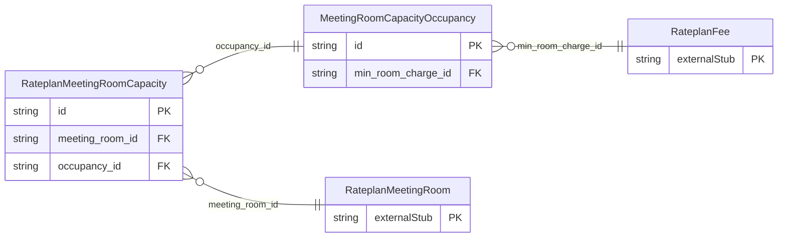

<!-- Code generated by protoc-gen-store. DO NOT EDIT. -->

# `ota/opentravel/hotel/revenue/rate_plan/v1/types/meeting_room_capacity/` — Prisma schema

Generated from Protobuf by protoc-gen-store. Source of truth is the `.proto` files — regenerate rather than editing.

| Models | Enums |
| ---: | ---: |
| 2 | 0 |

## Entity relationships

Schema file: [`meeting_room_capacity.postgres.prisma`](./meeting_room_capacity.postgres.prisma)

### `RateplanMeetingRoomCapacity` → `meeting_room_capacities`

The MeetingRoomCapacity object that defines the largest room seating capacity for a meeting room at the hotel facility.

| Column | Type | Null |
| --- | --- | --- |
| `id` | `CHAR(26)` | not null |
| `meeting_room_format_code` | `RateplanMeetingRoomFormatCode` | nullable |
| `meeting_room_id` | `VARCHAR(255)` | not null |
| `occupancy_id` | `CHAR(26)` | nullable |

### `MeetingRoomCapacityOccupancy` → `meeting_room_capacity_occupancies`

The Occupancy details of a meeting room.

| Column | Type | Null |
| --- | --- | --- |
| `id` | `CHAR(26)` | not null |
| `min_occupancy` | `INTEGER` | nullable |
| `max_occupancy` | `INTEGER` | nullable |
| `standard_occupancy` | `INTEGER` | nullable |
| `min_room_charge_id` | `CHAR(26)` | nullable |
