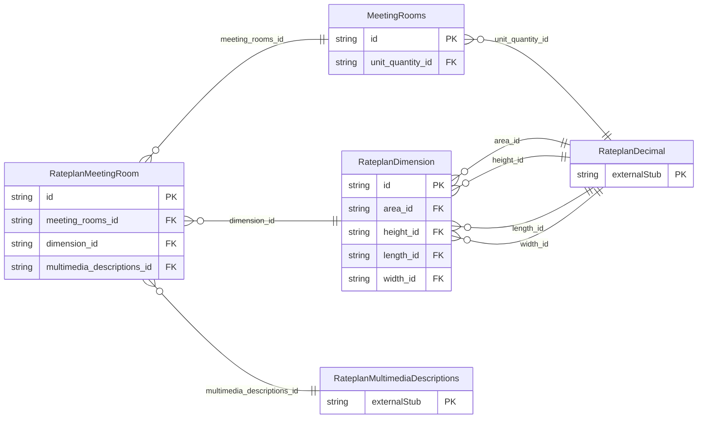

<!-- Code generated by protoc-gen-store. DO NOT EDIT. -->

# `ota/opentravel/hotel/revenue/rate_plan/v1/types/meeting_rooms/` — Prisma schema

Generated from Protobuf by protoc-gen-store. Source of truth is the `.proto` files — regenerate rather than editing.

| Models | Enums |
| ---: | ---: |
| 3 | 0 |

## Entity relationships

Schema file: [`meeting_rooms.postgres.prisma`](./meeting_rooms.postgres.prisma)

### `MeetingRooms` → `meeting_rooms`

A collection of MeetingRoom objects that provide the codes and description of the meeting rooms in the hotel.

| Column | Type | Null |
| --- | --- | --- |
| `id` | `CHAR(26)` | not null |
| `meeting_room_count` | `INTEGER` | nullable |
| `smallest_room_space` | `INTEGER` | nullable |
| `largest_room_space` | `INTEGER` | nullable |
| `unit` | `VARCHAR(255)` | nullable |
| `unit_code` | `RateplanUnitOfMeasureCode` | nullable |
| `total_room_space` | `INTEGER` | nullable |
| `largest_seating_capacity` | `INTEGER` | nullable |
| `second_largest_seating_capacity` | `INTEGER` | nullable |
| `smallest_seating_capacity` | `INTEGER` | nullable |
| `total_room_seating_capacity` | `INTEGER` | nullable |
| `largest_room_height` | `INTEGER` | nullable |
| `total_exhibit_space` | `INTEGER` | nullable |
| `unit_quantity_id` | `CHAR(26)` | nullable |

### `RateplanMeetingRoom` → `meeting_room`

Dedicated or non-dedicated space or area in which to hold a meeting.

| Column | Type | Null |
| --- | --- | --- |
| `irregular` | `BOOLEAN` | nullable |
| `property_system_display_name` | `VARCHAR(255)` | nullable |
| `room_display_name` | `VARCHAR(255)` | nullable |
| `sort` | `INTEGER` | nullable |
| `meeting_room_capacity` | `INTEGER` | nullable |
| `id` | `VARCHAR(255)` | not null |
| `access` | `VARCHAR(255)` | nullable |
| `meeting_room_type_code` | `RateplanMeetingRoomFormatCode` | nullable |
| `meeting_room_level` | `VARCHAR(255)` | nullable |
| `dedicated_indicator` | `BOOLEAN` | nullable |
| `featured` | `BOOLEAN` | nullable |
| `meeting_rooms_id` | `CHAR(26)` | not null |
| `dimension_id` | `CHAR(26)` | nullable |
| `multimedia_descriptions_id` | `CHAR(26)` | nullable |

### `RateplanDimension` → `dimensions`

Dimensions of the meeting room.

| Column | Type | Null |
| --- | --- | --- |
| `id` | `CHAR(26)` | not null |
| `units` | `VARCHAR(255)` | nullable |
| `unit_code` | `RateplanUnitOfMeasureCode` | nullable |
| `area_id` | `CHAR(26)` | nullable |
| `height_id` | `CHAR(26)` | nullable |
| `length_id` | `CHAR(26)` | nullable |
| `width_id` | `CHAR(26)` | nullable |
