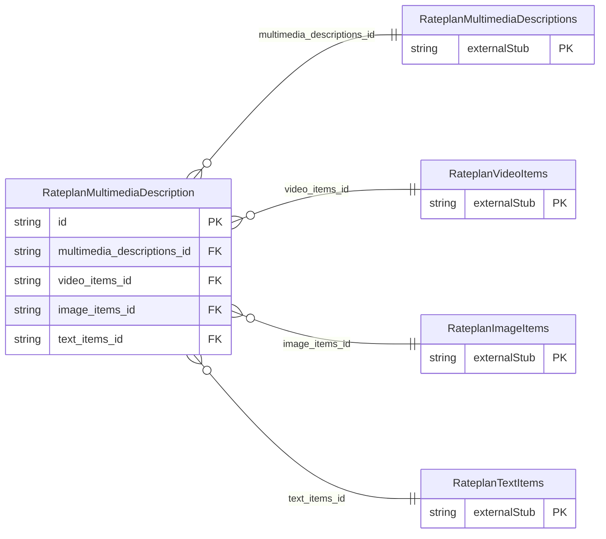

<!-- Code generated by protoc-gen-store. DO NOT EDIT. -->

# `ota/opentravel/hotel/revenue/rate_plan/v1/types/multimedia_description/` — Prisma schema

Generated from Protobuf by protoc-gen-store. Source of truth is the `.proto` files — regenerate rather than editing.

| Models | Enums |
| ---: | ---: |
| 1 | 1 |

## Entity relationships

Schema file: [`multimedia_description.postgres.prisma`](./multimedia_description.postgres.prisma)

### `RateplanMultimediaDescription` → `multimedia_description`

Describes multimedia item(s).

| Column | Type | Null |
| --- | --- | --- |
| `info_code` | `RateplanInfoType` | nullable |
| `additional_detail_code` | `RateplanAdditionalDetailType` | nullable |
| `id` | `VARCHAR(255)` | not null |
| `last_update_time` | `TIMESTAMPTZ` | nullable |
| `version` | `VARCHAR(255)` | nullable |
| `video_items_or_image_items_or_text_items_case` | `RateplanMultimediaDescriptionVideoItemsOrImageItemsOrTextItemsCase` | nullable |
| `multimedia_descriptions_id` | `CHAR(26)` | not null |
| `video_items_id` | `CHAR(26)` | nullable |
| `image_items_id` | `CHAR(26)` | nullable |
| `text_items_id` | `CHAR(26)` | nullable |

### Enums

- `RateplanMultimediaDescriptionVideoItemsOrImageItemsOrTextItemsCase`: VIDEO_ITEMS, IMAGE_ITEMS, TEXT_ITEMS
