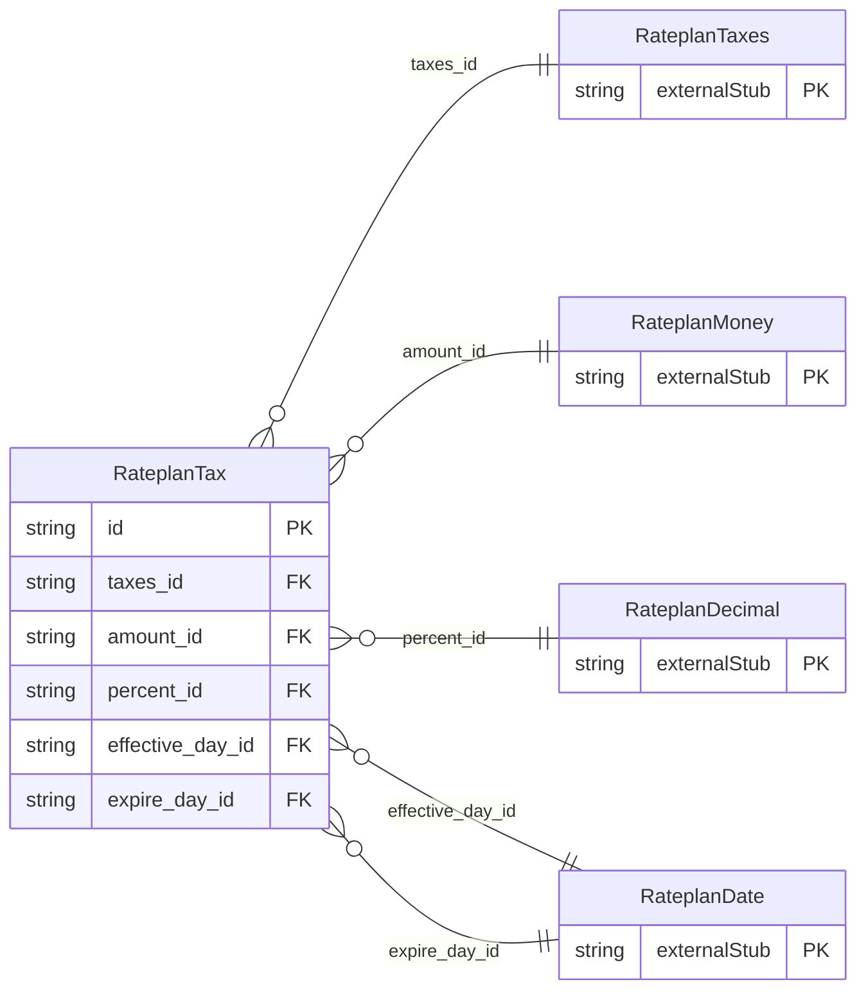

<!-- Code generated by protoc-gen-store. DO NOT EDIT. -->

# `ota/opentravel/hotel/revenue/rate_plan/v1/types/tax/` — Prisma schema

Generated from Protobuf by protoc-gen-store. Source of truth is the `.proto` files — regenerate rather than editing.

| Models | Enums |
| ---: | ---: |
| 1 | 0 |

## Entity relationships

Schema file: [`tax.postgres.prisma`](./tax.postgres.prisma)

### `RateplanTax` → `tax`

Applicable tax element. This element allows for both percentages and flat amounts. If one field is used, the other should be zero since logically, taxes should be calculated in only one of the two ways.

| Column | Type | Null |
| --- | --- | --- |
| `id` | `CHAR(26)` | not null |
| `type` | `RateplanAmountDetermination` | nullable |
| `code` | `RateplanFeeTaxType` | nullable |
| `expire_date_exclusive` | `BOOLEAN` | nullable |
| `charge_unit` | `RateplanChargeType` | nullable |
| `charge_frequency` | `RateplanChargeType` | nullable |
| `charge_unit_exempt` | `INTEGER` | nullable |
| `charge_frequency_exempt` | `INTEGER` | nullable |
| `max_charge_unit_applies` | `INTEGER` | nullable |
| `max_charge_frequency_applies` | `INTEGER` | nullable |
| `sequence_nbr` | `INTEGER` | nullable |
| `duration` | `VARCHAR(255)` | nullable |
| `taxes_id` | `CHAR(26)` | not null |
| `amount_id` | `CHAR(26)` | nullable |
| `percent_id` | `CHAR(26)` | nullable |
| `effective_day_id` | `CHAR(26)` | nullable |
| `expire_day_id` | `CHAR(26)` | nullable |
