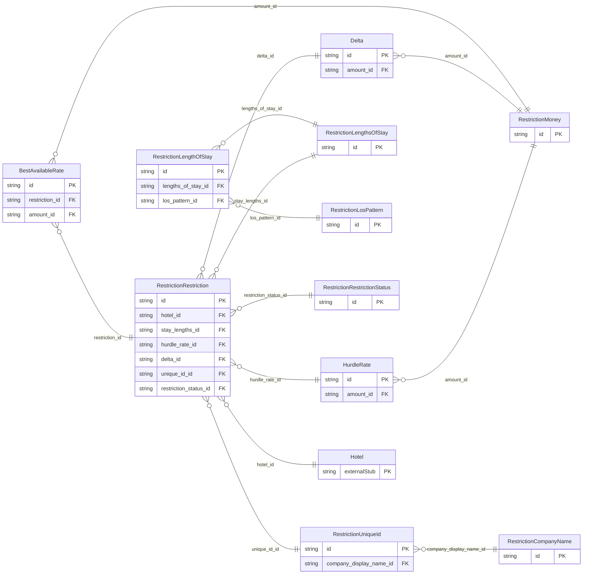

<!-- Code generated by protoc-gen-store. DO NOT EDIT. -->

# `ota/opentravel/hotel/revenue/restriction/` — Prisma schema

Generated from Protobuf by protoc-gen-store. Source of truth is the `.proto` files — regenerate rather than editing.

| Models | Enums |
| ---: | ---: |
| 11 | 8 |

## Entity relationships

## Subfolders

- [`restriction/`](./restriction/README.md)
- [`v1/`](./v1/README.md)
