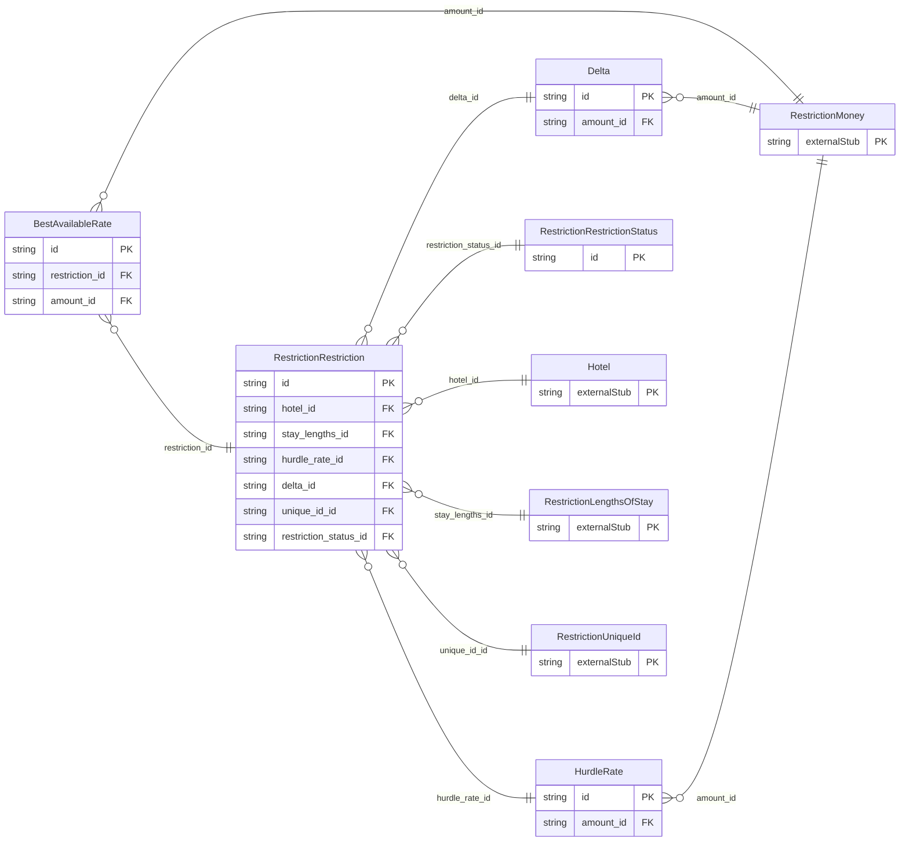

<!-- Code generated by protoc-gen-store. DO NOT EDIT. -->

# `ota/opentravel/hotel/revenue/restriction/restriction/` — Prisma schema

Generated from Protobuf by protoc-gen-store. Source of truth is the `.proto` files — regenerate rather than editing.

| Models | Enums |
| ---: | ---: |
| 5 | 3 |

## Entity relationships

Schema file: [`restriction.postgres.prisma`](./restriction.postgres.prisma)

### `RestrictionRestriction` → `resource`

The AvailStatusMessage. It is here that one indicates whether the inventory is opened, closed, closed on request, etc. The MinMaxLOSStatusMessage class communicates the set of minimum and maximum length-of-stay availability status changes to be synchronized with another system. The RateHurdleStatusMessage class defines the setting for rate hurdle controls to be synchronized with the central reservation system. A collection resource, named "hotels/{hotel}/ratePlans/{rate_plan}/restrictions/{restriction}". OTA: OTA_HotelAvailNotifRQ/AvailStatusMessages/AvailStatusMessage.

| Column | Type | Null |
| --- | --- | --- |
| `id` | `CHAR(26)` | not null |
| `name` | `VARCHAR(255)` | not null |
| `uid` | `VARCHAR(255)` | nullable |
| `etag` | `VARCHAR(255)` | nullable |
| `delete_time` | `TIMESTAMPTZ` | nullable |
| `expire_time` | `TIMESTAMPTZ` | nullable |
| `create_time` | `TIMESTAMPTZ` | not null |
| `update_time` | `TIMESTAMPTZ` | not null |
| `override` | `BOOLEAN` | nullable |
| `booking_limit_message_type` | `BookingLimitMessageType` | nullable |
| `booking_limit` | `INTEGER` | nullable |
| `locator_id` | `INTEGER` | nullable |
| `booking_threshold` | `INTEGER` | nullable |
| `room_gender` | `RestrictionRoomGender` | nullable |
| `shared_room` | `BOOLEAN` | nullable |
| `hotel_id` | `CHAR(26)` | not null |
| `rate_plan_id` | `CHAR(26)` | not null |
| `stay_lengths_id` | `CHAR(26)` | nullable |
| `hurdle_rate_id` | `CHAR(26)` | nullable |
| `delta_id` | `CHAR(26)` | nullable |
| `unique_id_id` | `VARCHAR(255)` | nullable |
| `restriction_status_id` | `CHAR(26)` | nullable |

### `BestAvailableRate` → `best_available_rates`

The details of a best available rate.

| Column | Type | Null |
| --- | --- | --- |
| `id` | `CHAR(26)` | not null |
| `stay_length` | `INTEGER` | nullable |
| `stay_lengths_time_unit` | `RestrictionTimeUnit` | nullable |
| `rate_plan_code` | `VARCHAR(255)` | nullable |
| `tax_inclusive` | `BOOLEAN` | nullable |
| `restriction_id` | `CHAR(26)` | not null |
| `amount_id` | `CHAR(26)` | nullable |

### `HurdleRate` → `hurdle_rates`

Restriction based on the minimum rate to be considered for availability, ex. can sell weekend rate only if charging the hurdle rate or more.

| Column | Type | Null |
| --- | --- | --- |
| `id` | `CHAR(26)` | not null |
| `amount_id` | `CHAR(26)` | nullable |

### `Delta` → `deltas`

Incremental amount added to the hurdle rate (e.g. Amount= 20 USD and Ceiling=5, the maximum Delta would be 100 USD).

| Column | Type | Null |
| --- | --- | --- |
| `id` | `CHAR(26)` | not null |
| `ceiling` | `INTEGER` | nullable |
| `max_sold` | `INTEGER` | nullable |
| `amount_id` | `CHAR(26)` | nullable |

### `RestrictionRestrictionStatus` → `status`

Availability status assigned to the room rate combination.

| Column | Type | Null |
| --- | --- | --- |
| `id` | `CHAR(26)` | not null |
| `restriction` | `RestrictionRestrictionStatusRestriction` | nullable |
| `status` | `RestrictionAvailability` | nullable |
| `sell_through_open_indicator` | `BOOLEAN` | nullable |
| `max_advanced_booking_offset` | `VARCHAR(255)` | nullable |
| `min_advanced_booking_offset` | `VARCHAR(255)` | nullable |

### Enums

- `BookingLimitMessageType`: REMOVE_LIMIT, SET_LIMIT, ADJUST_LIMIT
- `RestrictionRoomGender`: MALE, FEMALE, MALE_AND_FEMALE, UNKNOWN
- `RestrictionRestrictionStatusRestriction`: MASTER, ARRIVAL, DEPARTURE, NON_GUARANTEE, TRAVEL_AGENT
