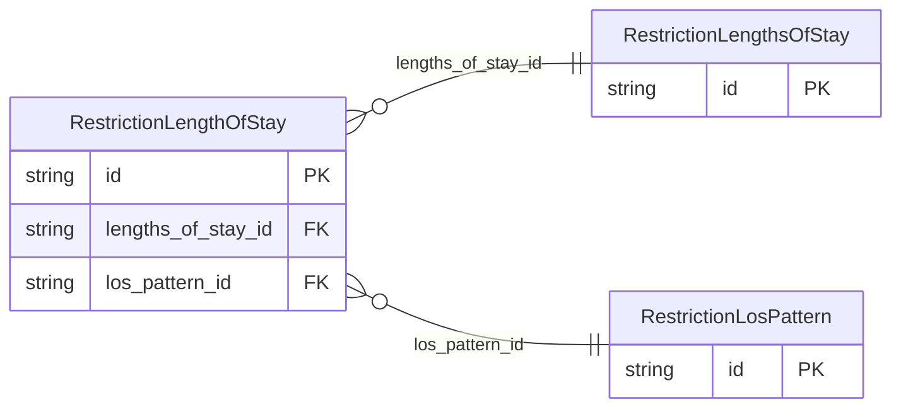

<!-- Code generated by protoc-gen-store. DO NOT EDIT. -->

# `ota/opentravel/hotel/revenue/restriction/v1/types/lengths_of_stay/` — Prisma schema

Generated from Protobuf by protoc-gen-store. Source of truth is the `.proto` files — regenerate rather than editing.

| Models | Enums |
| ---: | ---: |
| 3 | 1 |

## Entity relationships

Schema file: [`lengths_of_stay.postgres.prisma`](./lengths_of_stay.postgres.prisma)

### `RestrictionLengthsOfStay` → `lengths_of_stays`

A collection of LengthOfStay.

| Column | Type | Null |
| --- | --- | --- |
| `id` | `CHAR(26)` | not null |
| `arrival_date_based` | `BOOLEAN` | nullable |
| `fixed_pattern_length` | `INTEGER` | nullable |

### `RestrictionLengthOfStay` → `length_of_stays`

A collection of patterns defining allowable lengths of stay (LOS).

| Column | Type | Null |
| --- | --- | --- |
| `id` | `CHAR(26)` | not null |
| `length` | `INTEGER` | nullable |
| `time_unit` | `RestrictionTimeUnit` | nullable |
| `open_status_indicator` | `BOOLEAN` | nullable |
| `min_max_message_type` | `RestrictionMinMaxMessageType` | nullable |
| `lengths_of_stay_id` | `CHAR(26)` | not null |
| `los_pattern_id` | `CHAR(26)` | nullable |

### `RestrictionLosPattern` → `los_patterns`

Used to define the LOS Pattern.

| Column | Type | Null |
| --- | --- | --- |
| `id` | `CHAR(26)` | not null |
| `full_pattern_los` | `VARCHAR(255)` | nullable |

### Enums

- `RestrictionMinMaxMessageType`: SET_MIN_LOS, REMOVE_MIN_LOS, SET_MAX_LOS, REMOVE_MAX_LOS, SET_FORWARD_MIN_STAY, REMOVE_FORWARD_MIN_STAY, SET_FORWARD_MAX_STAY, REMOVE_FORWARD_MAX_STAY, FIXED_LOS, FULL_PATTERN_LOS, MIN_LOS, MAX_LOS
