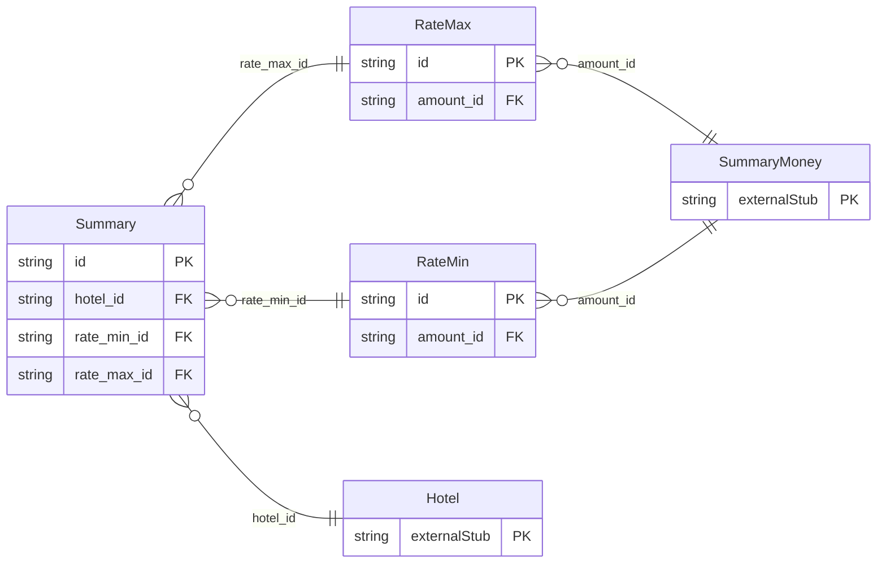

<!-- Code generated by protoc-gen-store. DO NOT EDIT. -->

# `ota/opentravel/hotel/revenue/summary/summary/` — Prisma schema

Generated from Protobuf by protoc-gen-store. Source of truth is the `.proto` files — regenerate rather than editing.

| Models | Enums |
| ---: | ---: |
| 3 | 1 |

## Entity relationships

Schema file: [`summary.postgres.prisma`](./summary.postgres.prisma)

### `Summary` → `summaries`

The HotelSummaryMessage is the message that is used to provide a notification of the general status of availability of the hotel, and its minimum and maximum rates. A collection resource, named "hotels/{hotel}/summaries/{summary}". OTA: OTA_HotelSummaryNotifRQ/HotelSummaryMessages/HotelSummaryMessage.

| Column | Type | Null |
| --- | --- | --- |
| `id` | `CHAR(26)` | not null |
| `name` | `VARCHAR(255)` | not null |
| `uid` | `VARCHAR(255)` | nullable |
| `etag` | `VARCHAR(255)` | nullable |
| `delete_time` | `TIMESTAMPTZ` | nullable |
| `expire_time` | `TIMESTAMPTZ` | nullable |
| `create_time` | `TIMESTAMPTZ` | not null |
| `update_time` | `TIMESTAMPTZ` | not null |
| `status_type` | `SummaryStatusType` | nullable |
| `arrivals_only_flag` | `BOOLEAN` | nullable |
| `hotel_id` | `CHAR(26)` | not null |
| `rate_min_id` | `CHAR(26)` | nullable |
| `rate_max_id` | `CHAR(26)` | nullable |

### `RateMin` → `rate_mins`

The minimum rate that may be available at the hotel.

| Column | Type | Null |
| --- | --- | --- |
| `id` | `CHAR(26)` | not null |
| `amount_id` | `CHAR(26)` | nullable |

### `RateMax` → `rate_maxes`

The maximum rate that may be available at the hotel.

| Column | Type | Null |
| --- | --- | --- |
| `id` | `CHAR(26)` | not null |
| `amount_id` | `CHAR(26)` | nullable |

### Enums

- `SummaryStatusType`: CLOSED, OPEN, ON_REQUEST
