<!-- Code generated by protoc-gen-store. DO NOT EDIT. -->

# `ota/opentravel/hotel/sales/event/event/` — Prisma schema

Generated from Protobuf by protoc-gen-store. Source of truth is the `.proto` files — regenerate rather than editing.

| Models | Enums |
| ---: | ---: |
| 44 | 11 |

## Entity relationships

```mermaid
erDiagram
    direction LR
    AttendeeInfo {
        string id PK
    }
    Event {
        string id PK
        string attendee_info_id FK
    }
    EventAddressInfo {
        string id PK
        string contact_id FK
        string street_nmbr_id FK
        string state_prov_id FK
        string country_display_name_id FK
        string contact_person_id FK
    }
    EventAudioVisual {
        string id PK
        string audio_visuals_id FK
        string amount_id FK
    }
    EventAudioVisuals {
        string id PK
    }
    EventBldgRoom {
        string id PK
        string address_info_id FK
    }
    EventContactPerson {
        string id PK
        string site_id FK
        string birth_day_id FK
        string person_display_name_id FK
        string exhibit_detail_id FK
        string shipping_receiving_detail_id FK
    }
    EventDocument {
        string id PK
    }
    EventEmail {
        string id PK
        string contact_id FK
        string contact_person_id FK
    }
    EventEventContact {
        string id PK
        string event_id FK
        string birth_day_id FK
        string person_display_name_id FK
    }
    EventEventDay {
        string id PK
        string event_days_id FK
    }
    EventEventDayFunction {
        string id PK
        string event_day_id FK
        string start_clock_id FK
        string end_clock_id FK
        string audio_visuals_id FK
        string room_setup_id FK
        string food_and_beverages_id FK
    }
    EventEventDays {
        string id PK
    }
    EventEventInfoAdditionalDate {
        string id PK
        string event_info_id FK
        string start_id FK
        string end_id FK
    }
    EventEventInfoContact {
        string id PK
        string event_info_id FK
        string birth_day_id FK
        string arrival_id FK
        string departure_id FK
        string person_display_name_id FK
    }
    EventEventInfoExhibitionAdditionalDate {
        string id PK
        string exhibition_id FK
        string start_id FK
        string end_id FK
    }
    EventEventInfoExhibitionExhibitDetailTaxExemptInfo {
        string id PK
        string exhibit_detail_id FK
    }
    EventEventInfoTaxExemptInfo {
        string id PK
        string event_info_id FK
    }
    EventExhibitDetail {
        string id PK
        string exhibition_id FK
        string area_id FK
        string height_id FK
        string length_id FK
        string width_id FK
    }
    EventExhibition {
        string id PK
        string event_info_id FK
        string exhibitor_info_id FK
    }
    EventExhibitorInfo {
        string id PK
    }
    EventFoodAndBeverage {
        string id PK
        string food_and_beverages_id FK
        string service_id FK
    }
    EventFoodAndBeverages {
        string id PK
    }
    EventInfo {
        string id PK
        string event_id FK
        string start_id FK
        string end_id FK
    }
    EventLocation {
        string id PK
        string off_site_transportation_id FK
        string clock_id FK
    }
    EventMenu {
        string id PK
        string food_and_beverage_id FK
        string amount_id FK
        string quantity_id FK
    }
    EventPersonName {
        string id PK
        string document_id FK
    }
    EventReservationMethod {
        string id PK
        string room_block_id FK
    }
    EventRoomBlock {
        string id PK
        string site_id FK
        string stay_days_id FK
    }
    EventRoomSetup {
        string id PK
        string setup_deadline_id FK
        string dismantle_deadline_id FK
        string diagram_id FK
    }
    EventSessionTimes {
        string id PK
        string event_day_function_id FK
        string start_clock_id FK
        string end_clock_id FK
    }
    EventSite {
        string id PK
        string event_id FK
        string event_days_id FK
        string shipping_receiving_details_id FK
    }
    EventSiteEventDaysEventDayEventDayFunctionContact {
        string id PK
        string event_day_function_id FK
        string birth_day_id FK
        string person_display_name_id FK
    }
    EventSiteEventDaysEventDayEventDayFunctionService {
        string id PK
        string event_day_function_id FK
        string start_clock_id FK
        string end_clock_id FK
    }
    EventSiteEventDaysEventDayService {
        string id PK
        string event_day_id FK
        string start_clock_id FK
        string end_clock_id FK
    }
    EventStayDay {
        string id PK
        string stay_days_id FK
    }
    EventStayDays {
        string id PK
    }
    EventStreetNmbr {
        string id PK
    }
    EventTelephone {
        string id PK
        string contact_id FK
        string contact_person_id FK
    }
    EventUtility {
        string id PK
        string service_id FK
        string amount_id FK
    }
    OffSiteTransportation {
        string id PK
        string event_day_id FK
    }
    SetupDetail {
        string id PK
        string room_setup_id FK
        string area_id FK
        string height_id FK
        string length_id FK
        string width_id FK
    }
    ShippingReceivingDetail {
        string id PK
        string shipping_receiving_details_id FK
        string expected_delivery_id FK
    }
    ShippingReceivingDetails {
        string id PK
    }
    EventCountryName {
        string externalStub PK
    }
    EventDate {
        string externalStub PK
    }
    EventDateOrDateTime {
        string externalStub PK
    }
    EventDateOrTimeOrDateTime {
        string externalStub PK
    }
    EventDecimal {
        string externalStub PK
    }
    EventMoney {
        string externalStub PK
    }
    EventParagraph {
        string externalStub PK
    }
    EventStateProv {
        string externalStub PK
    }
    EventTimeOfDay {
        string externalStub PK
    }
    Event }o--|| AttendeeInfo : "attendee_info_id"
    EventAddressInfo }o--|| EventEventContact : "contact_id"
    EventAddressInfo }o--|| EventStreetNmbr : "street_nmbr_id"
    EventAddressInfo }o--|| EventStateProv : "state_prov_id"
    EventAddressInfo }o--|| EventCountryName : "country_display_name_id"
    EventAddressInfo }o--|| EventContactPerson : "contact_person_id"
    EventAudioVisual }o--|| EventAudioVisuals : "audio_visuals_id"
    EventAudioVisual }o--|| EventMoney : "amount_id"
    EventBldgRoom }o--|| EventAddressInfo : "address_info_id"
    EventContactPerson }o--|| EventSite : "site_id"
    EventContactPerson }o--|| EventDate : "birth_day_id"
    EventContactPerson }o--|| EventPersonName : "person_display_name_id"
    EventContactPerson }o--|| EventExhibitDetail : "exhibit_detail_id"
    EventContactPerson }o--|| ShippingReceivingDetail : "shipping_receiving_detail_id"
    EventEmail }o--|| EventEventContact : "contact_id"
    EventEmail }o--|| EventContactPerson : "contact_person_id"
    EventEventContact }o--|| Event : "event_id"
    EventEventContact }o--|| EventDate : "birth_day_id"
    EventEventContact }o--|| EventPersonName : "person_display_name_id"
    EventEventDay }o--|| EventEventDays : "event_days_id"
    EventEventDayFunction }o--|| EventEventDay : "event_day_id"
    EventEventDayFunction }o--|| EventTimeOfDay : "start_clock_id"
    EventEventDayFunction }o--|| EventTimeOfDay : "end_clock_id"
    EventEventDayFunction }o--|| EventAudioVisuals : "audio_visuals_id"
    EventEventDayFunction }o--|| EventRoomSetup : "room_setup_id"
    EventEventDayFunction }o--|| EventFoodAndBeverages : "food_and_beverages_id"
    EventEventInfoAdditionalDate }o--|| EventInfo : "event_info_id"
    EventEventInfoAdditionalDate }o--|| EventDateOrTimeOrDateTime : "start_id"
    EventEventInfoAdditionalDate }o--|| EventDateOrTimeOrDateTime : "end_id"
    EventEventInfoContact }o--|| EventInfo : "event_info_id"
    EventEventInfoContact }o--|| EventDate : "birth_day_id"
    EventEventInfoContact }o--|| EventDateOrTimeOrDateTime : "arrival_id"
    EventEventInfoContact }o--|| EventDateOrTimeOrDateTime : "departure_id"
    EventEventInfoContact }o--|| EventPersonName : "person_display_name_id"
    EventEventInfoExhibitionAdditionalDate }o--|| EventExhibition : "exhibition_id"
    EventEventInfoExhibitionAdditionalDate }o--|| EventDateOrTimeOrDateTime : "start_id"
    EventEventInfoExhibitionAdditionalDate }o--|| EventDateOrTimeOrDateTime : "end_id"
    EventEventInfoExhibitionExhibitDetailTaxExemptInfo }o--|| EventExhibitDetail : "exhibit_detail_id"
    EventEventInfoTaxExemptInfo }o--|| EventInfo : "event_info_id"
    EventExhibitDetail }o--|| EventExhibition : "exhibition_id"
    EventExhibitDetail }o--|| EventDecimal : "area_id"
    EventExhibitDetail }o--|| EventDecimal : "height_id"
    EventExhibitDetail }o--|| EventDecimal : "length_id"
    EventExhibitDetail }o--|| EventDecimal : "width_id"
    EventExhibition }o--|| EventInfo : "event_info_id"
    EventExhibition }o--|| EventExhibitorInfo : "exhibitor_info_id"
    EventFoodAndBeverage }o--|| EventFoodAndBeverages : "food_and_beverages_id"
    EventFoodAndBeverage }o--|| EventDateOrTimeOrDateTime : "service_id"
    EventInfo }o--|| Event : "event_id"
    EventInfo }o--|| EventDateOrTimeOrDateTime : "start_id"
    EventInfo }o--|| EventDateOrTimeOrDateTime : "end_id"
    EventLocation }o--|| OffSiteTransportation : "off_site_transportation_id"
    EventLocation }o--|| EventTimeOfDay : "clock_id"
    EventMenu }o--|| EventFoodAndBeverage : "food_and_beverage_id"
    EventMenu }o--|| EventMoney : "amount_id"
    EventMenu }o--|| EventDecimal : "quantity_id"
    EventPersonName }o--|| EventDocument : "document_id"
    EventReservationMethod }o--|| EventRoomBlock : "room_block_id"
    EventRoomBlock }o--|| EventSite : "site_id"
    EventRoomBlock }o--|| EventStayDays : "stay_days_id"
    EventRoomSetup }o--|| EventDateOrTimeOrDateTime : "setup_deadline_id"
    EventRoomSetup }o--|| EventDateOrTimeOrDateTime : "dismantle_deadline_id"
    EventRoomSetup }o--|| EventParagraph : "diagram_id"
    EventSessionTimes }o--|| EventEventDayFunction : "event_day_function_id"
    EventSessionTimes }o--|| EventTimeOfDay : "start_clock_id"
    EventSessionTimes }o--|| EventTimeOfDay : "end_clock_id"
    EventSite }o--|| Event : "event_id"
    EventSite }o--|| EventEventDays : "event_days_id"
    EventSite }o--|| ShippingReceivingDetails : "shipping_receiving_details_id"
    EventSiteEventDaysEventDayEventDayFunctionContact }o--|| EventEventDayFunction : "event_day_function_id"
    EventSiteEventDaysEventDayEventDayFunctionContact }o--|| EventDate : "birth_day_id"
    EventSiteEventDaysEventDayEventDayFunctionContact }o--|| EventPersonName : "person_display_name_id"
    EventSiteEventDaysEventDayEventDayFunctionService }o--|| EventEventDayFunction : "event_day_function_id"
    EventSiteEventDaysEventDayEventDayFunctionService }o--|| EventTimeOfDay : "start_clock_id"
    EventSiteEventDaysEventDayEventDayFunctionService }o--|| EventTimeOfDay : "end_clock_id"
    EventSiteEventDaysEventDayService }o--|| EventEventDay : "event_day_id"
    EventSiteEventDaysEventDayService }o--|| EventTimeOfDay : "start_clock_id"
    EventSiteEventDaysEventDayService }o--|| EventTimeOfDay : "end_clock_id"
    EventStayDay }o--|| EventStayDays : "stay_days_id"
    EventTelephone }o--|| EventEventContact : "contact_id"
    EventTelephone }o--|| EventContactPerson : "contact_person_id"
    EventUtility }o--|| EventSiteEventDaysEventDayEventDayFunctionService : "service_id"
    EventUtility }o--|| EventMoney : "amount_id"
    OffSiteTransportation }o--|| EventEventDay : "event_day_id"
    SetupDetail }o--|| EventRoomSetup : "room_setup_id"
    SetupDetail }o--|| EventDecimal : "area_id"
    SetupDetail }o--|| EventDecimal : "height_id"
    SetupDetail }o--|| EventDecimal : "length_id"
    SetupDetail }o--|| EventDecimal : "width_id"
    ShippingReceivingDetail }o--|| ShippingReceivingDetails : "shipping_receiving_details_id"
    ShippingReceivingDetail }o--|| EventDateOrDateTime : "expected_delivery_id"
```

Schema file: [`event.postgres.prisma`](./event.postgres.prisma)

### `Event` → `resource`

Information for an event. Typically, this would be used to send information regarding related events (e.g., the same training class being taken by different organizations). A collection resource, named "events/{event}". OTA: OTA_HotelEventRQ/Events/Event.

| Column | Type | Null |
| --- | --- | --- |
| `id` | `CHAR(26)` | not null |
| `name` | `VARCHAR(255)` | not null |
| `uid` | `VARCHAR(255)` | nullable |
| `etag` | `VARCHAR(255)` | nullable |
| `delete_time` | `TIMESTAMPTZ` | nullable |
| `expire_time` | `TIMESTAMPTZ` | nullable |
| `create_time` | `TIMESTAMPTZ` | not null |
| `update_time` | `TIMESTAMPTZ` | not null |
| `display_name` | `VARCHAR(255)` | nullable |
| `acronym` | `VARCHAR(255)` | nullable |
| `uri` | `VARCHAR(255)` | nullable |
| `type` | `EventEventType` | nullable |
| `frequency` | `EventFrequency` | nullable |
| `mandatory_indicator` | `BOOLEAN` | nullable |
| `spouse_invited_indicator` | `BOOLEAN` | nullable |
| `children_invited_indicator` | `BOOLEAN` | nullable |
| `scope` | `EventScope` | nullable |
| `pre_event_set_up_indicator` | `BOOLEAN` | nullable |
| `pre_event_set_up_contractor` | `VARCHAR(255)` | nullable |
| `status` | `VARCHAR(255)` | nullable |
| `attendee_info_id` | `CHAR(26)` | nullable |

### `EventEventContact` → `contacts`

A contact associated with the event.

| Column | Type | Null |
| --- | --- | --- |
| `id` | `CHAR(26)` | not null |
| `share_synch_ind` | `EventContactShareSynchInd` | nullable |
| `share_market_ind` | `EventContactShareMarketInd` | nullable |
| `default_value` | `BOOLEAN` | nullable |
| `contact_type` | `VARCHAR(255)` | nullable |
| `relation` | `VARCHAR(255)` | nullable |
| `emergency_flag` | `BOOLEAN` | nullable |
| `rph` | `VARCHAR(255)` | nullable |
| `communication_method_code` | `EventDistributionType` | nullable |
| `document_distrib_method_code` | `EventDistributionType` | nullable |
| `on_site_indicator` | `BOOLEAN` | nullable |
| `event_id` | `CHAR(26)` | not null |
| `birth_day_id` | `CHAR(26)` | nullable |
| `person_display_name_id` | `CHAR(26)` | nullable |

### `AttendeeInfo` → `attendee_infos`

The number of attendees to the event.

| Column | Type | Null |
| --- | --- | --- |
| `id` | `CHAR(26)` | not null |
| `expected_total_quantity` | `INTEGER` | nullable |
| `domestic_quantity` | `INTEGER` | nullable |
| `international_quantity` | `INTEGER` | nullable |
| `pre_registered_quantity` | `INTEGER` | nullable |

### `EventInfo` → `infos`

Details regarding a particular occurence of an event.

| Column | Type | Null |
| --- | --- | --- |
| `id` | `CHAR(26)` | not null |
| `duration` | `VARCHAR(255)` | nullable |
| `event_id` | `CHAR(26)` | not null |
| `start_id` | `CHAR(26)` | nullable |
| `end_id` | `CHAR(26)` | nullable |

### `EventSite` → `sites`

Identifies the site where functions for the event will be held.

| Column | Type | Null |
| --- | --- | --- |
| `id` | `CHAR(26)` | not null |
| `primary_facility_indicator` | `BOOLEAN` | nullable |
| `headquarter_hotel_indicator` | `BOOLEAN` | nullable |
| `chain_code` | `VARCHAR(255)` | nullable |
| `brand_code` | `VARCHAR(255)` | nullable |
| `hotel_code` | `VARCHAR(255)` | nullable |
| `hotel_city_code` | `VARCHAR(255)` | nullable |
| `hotel_display_name` | `VARCHAR(255)` | nullable |
| `hotel_code_context` | `VARCHAR(255)` | nullable |
| `chain_display_name` | `VARCHAR(255)` | nullable |
| `brand_display_name` | `VARCHAR(255)` | nullable |
| `area_id` | `VARCHAR(255)` | nullable |
| `tt_icode` | `INTEGER` | nullable |
| `event_id` | `CHAR(26)` | not null |
| `event_days_id` | `CHAR(26)` | nullable |
| `shipping_receiving_details_id` | `CHAR(26)` | nullable |

### `EventPersonName` → `person_names`

This provides name information for a person.

| Column | Type | Null |
| --- | --- | --- |
| `id` | `CHAR(26)` | not null |
| `share_synch_ind` | `EventContactShareSynchInd` | nullable |
| `share_market_ind` | `EventContactShareMarketInd` | nullable |
| `name_type` | `EventNameType` | nullable |
| `language_code` | `VARCHAR(255)` | nullable |
| `default_value` | `BOOLEAN` | nullable |
| `name_prefixes` | `VARCHAR(255)[]` | nullable |
| `given_names` | `VARCHAR(255)[]` | nullable |
| `middle_names` | `VARCHAR(255)[]` | nullable |
| `surname_prefix` | `VARCHAR(255)` | nullable |
| `surname` | `VARCHAR(255)` | not null |
| `name_suffixes` | `VARCHAR(255)[]` | nullable |
| `name_titles` | `VARCHAR(255)[]` | nullable |
| `document_id` | `CHAR(26)` | nullable |

### `EventTelephone` → `telephones`

Information about a telephone number, including the actual number and its usage.

| Column | Type | Null |
| --- | --- | --- |
| `id` | `CHAR(26)` | not null |
| `rph` | `VARCHAR(255)` | nullable |
| `share_synch_ind` | `EventContactTelephoneShareSynchInd` | nullable |
| `share_market_ind` | `EventContactTelephoneShareMarketInd` | nullable |
| `phone_location_type` | `EventPhoneLocationType` | nullable |
| `phone_tech_type` | `EventPhoneTechnologyType` | nullable |
| `phone_use_type` | `EventPhoneUseType` | nullable |
| `country_access_code` | `VARCHAR(255)` | nullable |
| `area_city_code` | `VARCHAR(255)` | nullable |
| `phone_number` | `VARCHAR(255)` | not null |
| `extension` | `VARCHAR(255)` | nullable |
| `pin` | `VARCHAR(255)` | nullable |
| `remark` | `VARCHAR(255)` | nullable |
| `formatted` | `BOOLEAN` | nullable |
| `default_value` | `BOOLEAN` | nullable |
| `contact_id` | `CHAR(26)` | not null |
| `contact_person_id` | `CHAR(26)` | not null |

### `EventAddressInfo` → `address_infos`

Information about an address that identifies a location for a specific purposes.

| Column | Type | Null |
| --- | --- | --- |
| `id` | `CHAR(26)` | not null |
| `formatted` | `BOOLEAN` | nullable |
| `share_synch_ind` | `EventContactShareSynchInd` | nullable |
| `share_market_ind` | `EventContactShareMarketInd` | nullable |
| `type` | `EventCommunicationLocationType` | nullable |
| `remark` | `VARCHAR(255)` | nullable |
| `language_code` | `VARCHAR(255)` | nullable |
| `valid` | `BOOLEAN` | nullable |
| `default_value` | `BOOLEAN` | nullable |
| `use_type` | `EventAddressUseType` | nullable |
| `rph` | `VARCHAR(255)` | nullable |
| `address_lines` | `VARCHAR(255)[]` | nullable |
| `city_display_name` | `VARCHAR(255)` | nullable |
| `postal_code` | `VARCHAR(255)` | nullable |
| `county` | `VARCHAR(255)` | nullable |
| `contact_id` | `CHAR(26)` | not null |
| `street_nmbr_id` | `CHAR(26)` | nullable |
| `state_prov_id` | `CHAR(26)` | nullable |
| `country_display_name_id` | `CHAR(26)` | nullable |
| `contact_person_id` | `CHAR(26)` | not null |

### `EventEmail` → `emails`

Electronic email addresses, in IETF specified format.

| Column | Type | Null |
| --- | --- | --- |
| `id` | `CHAR(26)` | not null |
| `share_synch_ind` | `EventContactShareSynchInd` | nullable |
| `share_market_ind` | `EventContactShareMarketInd` | nullable |
| `default_value` | `BOOLEAN` | nullable |
| `email_type` | `EventEmailAddressType` | nullable |
| `rph` | `VARCHAR(255)` | nullable |
| `remark` | `VARCHAR(255)` | nullable |
| `valid` | `BOOLEAN` | nullable |
| `text_format` | `EventEmailTextFormat` | nullable |
| `value` | `VARCHAR(255)` | nullable |
| `contact_id` | `CHAR(26)` | not null |
| `contact_person_id` | `CHAR(26)` | not null |

### `EventEventInfoAdditionalDate` → `event_info_additional_dates_link`

Additional date/time information (e.g., dates and times associated with pre- and post-convention meetings, major arrival and departure dates for event attendees, group arrivals and departure dates).

| Column | Type | Null |
| --- | --- | --- |
| `id` | `CHAR(26)` | not null |
| `duration` | `VARCHAR(255)` | nullable |
| `type` | `EventEventInfoAdditionalDateType` | nullable |
| `name` | `VARCHAR(255)` | nullable |
| `location_display_name` | `VARCHAR(255)` | nullable |
| `attendee_quantity` | `INTEGER` | nullable |
| `event_info_id` | `CHAR(26)` | not null |
| `start_id` | `CHAR(26)` | nullable |
| `end_id` | `CHAR(26)` | nullable |

### `EventEventInfoContact` → `event_info_contacts_link`

A contact that pertains to this occurence of the event.

| Column | Type | Null |
| --- | --- | --- |
| `id` | `CHAR(26)` | not null |
| `share_synch_ind` | `EventContactShareSynchInd` | nullable |
| `share_market_ind` | `EventContactShareMarketInd` | nullable |
| `default_value` | `BOOLEAN` | nullable |
| `contact_type` | `VARCHAR(255)` | nullable |
| `relation` | `VARCHAR(255)` | nullable |
| `emergency_flag` | `BOOLEAN` | nullable |
| `rph` | `VARCHAR(255)` | nullable |
| `communication_method_code` | `EventDistributionType` | nullable |
| `document_distrib_method_code` | `EventDistributionType` | nullable |
| `vip_indicator` | `BOOLEAN` | nullable |
| `event_info_id` | `CHAR(26)` | not null |
| `birth_day_id` | `CHAR(26)` | nullable |
| `arrival_id` | `CHAR(26)` | nullable |
| `departure_id` | `CHAR(26)` | nullable |
| `person_display_name_id` | `CHAR(26)` | nullable |

### `EventExhibition` → `exhibitions`

Describes an event at which products and services are displayed.

| Column | Type | Null |
| --- | --- | --- |
| `id` | `CHAR(26)` | not null |
| `type` | `EventEventInfoExhibitionType` | nullable |
| `kit_distribution_code` | `VARCHAR(255)` | nullable |
| `kit_format_code` | `VARCHAR(255)` | nullable |
| `general_service_contractor` | `BOOLEAN` | nullable |
| `gross_exhibition_space` | `INTEGER` | nullable |
| `net_exhibition_space` | `INTEGER` | nullable |
| `unit_code` | `EventUnitOfMeasureCode` | nullable |
| `exhibit_quantity` | `INTEGER` | nullable |
| `company_quantity` | `INTEGER` | nullable |
| `secured_area_indicator` | `BOOLEAN` | nullable |
| `event_info_id` | `CHAR(26)` | not null |
| `exhibitor_info_id` | `CHAR(26)` | nullable |

### `EventEventInfoTaxExemptInfo` → `event_info_tax_exempt_infos_link`

Used to provide tax exemption information for the event.

| Column | Type | Null |
| --- | --- | --- |
| `id` | `CHAR(26)` | not null |
| `tax_exempt_indicator` | `BOOLEAN` | nullable |
| `tax_exempt_id` | `VARCHAR(255)` | nullable |
| `tax_exempt_type` | `EventTaxExemptType` | nullable |
| `event_info_id` | `CHAR(26)` | not null |

### `EventContactPerson` → `contact_persons`

Name of an individual and appropriate contact information. May be contact information for the customer or someone affiliated with the customer.

| Column | Type | Null |
| --- | --- | --- |
| `id` | `CHAR(26)` | not null |
| `share_synch_ind` | `EventContactShareSynchInd` | nullable |
| `share_market_ind` | `EventContactShareMarketInd` | nullable |
| `default_value` | `BOOLEAN` | nullable |
| `contact_type` | `VARCHAR(255)` | nullable |
| `relation` | `VARCHAR(255)` | nullable |
| `emergency_flag` | `BOOLEAN` | nullable |
| `rph` | `VARCHAR(255)` | nullable |
| `communication_method_code` | `EventDistributionType` | nullable |
| `document_distrib_method_code` | `EventDistributionType` | nullable |
| `site_id` | `CHAR(26)` | not null |
| `birth_day_id` | `CHAR(26)` | nullable |
| `person_display_name_id` | `CHAR(26)` | nullable |
| `exhibit_detail_id` | `CHAR(26)` | not null |
| `shipping_receiving_detail_id` | `CHAR(26)` | not null |

### `EventRoomBlock` → `room_blocks`

Information pertaining to room requirements for this event.

| Column | Type | Null |
| --- | --- | --- |
| `id` | `CHAR(26)` | not null |
| `total_room_night_quantity` | `INTEGER` | nullable |
| `peak_room_night_quantity` | `INTEGER` | nullable |
| `concessions_indicator` | `BOOLEAN` | nullable |
| `housing_provider_display_name` | `VARCHAR(255)` | nullable |
| `site_id` | `CHAR(26)` | not null |
| `stay_days_id` | `CHAR(26)` | nullable |

### `EventEventDays` → `days`

A collection of event days.

| Column | Type | Null |
| --- | --- | --- |
| `id` | `CHAR(26)` | not null |
| `first_event_weekday` | `EventDayOfWeek` | nullable |

### `ShippingReceivingDetails` → `shipping_receiving_details`

A collection of shipping and receiving details.

| Column | Type | Null |
| --- | --- | --- |
| `id` | `CHAR(26)` | not null |
| `private_vehicle_delivery_quantity` | `INTEGER` | nullable |

### `EventDocument` → `documents`

Document information for verification purposes and also used for additional filtering for common names.

| Column | Type | Null |
| --- | --- | --- |
| `id` | `CHAR(26)` | not null |
| `doc_id` | `VARCHAR(255)` | nullable |
| `doc_type` | `EventDocumentType` | nullable |

### `EventStreetNmbr` → `street_nmbrs`

May contain the street number and optionally the street name.

| Column | Type | Null |
| --- | --- | --- |
| `id` | `CHAR(26)` | not null |
| `po_box` | `VARCHAR(255)` | nullable |
| `street_nmbr_suffix` | `VARCHAR(255)` | nullable |
| `street_direction` | `VARCHAR(255)` | nullable |
| `rural_route_nmbr` | `VARCHAR(255)` | nullable |
| `value` | `VARCHAR(255)` | nullable |

### `EventBldgRoom` → `bldg_rooms`

Building name, room, apartment, or suite number.

| Column | Type | Null |
| --- | --- | --- |
| `id` | `CHAR(26)` | not null |
| `bldg_name_indicator` | `BOOLEAN` | nullable |
| `value` | `VARCHAR(255)` | nullable |
| `address_info_id` | `CHAR(26)` | not null |

### `EventExhibitDetail` → `exhibit_details`

Describes a single exhibit within an exhibitiion.

| Column | Type | Null |
| --- | --- | --- |
| `id` | `CHAR(26)` | not null |
| `exhibit_type_code` | `VARCHAR(255)` | nullable |
| `booth_number` | `VARCHAR(255)` | nullable |
| `units` | `VARCHAR(255)` | nullable |
| `unit_code` | `EventUnitOfMeasureCode` | nullable |
| `exhibition_id` | `CHAR(26)` | not null |
| `area_id` | `CHAR(26)` | nullable |
| `height_id` | `CHAR(26)` | nullable |
| `length_id` | `CHAR(26)` | nullable |
| `width_id` | `CHAR(26)` | nullable |

### `EventExhibitorInfo` → `exhibitor_infos`

Exhibitor (i.e., the people working the booths) information for the event.

| Column | Type | Null |
| --- | --- | --- |
| `id` | `CHAR(26)` | not null |
| `expected_total_quantity` | `INTEGER` | nullable |
| `domestic_quantity` | `INTEGER` | nullable |
| `international_quantity` | `INTEGER` | nullable |
| `pre_registered_quantity` | `INTEGER` | nullable |

### `EventEventInfoExhibitionAdditionalDate` → `event_info_exhibition_additional_dates_link`

Date information petaining to the exhibition.

| Column | Type | Null |
| --- | --- | --- |
| `id` | `CHAR(26)` | not null |
| `duration` | `VARCHAR(255)` | nullable |
| `type` | `EventEventInfoExhibitionAdditionalDateType` | nullable |
| `exhibition_id` | `CHAR(26)` | not null |
| `start_id` | `CHAR(26)` | nullable |
| `end_id` | `CHAR(26)` | nullable |

### `EventReservationMethod` → `reservation_methods`

Information regarding the reservation method.

| Column | Type | Null |
| --- | --- | --- |
| `id` | `CHAR(26)` | not null |
| `code` | `EventReservationMethodCode` | nullable |
| `room_block_id` | `CHAR(26)` | not null |

### `EventStayDays` → `stay_days`

A collection of stay days.

| Column | Type | Null |
| --- | --- | --- |
| `id` | `CHAR(26)` | not null |
| `first_stay_weekday` | `EventDayOfWeek` | nullable |

### `EventEventDay` → `days_link`

Defines the functions for a specific day of the event.

| Column | Type | Null |
| --- | --- | --- |
| `id` | `CHAR(26)` | not null |
| `day_number` | `INTEGER` | not null |
| `event_days_id` | `CHAR(26)` | not null |

### `ShippingReceivingDetail` → `shipping_receiving_detail`

The shipping and receiving details for a specific shipment.

| Column | Type | Null |
| --- | --- | --- |
| `id` | `CHAR(26)` | not null |
| `tracking_number` | `VARCHAR(255)` | nullable |
| `quantity` | `INTEGER` | nullable |
| `shipping_receiving_details_id` | `CHAR(26)` | not null |
| `expected_delivery_id` | `CHAR(26)` | nullable |

### `EventEventInfoExhibitionExhibitDetailTaxExemptInfo` → `event_info_exhibition_exhibit_detail_tax_exempt_infos_link`

Used to provide tax exemption information for the exhibiting company of the booth.

| Column | Type | Null |
| --- | --- | --- |
| `id` | `CHAR(26)` | not null |
| `tax_exempt_indicator` | `BOOLEAN` | nullable |
| `tax_exempt_id` | `VARCHAR(255)` | nullable |
| `tax_exempt_type` | `EventTaxExemptType` | nullable |
| `exhibit_detail_id` | `CHAR(26)` | not null |

### `EventStayDay` → `stay_day`

A particular stay day.

| Column | Type | Null |
| --- | --- | --- |
| `id` | `CHAR(26)` | not null |
| `day_number` | `INTEGER` | not null |
| `guest_quantity` | `INTEGER` | nullable |
| `total_unit_count` | `INTEGER` | nullable |
| `stay_days_id` | `CHAR(26)` | not null |

### `EventEventDayFunction` → `day_functions`

A container for the events requirements data.

| Column | Type | Null |
| --- | --- | --- |
| `function_display_name` | `VARCHAR(255)` | nullable |
| `function_type` | `VARCHAR(255)` | nullable |
| `location_display_name` | `VARCHAR(255)` | nullable |
| `location_id` | `VARCHAR(255)` | nullable |
| `twenty_four_hour_hold` | `BOOLEAN` | nullable |
| `attendee_quantity` | `INTEGER` | nullable |
| `required_key_quantity` | `INTEGER` | nullable |
| `re_key_indicator` | `BOOLEAN` | nullable |
| `post_indicator` | `BOOLEAN` | nullable |
| `id` | `VARCHAR(255)` | not null |
| `exhibition_indicator` | `BOOLEAN` | nullable |
| `event_day_id` | `CHAR(26)` | not null |
| `start_clock_id` | `CHAR(26)` | nullable |
| `end_clock_id` | `CHAR(26)` | nullable |
| `audio_visuals_id` | `CHAR(26)` | nullable |
| `room_setup_id` | `CHAR(26)` | nullable |
| `food_and_beverages_id` | `CHAR(26)` | nullable |

### `EventSiteEventDaysEventDayService` → `site_event_days_event_day_services`

Details regarding additional services (e.g., security, first aid).

| Column | Type | Null |
| --- | --- | --- |
| `id` | `CHAR(26)` | not null |
| `provider` | `EventProvider` | nullable |
| `provider_display_name` | `VARCHAR(255)` | nullable |
| `location_display_name` | `VARCHAR(255)` | nullable |
| `code` | `EventMeetingRoomCode` | nullable |
| `event_day_id` | `CHAR(26)` | not null |
| `start_clock_id` | `CHAR(26)` | nullable |
| `end_clock_id` | `CHAR(26)` | nullable |

### `OffSiteTransportation` → `off_site_transportations`

Transportation information for an off-site function.

| Column | Type | Null |
| --- | --- | --- |
| `id` | `CHAR(26)` | not null |
| `provider` | `EventProvider` | nullable |
| `provider_display_name` | `VARCHAR(255)` | nullable |
| `function_display_name` | `VARCHAR(255)` | nullable |
| `event_day_id` | `CHAR(26)` | not null |

### `EventSiteEventDaysEventDayEventDayFunctionContact` → `site_event_days_event_day_event_day_function_contacts`

A contact associated with a function.

| Column | Type | Null |
| --- | --- | --- |
| `id` | `CHAR(26)` | not null |
| `share_synch_ind` | `EventContactShareSynchInd` | nullable |
| `share_market_ind` | `EventContactShareMarketInd` | nullable |
| `default_value` | `BOOLEAN` | nullable |
| `contact_type` | `VARCHAR(255)` | nullable |
| `relation` | `VARCHAR(255)` | nullable |
| `emergency_flag` | `BOOLEAN` | nullable |
| `rph` | `VARCHAR(255)` | nullable |
| `communication_method_code` | `EventDistributionType` | nullable |
| `document_distrib_method_code` | `EventDistributionType` | nullable |
| `event_day_function_id` | `VARCHAR(255)` | not null |
| `birth_day_id` | `CHAR(26)` | nullable |
| `person_display_name_id` | `CHAR(26)` | nullable |

### `EventAudioVisuals` → `audio_visuals`

A collection of audio visual needs for a function.

| Column | Type | Null |
| --- | --- | --- |
| `id` | `CHAR(26)` | not null |
| `provider` | `EventProvider` | nullable |
| `provider_display_name` | `VARCHAR(255)` | nullable |

### `EventRoomSetup` → `room_setups`

The room setup requirements for the function.

| Column | Type | Null |
| --- | --- | --- |
| `id` | `CHAR(26)` | not null |
| `room_setup_code` | `EventMeetingRoomFormatCode` | nullable |
| `setup_quantity` | `INTEGER` | nullable |
| `setup_deadline_id` | `CHAR(26)` | nullable |
| `dismantle_deadline_id` | `CHAR(26)` | nullable |
| `diagram_id` | `CHAR(26)` | nullable |

### `EventSessionTimes` → `session_times`

The start and end times for a session or show within a function.

| Column | Type | Null |
| --- | --- | --- |
| `id` | `CHAR(26)` | not null |
| `event_day_function_id` | `VARCHAR(255)` | not null |
| `start_clock_id` | `CHAR(26)` | nullable |
| `end_clock_id` | `CHAR(26)` | nullable |

### `EventFoodAndBeverages` → `food_and_beverages`

A collection of food and beverage details for a function.

| Column | Type | Null |
| --- | --- | --- |
| `id` | `CHAR(26)` | not null |
| `provider` | `EventProvider` | nullable |
| `provider_display_name` | `VARCHAR(255)` | nullable |

### `EventSiteEventDaysEventDayEventDayFunctionService` → `site_event_days_event_day_event_day_function_services`

Details regarding an additional services(e.g., security, first aid).

| Column | Type | Null |
| --- | --- | --- |
| `id` | `CHAR(26)` | not null |
| `provider` | `EventProvider` | nullable |
| `provider_display_name` | `VARCHAR(255)` | nullable |
| `location_display_name` | `VARCHAR(255)` | nullable |
| `code` | `EventMeetingRoomCode` | nullable |
| `code_detail` | `VARCHAR(255)` | nullable |
| `event_day_function_id` | `VARCHAR(255)` | not null |
| `start_clock_id` | `CHAR(26)` | nullable |
| `end_clock_id` | `CHAR(26)` | nullable |

### `EventLocation` → `locations`

Location information for a departure, drop-off, or return.

| Column | Type | Null |
| --- | --- | --- |
| `id` | `CHAR(26)` | not null |
| `name` | `VARCHAR(255)` | nullable |
| `type` | `EventSiteEventDaysEventDayOffSiteTransportationLocationType` | nullable |
| `off_site_transportation_id` | `CHAR(26)` | not null |
| `clock_id` | `CHAR(26)` | nullable |

### `EventAudioVisual` → `audio_visual`

Defines a specific audio visual need for a function.

| Column | Type | Null |
| --- | --- | --- |
| `id` | `CHAR(26)` | not null |
| `code` | `VARCHAR(255)` | nullable |
| `audio_visual_pref` | `EventPreferLevel` | nullable |
| `quantity` | `INTEGER` | nullable |
| `audio_visuals_id` | `CHAR(26)` | not null |
| `amount_id` | `CHAR(26)` | nullable |

### `SetupDetail` → `setup_details`

A setup requirement for the function.

| Column | Type | Null |
| --- | --- | --- |
| `id` | `CHAR(26)` | not null |
| `units` | `VARCHAR(255)` | nullable |
| `unit_code` | `EventUnitOfMeasureCode` | nullable |
| `code` | `EventMeetingRoomCode` | nullable |
| `quantity` | `INTEGER` | nullable |
| `room_setup_id` | `CHAR(26)` | not null |
| `area_id` | `CHAR(26)` | nullable |
| `height_id` | `CHAR(26)` | nullable |
| `length_id` | `CHAR(26)` | nullable |
| `width_id` | `CHAR(26)` | nullable |

### `EventFoodAndBeverage` → `food_and_beverage`

Food and beverage details for a function.

| Column | Type | Null |
| --- | --- | --- |
| `id` | `CHAR(26)` | not null |
| `setup_quantity` | `INTEGER` | nullable |
| `attendee_quantity` | `INTEGER` | nullable |
| `guarantee_quantity` | `INTEGER` | nullable |
| `meal_type_code` | `EventAvailableMealCategoryCodes` | nullable |
| `service_type_code` | `EventEventCharge` | nullable |
| `food_and_beverages_id` | `CHAR(26)` | not null |
| `service_id` | `CHAR(26)` | nullable |

### `EventUtility` → `utilities`

A utility requirement for this function.

| Column | Type | Null |
| --- | --- | --- |
| `id` | `CHAR(26)` | not null |
| `code` | `EventUtilityServiceCode` | nullable |
| `quantity` | `INTEGER` | nullable |
| `name` | `VARCHAR(255)` | nullable |
| `telecommunication_code` | `EventBusinessSrvcType` | nullable |
| `description` | `VARCHAR(255)` | nullable |
| `service_id` | `CHAR(26)` | not null |
| `amount_id` | `CHAR(26)` | nullable |

### `EventMenu` → `menus`

Menu details.

| Column | Type | Null |
| --- | --- | --- |
| `id` | `CHAR(26)` | not null |
| `name` | `VARCHAR(255)` | nullable |
| `charge_unit` | `VARCHAR(255)` | nullable |
| `food_and_beverage_id` | `CHAR(26)` | not null |
| `amount_id` | `CHAR(26)` | nullable |
| `quantity_id` | `CHAR(26)` | nullable |

### Enums

- `EventScope`: CITY_WIDE, SINGLE_VENUE, MULTIPLE_VENUE
- `EventContactShareSynchInd`: YES, NO, INHERIT
- `EventContactShareMarketInd`: YES, NO, INHERIT
- `EventContactTelephoneShareSynchInd`: YES, NO, INHERIT
- `EventContactTelephoneShareMarketInd`: YES, NO, INHERIT
- `EventEmailTextFormat`: TEXT_HTML, TEXT_PLAIN
- `EventEventInfoAdditionalDateType`: PRE_CON_MEETING, POST_CON_MEETING, MAJOR_ARRIVAL, MAJOR_DEPARTURE, PUBLISHED, GROUP_ARRIVAL, GROUP_DEPARTURE
- `EventEventInfoExhibitionType`: PUBLIC, PRIVATE, PUBLIC_PRIVATE
- `EventTaxExemptType`: STATE, FEDERAL, CITY
- `EventEventInfoExhibitionAdditionalDateType`: CONTRACTED, CONTRACTOR_MOVE_IN, CONTRACTOR_MOVE_OUT, EXHIBITOR_MOVE_IN, EXHIBITOR_MOVE_OUT
- `EventSiteEventDaysEventDayOffSiteTransportationLocationType`: DEPARTURE, DROP_OFF, RETURN
