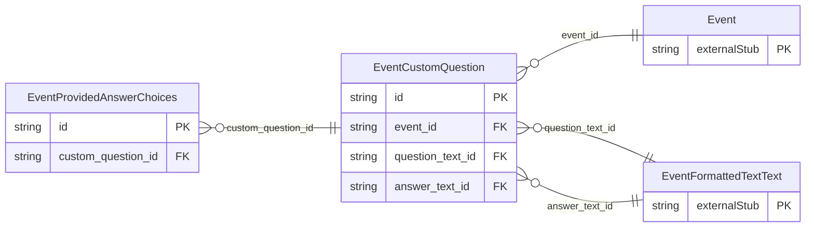

<!-- Code generated by protoc-gen-store. DO NOT EDIT. -->

# `ota/opentravel/hotel/sales/event/v1/types/custom_question/` — Prisma schema

Generated from Protobuf by protoc-gen-store. Source of truth is the `.proto` files — regenerate rather than editing.

| Models | Enums |
| ---: | ---: |
| 2 | 0 |

## Entity relationships

Schema file: [`custom_question.postgres.prisma`](./custom_question.postgres.prisma)

### `EventCustomQuestion` → `custom_questions`

Custom question.

| Column | Type | Null |
| --- | --- | --- |
| `id` | `CHAR(26)` | not null |
| `question_id` | `VARCHAR(255)` | nullable |
| `question_type_code` | `EventQuestionType` | nullable |
| `question_category_code` | `EventQuestionCategory` | nullable |
| `answer_required` | `BOOLEAN` | nullable |
| `event_id` | `CHAR(26)` | not null |
| `question_text_id` | `CHAR(26)` | nullable |
| `answer_text_id` | `CHAR(26)` | nullable |

### `EventProvidedAnswerChoices` → `provided_answer_choices`

Allows the requestor to provide prewritten answers for the question.

| Column | Type | Null |
| --- | --- | --- |
| `id` | `CHAR(26)` | not null |
| `formatted` | `BOOLEAN` | nullable |
| `language_code` | `VARCHAR(255)` | nullable |
| `text_format` | `EventFormattedTextTextTextFormat` | nullable |
| `answer_id` | `VARCHAR(255)` | nullable |
| `value` | `VARCHAR(255)` | nullable |
| `custom_question_id` | `CHAR(26)` | not null |
