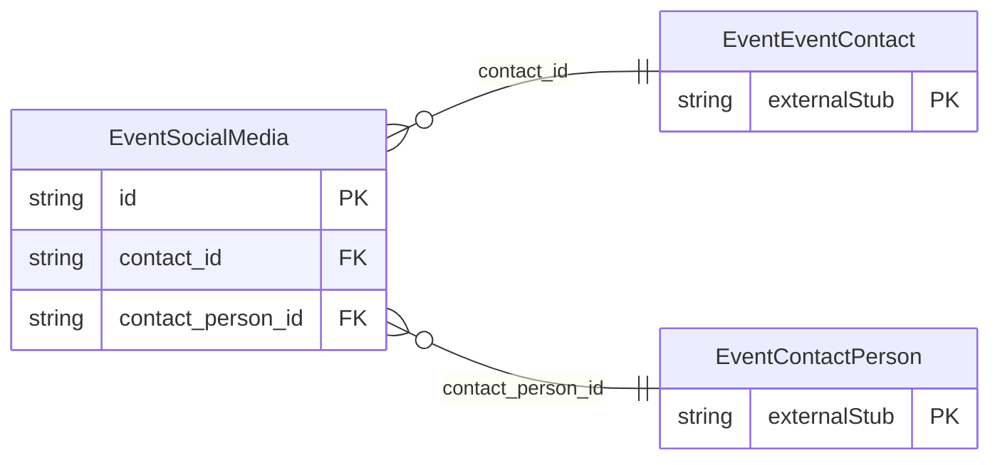

<!-- Code generated by protoc-gen-store. DO NOT EDIT. -->

# `ota/opentravel/hotel/sales/event/v1/types/social_media/` — Prisma schema

Generated from Protobuf by protoc-gen-store. Source of truth is the `.proto` files — regenerate rather than editing.

| Models | Enums |
| ---: | ---: |
| 1 | 1 |

## Entity relationships

Schema file: [`social_media.postgres.prisma`](./social_media.postgres.prisma)

### `EventSocialMedia` → `social_medias`

Specifies social media information used for communication with the traveler.

| Column | Type | Null |
| --- | --- | --- |
| `id` | `CHAR(26)` | not null |
| `type` | `VARCHAR(255)` | not null |
| `user_display_name` | `VARCHAR(255)` | not null |
| `preferred_contact` | `BOOLEAN` | nullable |
| `share_market_ind` | `EventSocialMediaShareMarketInd` | nullable |
| `contact_id` | `CHAR(26)` | not null |
| `contact_person_id` | `CHAR(26)` | not null |

### Enums

- `EventSocialMediaShareMarketInd`: YES, NO, INHERIT
