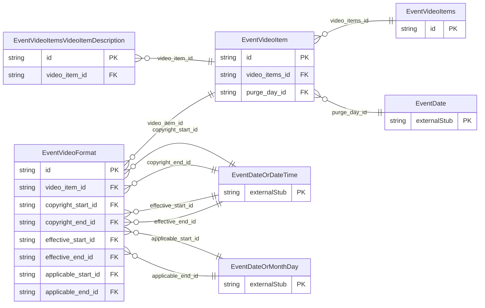

<!-- Code generated by protoc-gen-store. DO NOT EDIT. -->

# `ota/opentravel/hotel/sales/event/v1/types/video_items/` — Prisma schema

Generated from Protobuf by protoc-gen-store. Source of truth is the `.proto` files — regenerate rather than editing.

| Models | Enums |
| ---: | ---: |
| 4 | 0 |

## Entity relationships

Schema file: [`video_items.postgres.prisma`](./video_items.postgres.prisma)

### `EventVideoItems` → `video_items`

Collection of video items.

| Column | Type | Null |
| --- | --- | --- |
| `id` | `CHAR(26)` | not null |

### `EventVideoItem` → `video_item`

Each video item represents a specific category.

| Column | Type | Null |
| --- | --- | --- |
| `id` | `CHAR(26)` | not null |
| `category` | `EventPictureCategoryCode` | nullable |
| `language_code` | `VARCHAR(255)` | nullable |
| `caption` | `VARCHAR(255)` | nullable |
| `version` | `VARCHAR(255)` | nullable |
| `create_date_time` | `TIMESTAMPTZ` | nullable |
| `creator_id` | `VARCHAR(255)` | nullable |
| `last_modify_date_time` | `TIMESTAMPTZ` | nullable |
| `last_modifier_id` | `VARCHAR(255)` | nullable |
| `video_items_id` | `CHAR(26)` | not null |
| `purge_day_id` | `CHAR(26)` | nullable |

### `EventVideoFormat` → `video_formats`

A set of video of a given category can be provided in different Format, each format will be described in this element.

| Column | Type | Null |
| --- | --- | --- |
| `unit_code` | `EventUnitOfMeasureCode` | nullable |
| `width` | `INTEGER` | nullable |
| `height` | `INTEGER` | nullable |
| `bit_rate` | `INTEGER` | nullable |
| `length` | `INTEGER` | nullable |
| `language_code` | `VARCHAR(255)` | nullable |
| `format` | `EventContentFormatCode` | nullable |
| `file_size` | `INTEGER` | nullable |
| `file_display_name` | `VARCHAR(255)` | nullable |
| `streaming_source` | `VARCHAR(255)` | nullable |
| `content_id` | `VARCHAR(255)` | nullable |
| `title` | `VARCHAR(255)` | nullable |
| `author` | `VARCHAR(255)` | nullable |
| `copyright_notice` | `VARCHAR(255)` | nullable |
| `copyright_owner` | `VARCHAR(255)` | nullable |
| `record_id` | `VARCHAR(255)` | nullable |
| `source_id` | `VARCHAR(255)` | nullable |
| `id` | `VARCHAR(255)` | not null |
| `uri` | `VARCHAR(255)` | nullable |
| `video_item_id` | `CHAR(26)` | not null |
| `copyright_start_id` | `CHAR(26)` | nullable |
| `copyright_end_id` | `CHAR(26)` | nullable |
| `effective_start_id` | `CHAR(26)` | nullable |
| `effective_end_id` | `CHAR(26)` | nullable |
| `applicable_start_id` | `CHAR(26)` | nullable |
| `applicable_end_id` | `CHAR(26)` | nullable |

### `EventVideoItemsVideoItemDescription` → `video_items_video_item_descriptions`

The description associated with the video in a specific language.

| Column | Type | Null |
| --- | --- | --- |
| `id` | `CHAR(26)` | not null |
| `formatted` | `BOOLEAN` | nullable |
| `language_code` | `VARCHAR(255)` | nullable |
| `text_format` | `EventFormattedTextTextTextFormat` | nullable |
| `caption` | `VARCHAR(255)` | nullable |
| `value` | `VARCHAR(255)` | nullable |
| `video_item_id` | `CHAR(26)` | not null |
