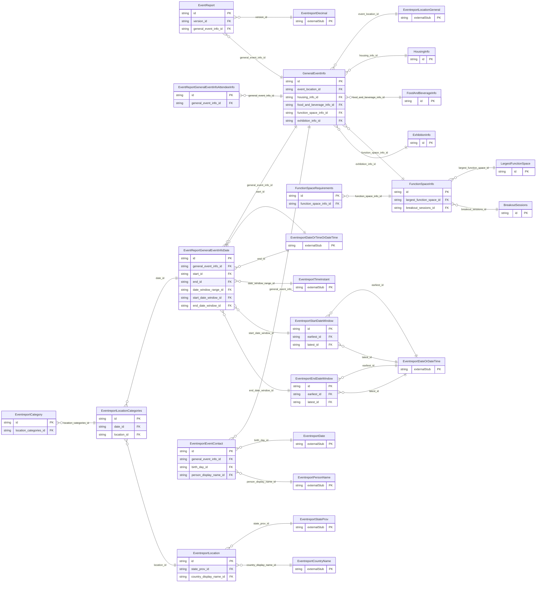

<!-- Code generated by protoc-gen-store. DO NOT EDIT. -->

# `ota/opentravel/hotel/sales/event_report/event_report/` — Prisma schema

Generated from Protobuf by protoc-gen-store. Source of truth is the `.proto` files — regenerate rather than editing.

| Models | Enums |
| ---: | ---: |
| 17 | 3 |

## Entity relationships

Schema file: [`event_report.postgres.prisma`](./event_report.postgres.prisma)

### `EventReport` → `resource`

Provides the actual event information. A collection resource, named "eventReports/{event_report}". OTA: OTA_HotelPostEventNotifRQ/EventReports/EventReport.

| Column | Type | Null |
| --- | --- | --- |
| `id` | `CHAR(26)` | not null |
| `name` | `VARCHAR(255)` | not null |
| `uid` | `VARCHAR(255)` | nullable |
| `etag` | `VARCHAR(255)` | nullable |
| `delete_time` | `TIMESTAMPTZ` | nullable |
| `expire_time` | `TIMESTAMPTZ` | nullable |
| `create_time` | `TIMESTAMPTZ` | not null |
| `update_time` | `TIMESTAMPTZ` | not null |
| `time_stamp_time` | `TIMESTAMPTZ` | nullable |
| `rph` | `VARCHAR(255)` | nullable |
| `version_id` | `CHAR(26)` | nullable |
| `general_event_info_id` | `CHAR(26)` | nullable |

### `GeneralEventInfo` → `general_event_infos`

High-level information regarding the event.

| Column | Type | Null |
| --- | --- | --- |
| `id` | `CHAR(26)` | not null |
| `name` | `VARCHAR(255)` | nullable |
| `acronym` | `VARCHAR(255)` | nullable |
| `uri` | `VARCHAR(255)` | nullable |
| `type` | `EventreportEventType` | nullable |
| `frequency` | `EventreportFrequency` | nullable |
| `spouse_invited_indicator` | `BOOLEAN` | nullable |
| `children_invited_indicator` | `BOOLEAN` | nullable |
| `scope` | `EventreportScope` | nullable |
| `offsite_venue_indicator` | `BOOLEAN` | nullable |
| `shuttle_service_indicator` | `BOOLEAN` | nullable |
| `destination_service_provider_codes` | `` | nullable |
| `attendee_guest_program_indicator` | `BOOLEAN` | nullable |
| `event_report_rphs` | `VARCHAR(255)[]` | nullable |
| `event_location_id` | `CHAR(26)` | nullable |
| `housing_info_id` | `CHAR(26)` | nullable |
| `food_and_beverage_info_id` | `CHAR(26)` | nullable |
| `function_space_info_id` | `CHAR(26)` | nullable |
| `exhibition_info_id` | `CHAR(26)` | nullable |

### `EventreportEventContact` → `event_contacts`

A contact that pertains to this event.

| Column | Type | Null |
| --- | --- | --- |
| `id` | `CHAR(26)` | not null |
| `share_synch_ind` | `PostEventSiteReportContactShareSynchInd` | nullable |
| `share_market_ind` | `PostEventSiteReportContactShareMarketInd` | nullable |
| `default_value` | `BOOLEAN` | nullable |
| `contact_type` | `VARCHAR(255)` | nullable |
| `relation` | `VARCHAR(255)` | nullable |
| `emergency_flag` | `BOOLEAN` | nullable |
| `rph` | `VARCHAR(255)` | nullable |
| `communication_method_code` | `EventreportDistributionType` | nullable |
| `document_distrib_method_code` | `EventreportDistributionType` | nullable |
| `role` | `VARCHAR(255)` | nullable |
| `general_event_info_id` | `CHAR(26)` | not null |
| `birth_day_id` | `CHAR(26)` | nullable |
| `person_display_name_id` | `CHAR(26)` | nullable |

### `EventReportGeneralEventInfoAttendeeInfo` → `general_event_info_attendee_infos`

Specifies the number of event attendees.

| Column | Type | Null |
| --- | --- | --- |
| `id` | `CHAR(26)` | not null |
| `total_quantity` | `INTEGER` | nullable |
| `domestic_quantity` | `INTEGER` | nullable |
| `international_quantity` | `INTEGER` | nullable |
| `pre_registered_quantity` | `INTEGER` | nullable |
| `onsite_registered_quantity` | `INTEGER` | nullable |
| `no_show_quantity` | `INTEGER` | nullable |
| `exhibitor_quantity` | `INTEGER` | nullable |
| `quantity_type` | `QuantityType` | nullable |
| `general_event_info_id` | `CHAR(26)` | not null |

### `EventReportGeneralEventInfoDate` → `general_event_info_dates`

Specifies event date and associated location information.

| Column | Type | Null |
| --- | --- | --- |
| `id` | `CHAR(26)` | not null |
| `duration` | `VARCHAR(255)` | nullable |
| `contracted_indicator` | `BOOLEAN` | nullable |
| `event_date_type` | `EventDateType` | nullable |
| `general_event_info_id` | `CHAR(26)` | not null |
| `start_id` | `CHAR(26)` | nullable |
| `end_id` | `CHAR(26)` | nullable |
| `date_window_range_id` | `CHAR(26)` | nullable |
| `start_date_window_id` | `CHAR(26)` | nullable |
| `end_date_window_id` | `CHAR(26)` | nullable |

### `HousingInfo` → `housing_infos`

General hotel usage information.

| Column | Type | Null |
| --- | --- | --- |
| `id` | `CHAR(26)` | not null |
| `sleeping_rooms_indicator` | `BOOLEAN` | nullable |
| `hotel_quantity` | `INTEGER` | nullable |
| `peak_room_night_quantity` | `INTEGER` | nullable |
| `housing_provider_code` | `DestinationServiceProviderType` | nullable |
| `housing_provider_display_name` | `VARCHAR(255)` | nullable |

### `FoodAndBeverageInfo` → `food_and_beverage_infos`

General food and beverage information.

| Column | Type | Null |
| --- | --- | --- |
| `id` | `CHAR(26)` | not null |
| `food_and_beverage_indicator` | `BOOLEAN` | nullable |
| `largest_attendance_quantity` | `INTEGER` | nullable |
| `largest_attendance_function_type` | `EventreportEventCharge` | nullable |
| `largest_revenue_function_type` | `EventreportEventCharge` | nullable |
| `icw_indicator` | `BOOLEAN` | nullable |

### `FunctionSpaceInfo` → `function_space_infos`

General function space information for this event.

| Column | Type | Null |
| --- | --- | --- |
| `id` | `CHAR(26)` | not null |
| `function_space_indicator` | `BOOLEAN` | nullable |
| `property_type_codes` | `` | nullable |
| `pre_function_space_indicator` | `BOOLEAN` | nullable |
| `pre_event_setup_indicator` | `BOOLEAN` | nullable |
| `movein_requirement` | `VARCHAR(255)` | nullable |
| `move_out_requirement` | `VARCHAR(255)` | nullable |
| `utility_codes` | `` | nullable |
| `telecommunication_codes` | `` | nullable |
| `largest_function_space_id` | `CHAR(26)` | nullable |
| `breakout_sessions_id` | `CHAR(26)` | nullable |

### `ExhibitionInfo` → `exhibition_infos`

General exhibition information for this event.

| Column | Type | Null |
| --- | --- | --- |
| `id` | `CHAR(26)` | not null |
| `exhibition_space_indicator` | `BOOLEAN` | nullable |
| `property_type_codes` | `` | nullable |

### `EventreportStartDateWindow` → `start_date_windows`

The earliest and latest dates acceptable for the start date.

| Column | Type | Null |
| --- | --- | --- |
| `id` | `CHAR(26)` | not null |
| `dow` | `EventreportDayOfWeek` | nullable |
| `earliest_id` | `CHAR(26)` | nullable |
| `latest_id` | `CHAR(26)` | nullable |

### `EventreportEndDateWindow` → `end_date_windows`

The earliest and latest dates acceptable for the end date.

| Column | Type | Null |
| --- | --- | --- |
| `id` | `CHAR(26)` | not null |
| `dow` | `EventreportDayOfWeek` | nullable |
| `earliest_id` | `CHAR(26)` | nullable |
| `latest_id` | `CHAR(26)` | nullable |

### `EventreportLocationCategories` → `location_categories`

Used to define requirements or preferences in location for the event.

| Column | Type | Null |
| --- | --- | --- |
| `id` | `CHAR(26)` | not null |
| `date_id` | `CHAR(26)` | not null |
| `location_id` | `CHAR(26)` | nullable |

### `LargestFunctionSpace` → `largest_function_spaces`

Information regarding the largest function space for this event.

| Column | Type | Null |
| --- | --- | --- |
| `id` | `CHAR(26)` | not null |
| `attendance_quantity` | `INTEGER` | nullable |
| `twenty_four_hour_hold` | `BOOLEAN` | nullable |
| `room_setup_code` | `EventreportMeetingRoomFormatCode` | nullable |
| `audio_visual_codes` | `VARCHAR(255)[]` | nullable |

### `BreakoutSessions` → `breakout_sessions`

General breakout session information for this event.

| Column | Type | Null |
| --- | --- | --- |
| `id` | `CHAR(26)` | not null |
| `largest_concurrent_quantity` | `INTEGER` | nullable |
| `largest_daily_quantity` | `INTEGER` | nullable |
| `typical_seat_quantity` | `INTEGER` | nullable |
| `typical_room_setup_code` | `EventreportMeetingRoomFormatCode` | nullable |

### `FunctionSpaceRequirements` → `function_space_requirements`

General function space requirements for this event.

| Column | Type | Null |
| --- | --- | --- |
| `id` | `CHAR(26)` | not null |
| `quantity` | `INTEGER` | nullable |
| `requirement` | `Requirement` | nullable |
| `function_space_info_id` | `CHAR(26)` | not null |

### `EventreportLocation` → `locations`

Preferred event location.

| Column | Type | Null |
| --- | --- | --- |
| `id` | `CHAR(26)` | not null |
| `chain_code` | `VARCHAR(255)` | nullable |
| `brand_code` | `VARCHAR(255)` | nullable |
| `hotel_code` | `VARCHAR(255)` | nullable |
| `hotel_city_code` | `VARCHAR(255)` | nullable |
| `hotel_display_name` | `VARCHAR(255)` | nullable |
| `hotel_code_context` | `VARCHAR(255)` | nullable |
| `chain_display_name` | `VARCHAR(255)` | nullable |
| `brand_display_name` | `VARCHAR(255)` | nullable |
| `area_id` | `VARCHAR(255)` | nullable |
| `tt_icode` | `INTEGER` | nullable |
| `city_display_name` | `VARCHAR(255)` | nullable |
| `state_prov_id` | `CHAR(26)` | nullable |
| `country_display_name_id` | `CHAR(26)` | nullable |

### `EventreportCategory` → `categories`

Used to define the preferences or requirements regarding an event location.

| Column | Type | Null |
| --- | --- | --- |
| `id` | `CHAR(26)` | not null |
| `formatted` | `BOOLEAN` | nullable |
| `language_code` | `VARCHAR(255)` | nullable |
| `text_format` | `EventreportFormattedTextTextTextFormat` | nullable |
| `location_category_code` | `VARCHAR(255)` | nullable |
| `prefer_level` | `EventreportPreferLevel` | nullable |
| `value` | `VARCHAR(255)` | nullable |
| `location_categories_id` | `CHAR(26)` | not null |

### Enums

- `EventreportScope`: CITY_WIDE, SINGLE_VENUE, MULTIPLE_VENUE
- `EventDateType`: PAST, CURRENT, FUTURE
- `Requirement`: REGISTRATION_AREA, LOUNGE_AREA, OFFICE_SPACE, TABLETOP_EXHIBIT_SPACE
