<!-- Code generated by protoc-gen-store. DO NOT EDIT. -->

# `ota/opentravel/hotel/sales/event_report/v1/types/post_event_site_report/` — Prisma schema

Generated from Protobuf by protoc-gen-store. Source of truth is the `.proto` files — regenerate rather than editing.

| Models | Enums |
| ---: | ---: |
| 41 | 11 |

## Entity relationships

```mermaid
erDiagram
    direction LR
    AdditionalDate {
        string id PK
        string exhibition_id FK
        string start_id FK
        string end_id FK
    }
    EventId {
        string id PK
        string post_event_site_report_id FK
        string company_display_name_id FK
    }
    EventreportAddressInfo {
        string id PK
        string contact_id FK
        string event_contact_id FK
        string street_nmbr_id FK
        string state_prov_id FK
        string country_display_name_id FK
        string contact_person_id FK
    }
    EventreportAudioVisual {
        string id PK
        string audio_visuals_id FK
        string amount_id FK
    }
    EventreportAudioVisuals {
        string id PK
    }
    EventreportBldgRoom {
        string id PK
        string address_info_id FK
    }
    EventreportContactPerson {
        string id PK
        string exhibit_detail_id FK
        string birth_day_id FK
        string person_display_name_id FK
    }
    EventreportDocument {
        string id PK
    }
    EventreportEmail {
        string id PK
        string contact_id FK
        string event_contact_id FK
        string contact_person_id FK
    }
    EventreportEventDay {
        string id PK
        string event_days_id FK
    }
    EventreportEventDayFunction {
        string id PK
        string event_day_id FK
        string start_clock_id FK
        string end_clock_id FK
        string audio_visuals_id FK
        string room_setup_id FK
        string food_and_beverages_id FK
    }
    EventreportEventDays {
        string id PK
    }
    EventreportExhibitDetail {
        string id PK
        string exhibit_details_id FK
        string area_id FK
        string height_id FK
        string length_id FK
        string width_id FK
    }
    EventreportExhibition {
        string id PK
        string post_event_site_report_id FK
        string exhibit_details_id FK
        string exhibitor_info_id FK
    }
    EventreportExhibitorInfo {
        string id PK
    }
    EventreportFoodAndBeverage {
        string id PK
        string food_and_beverages_id FK
        string service_id FK
    }
    EventreportFoodAndBeverages {
        string id PK
    }
    EventreportMenu {
        string id PK
        string food_and_beverage_id FK
        string amount_id FK
        string quantity_id FK
    }
    EventreportPersonName {
        string id PK
        string document_id FK
    }
    EventreportRate {
        string id PK
        string stay_day_id FK
        string amount_id FK
        string taxes_id FK
    }
    EventreportReservationMethod {
        string id PK
        string room_block_id FK
    }
    EventreportRoomBlock {
        string id PK
        string room_blocks_id FK
        string contracted_id FK
        string cutoff_id FK
        string requested_oversell_percentage_id FK
        string stay_days_id FK
    }
    EventreportRoomBlocks {
        string id PK
    }
    EventreportRoomSetup {
        string id PK
    }
    EventreportService {
        string id PK
        string event_day_function_id FK
        string start_clock_id FK
        string end_clock_id FK
    }
    EventreportSessionTimes {
        string id PK
        string event_day_function_id FK
        string start_clock_id FK
        string end_clock_id FK
    }
    EventreportStayDay {
        string id PK
        string stay_days_id FK
    }
    EventreportStayDays {
        string id PK
    }
    EventreportStreetNmbr {
        string id PK
    }
    EventreportTelephone {
        string id PK
        string contact_id FK
        string event_contact_id FK
        string contact_person_id FK
    }
    EventreportUtility {
        string id PK
        string service_id FK
        string amount_id FK
    }
    ExhibitDetails {
        string id PK
    }
    FunctionCharge {
        string id PK
        string event_day_function_id FK
        string amount_id FK
        string taxes_id FK
        string comment_id FK
    }
    PostEventSiteReport {
        string id PK
        string event_report_id FK
        string response_type_id FK
        string event_dates_id FK
        string event_days_id FK
        string room_blocks_id FK
    }
    PostEventSiteReportAttendeeInfo {
        string id PK
        string post_event_site_report_id FK
    }
    PostEventSiteReportContact {
        string id PK
        string post_event_site_report_id FK
        string birth_day_id FK
        string arrival_id FK
        string departure_id FK
        string person_display_name_id FK
    }
    PostEventSiteReportDate {
        string id PK
        string start_id FK
        string end_id FK
    }
    PostEventSiteReportEventDaysEventDayEventDayFunctionContact {
        string id PK
        string event_day_function_id FK
        string birth_day_id FK
        string person_display_name_id FK
    }
    RoomPickUp {
        string id PK
        string stay_day_id FK
    }
    TaxExemptInfo {
        string id PK
        string post_event_site_report_id FK
    }
    TotalRoomPickUp {
        string id PK
        string room_block_id FK
    }
    EventReport {
        string externalStub PK
    }
    EventreportCompanyName {
        string externalStub PK
    }
    EventreportCountryName {
        string externalStub PK
    }
    EventreportDate {
        string externalStub PK
    }
    EventreportDateOrTimeOrDateTime {
        string externalStub PK
    }
    EventreportDecimal {
        string externalStub PK
    }
    EventreportEventContact {
        string externalStub PK
    }
    EventreportMoney {
        string externalStub PK
    }
    EventreportParagraph {
        string externalStub PK
    }
    EventreportStateProv {
        string externalStub PK
    }
    EventreportTaxes {
        string externalStub PK
    }
    EventreportTimeOfDay {
        string externalStub PK
    }
    RfpResponseDetail {
        string externalStub PK
    }
    AdditionalDate }o--|| EventreportExhibition : "exhibition_id"
    AdditionalDate }o--|| EventreportDateOrTimeOrDateTime : "start_id"
    AdditionalDate }o--|| EventreportDateOrTimeOrDateTime : "end_id"
    EventId }o--|| PostEventSiteReport : "post_event_site_report_id"
    EventId }o--|| EventreportCompanyName : "company_display_name_id"
    EventreportAddressInfo }o--|| PostEventSiteReportContact : "contact_id"
    EventreportAddressInfo }o--|| EventreportEventContact : "event_contact_id"
    EventreportAddressInfo }o--|| EventreportStreetNmbr : "street_nmbr_id"
    EventreportAddressInfo }o--|| EventreportStateProv : "state_prov_id"
    EventreportAddressInfo }o--|| EventreportCountryName : "country_display_name_id"
    EventreportAddressInfo }o--|| EventreportContactPerson : "contact_person_id"
    EventreportAudioVisual }o--|| EventreportAudioVisuals : "audio_visuals_id"
    EventreportAudioVisual }o--|| EventreportMoney : "amount_id"
    EventreportBldgRoom }o--|| EventreportAddressInfo : "address_info_id"
    EventreportContactPerson }o--|| EventreportExhibitDetail : "exhibit_detail_id"
    EventreportContactPerson }o--|| EventreportDate : "birth_day_id"
    EventreportContactPerson }o--|| EventreportPersonName : "person_display_name_id"
    EventreportEmail }o--|| PostEventSiteReportContact : "contact_id"
    EventreportEmail }o--|| EventreportEventContact : "event_contact_id"
    EventreportEmail }o--|| EventreportContactPerson : "contact_person_id"
    EventreportEventDay }o--|| EventreportEventDays : "event_days_id"
    EventreportEventDayFunction }o--|| EventreportEventDay : "event_day_id"
    EventreportEventDayFunction }o--|| EventreportTimeOfDay : "start_clock_id"
    EventreportEventDayFunction }o--|| EventreportTimeOfDay : "end_clock_id"
    EventreportEventDayFunction }o--|| EventreportAudioVisuals : "audio_visuals_id"
    EventreportEventDayFunction }o--|| EventreportRoomSetup : "room_setup_id"
    EventreportEventDayFunction }o--|| EventreportFoodAndBeverages : "food_and_beverages_id"
    EventreportExhibitDetail }o--|| ExhibitDetails : "exhibit_details_id"
    EventreportExhibitDetail }o--|| EventreportDecimal : "area_id"
    EventreportExhibitDetail }o--|| EventreportDecimal : "height_id"
    EventreportExhibitDetail }o--|| EventreportDecimal : "length_id"
    EventreportExhibitDetail }o--|| EventreportDecimal : "width_id"
    EventreportExhibition }o--|| PostEventSiteReport : "post_event_site_report_id"
    EventreportExhibition }o--|| ExhibitDetails : "exhibit_details_id"
    EventreportExhibition }o--|| EventreportExhibitorInfo : "exhibitor_info_id"
    EventreportFoodAndBeverage }o--|| EventreportFoodAndBeverages : "food_and_beverages_id"
    EventreportFoodAndBeverage }o--|| EventreportDateOrTimeOrDateTime : "service_id"
    EventreportMenu }o--|| EventreportFoodAndBeverage : "food_and_beverage_id"
    EventreportMenu }o--|| EventreportMoney : "amount_id"
    EventreportMenu }o--|| EventreportDecimal : "quantity_id"
    EventreportPersonName }o--|| EventreportDocument : "document_id"
    EventreportRate }o--|| EventreportStayDay : "stay_day_id"
    EventreportRate }o--|| EventreportMoney : "amount_id"
    EventreportRate }o--|| EventreportTaxes : "taxes_id"
    EventreportReservationMethod }o--|| EventreportRoomBlock : "room_block_id"
    EventreportRoomBlock }o--|| EventreportRoomBlocks : "room_blocks_id"
    EventreportRoomBlock }o--|| EventreportDateOrTimeOrDateTime : "contracted_id"
    EventreportRoomBlock }o--|| EventreportDateOrTimeOrDateTime : "cutoff_id"
    EventreportRoomBlock }o--|| EventreportDecimal : "requested_oversell_percentage_id"
    EventreportRoomBlock }o--|| EventreportStayDays : "stay_days_id"
    EventreportService }o--|| EventreportEventDayFunction : "event_day_function_id"
    EventreportService }o--|| EventreportTimeOfDay : "start_clock_id"
    EventreportService }o--|| EventreportTimeOfDay : "end_clock_id"
    EventreportSessionTimes }o--|| EventreportEventDayFunction : "event_day_function_id"
    EventreportSessionTimes }o--|| EventreportTimeOfDay : "start_clock_id"
    EventreportSessionTimes }o--|| EventreportTimeOfDay : "end_clock_id"
    EventreportStayDay }o--|| EventreportStayDays : "stay_days_id"
    EventreportTelephone }o--|| PostEventSiteReportContact : "contact_id"
    EventreportTelephone }o--|| EventreportEventContact : "event_contact_id"
    EventreportTelephone }o--|| EventreportContactPerson : "contact_person_id"
    EventreportUtility }o--|| EventreportService : "service_id"
    EventreportUtility }o--|| EventreportMoney : "amount_id"
    FunctionCharge }o--|| EventreportEventDayFunction : "event_day_function_id"
    FunctionCharge }o--|| EventreportMoney : "amount_id"
    FunctionCharge }o--|| EventreportTaxes : "taxes_id"
    FunctionCharge }o--|| EventreportParagraph : "comment_id"
    PostEventSiteReport }o--|| EventReport : "event_report_id"
    PostEventSiteReport }o--|| RfpResponseDetail : "response_type_id"
    PostEventSiteReport }o--|| PostEventSiteReportDate : "event_dates_id"
    PostEventSiteReport }o--|| EventreportEventDays : "event_days_id"
    PostEventSiteReport }o--|| EventreportRoomBlocks : "room_blocks_id"
    PostEventSiteReportAttendeeInfo }o--|| PostEventSiteReport : "post_event_site_report_id"
    PostEventSiteReportContact }o--|| PostEventSiteReport : "post_event_site_report_id"
    PostEventSiteReportContact }o--|| EventreportDate : "birth_day_id"
    PostEventSiteReportContact }o--|| EventreportDateOrTimeOrDateTime : "arrival_id"
    PostEventSiteReportContact }o--|| EventreportDateOrTimeOrDateTime : "departure_id"
    PostEventSiteReportContact }o--|| EventreportPersonName : "person_display_name_id"
    PostEventSiteReportDate }o--|| EventreportDateOrTimeOrDateTime : "start_id"
    PostEventSiteReportDate }o--|| EventreportDateOrTimeOrDateTime : "end_id"
    PostEventSiteReportEventDaysEventDayEventDayFunctionContact }o--|| EventreportEventDayFunction : "event_day_function_id"
    PostEventSiteReportEventDaysEventDayEventDayFunctionContact }o--|| EventreportDate : "birth_day_id"
    PostEventSiteReportEventDaysEventDayEventDayFunctionContact }o--|| EventreportPersonName : "person_display_name_id"
    RoomPickUp }o--|| EventreportStayDay : "stay_day_id"
    TaxExemptInfo }o--|| PostEventSiteReport : "post_event_site_report_id"
    TotalRoomPickUp }o--|| EventreportRoomBlock : "room_block_id"
```

Schema file: [`post_event_site_report.postgres.prisma`](./post_event_site_report.postgres.prisma)

### `PostEventSiteReport` → `post_event_site_reports`

Provides event site information.

| Column | Type | Null |
| --- | --- | --- |
| `id` | `CHAR(26)` | not null |
| `chain_code` | `VARCHAR(255)` | nullable |
| `brand_code` | `VARCHAR(255)` | nullable |
| `hotel_code` | `VARCHAR(255)` | nullable |
| `hotel_city_code` | `VARCHAR(255)` | nullable |
| `hotel_display_name` | `VARCHAR(255)` | nullable |
| `hotel_code_context` | `VARCHAR(255)` | nullable |
| `chain_display_name` | `VARCHAR(255)` | nullable |
| `brand_display_name` | `VARCHAR(255)` | nullable |
| `area_id` | `VARCHAR(255)` | nullable |
| `tt_icode` | `INTEGER` | nullable |
| `location_category_code` | `VARCHAR(255)` | nullable |
| `primary_facility_indicator` | `BOOLEAN` | nullable |
| `headquarter_hotel_indicator` | `BOOLEAN` | nullable |
| `property_type_code` | `EventreportPropertyClassType` | nullable |
| `currency_code` | `VARCHAR(255)` | nullable |
| `decimal_places` | `INTEGER` | nullable |
| `event_report_id` | `CHAR(26)` | not null |
| `response_type_id` | `CHAR(26)` | nullable |
| `event_dates_id` | `CHAR(26)` | nullable |
| `event_days_id` | `CHAR(26)` | nullable |
| `room_blocks_id` | `CHAR(26)` | nullable |

### `EventId` → `event_ids`

This is a UniqueID that is associated with an individual event. This element repeats to accommodate the IDs of multiple systems.

| Column | Type | Null |
| --- | --- | --- |
| `uri` | `VARCHAR(255)` | nullable |
| `type` | `EventreportUniqueIdType` | not null |
| `instance` | `VARCHAR(255)` | nullable |
| `id` | `VARCHAR(255)` | not null |
| `id_context` | `VARCHAR(255)` | nullable |
| `meeting_display_name` | `VARCHAR(255)` | nullable |
| `post_event_site_report_id` | `CHAR(26)` | not null |
| `company_display_name_id` | `CHAR(26)` | nullable |

### `PostEventSiteReportDate` → `post_event_site_report_dates`

Date or date range for this event for this site. This date range encompasses any pre-event, published and post event dates.

| Column | Type | Null |
| --- | --- | --- |
| `id` | `CHAR(26)` | not null |
| `duration` | `VARCHAR(255)` | nullable |
| `start_id` | `CHAR(26)` | nullable |
| `end_id` | `CHAR(26)` | nullable |

### `PostEventSiteReportContact` → `post_event_site_report_contacts`

Contact information as well as site address information.

| Column | Type | Null |
| --- | --- | --- |
| `id` | `CHAR(26)` | not null |
| `share_synch_ind` | `PostEventSiteReportContactShareSynchInd` | nullable |
| `share_market_ind` | `PostEventSiteReportContactShareMarketInd` | nullable |
| `default_value` | `BOOLEAN` | nullable |
| `contact_type` | `VARCHAR(255)` | nullable |
| `relation` | `VARCHAR(255)` | nullable |
| `emergency_flag` | `BOOLEAN` | nullable |
| `rph` | `VARCHAR(255)` | nullable |
| `communication_method_code` | `EventreportDistributionType` | nullable |
| `document_distrib_method_code` | `EventreportDistributionType` | nullable |
| `vip_indicator` | `BOOLEAN` | nullable |
| `post_event_site_report_id` | `CHAR(26)` | not null |
| `birth_day_id` | `CHAR(26)` | nullable |
| `arrival_id` | `CHAR(26)` | nullable |
| `departure_id` | `CHAR(26)` | nullable |
| `person_display_name_id` | `CHAR(26)` | nullable |

### `PostEventSiteReportAttendeeInfo` → `post_event_site_report_attendee_infos`

The number of attendees by type at this site for this event.

| Column | Type | Null |
| --- | --- | --- |
| `id` | `CHAR(26)` | not null |
| `total_quantity` | `INTEGER` | nullable |
| `domestic_quantity` | `INTEGER` | nullable |
| `international_quantity` | `INTEGER` | nullable |
| `pre_registered_quantity` | `INTEGER` | nullable |
| `onsite_registered_quantity` | `INTEGER` | nullable |
| `no_show_quantity` | `INTEGER` | nullable |
| `exhibitor_quantity` | `INTEGER` | nullable |
| `quantity_type` | `QuantityType` | nullable |
| `post_event_site_report_id` | `CHAR(26)` | not null |

### `EventreportEventDays` → `event_days`

A collection of event days.

| Column | Type | Null |
| --- | --- | --- |
| `id` | `CHAR(26)` | not null |
| `first_event_weekday` | `EventreportDayOfWeek` | nullable |

### `EventreportExhibition` → `exhibitions`

Describes an event at which products and services are displayed.

| Column | Type | Null |
| --- | --- | --- |
| `id` | `CHAR(26)` | not null |
| `type` | `PostEventSiteReportExhibitionType` | nullable |
| `gross_exhibition_space` | `INTEGER` | nullable |
| `net_exhibition_space` | `INTEGER` | nullable |
| `unit_code` | `EventreportUnitOfMeasureCode` | nullable |
| `exhibit_quantity` | `INTEGER` | nullable |
| `company_quantity` | `INTEGER` | nullable |
| `general_service_contractor` | `BOOLEAN` | nullable |
| `secured_area_indicator` | `BOOLEAN` | nullable |
| `post_event_site_report_id` | `CHAR(26)` | not null |
| `exhibit_details_id` | `CHAR(26)` | nullable |
| `exhibitor_info_id` | `CHAR(26)` | nullable |

### `EventreportRoomBlocks` → `room_blocks`

A collection of room blocks for this event.

| Column | Type | Null |
| --- | --- | --- |
| `id` | `CHAR(26)` | not null |
| `total_block_quantity` | `INTEGER` | nullable |

### `TaxExemptInfo` → `tax_exempt_infos`

Used to provide tax exemption information for the event.

| Column | Type | Null |
| --- | --- | --- |
| `id` | `CHAR(26)` | not null |
| `tax_exempt_indicator` | `BOOLEAN` | nullable |
| `tax_exempt_id` | `VARCHAR(255)` | nullable |
| `tax_exempt_type` | `EventreportTaxExemptType` | nullable |
| `post_event_site_report_id` | `CHAR(26)` | not null |

### `EventreportPersonName` → `person_names`

This provides name information for a person.

| Column | Type | Null |
| --- | --- | --- |
| `id` | `CHAR(26)` | not null |
| `share_synch_ind` | `PostEventSiteReportContactShareSynchInd` | nullable |
| `share_market_ind` | `PostEventSiteReportContactShareMarketInd` | nullable |
| `name_type` | `EventreportNameType` | nullable |
| `language_code` | `VARCHAR(255)` | nullable |
| `default_value` | `BOOLEAN` | nullable |
| `name_prefixes` | `VARCHAR(255)[]` | nullable |
| `given_names` | `VARCHAR(255)[]` | nullable |
| `middle_names` | `VARCHAR(255)[]` | nullable |
| `surname_prefix` | `VARCHAR(255)` | nullable |
| `surname` | `VARCHAR(255)` | not null |
| `name_suffixes` | `VARCHAR(255)[]` | nullable |
| `name_titles` | `VARCHAR(255)[]` | nullable |
| `document_id` | `CHAR(26)` | nullable |

### `EventreportTelephone` → `telephones`

Information about a telephone number, including the actual number and its usage.

| Column | Type | Null |
| --- | --- | --- |
| `id` | `CHAR(26)` | not null |
| `rph` | `VARCHAR(255)` | nullable |
| `share_synch_ind` | `PostEventSiteReportContactTelephoneShareSynchInd` | nullable |
| `share_market_ind` | `PostEventSiteReportContactTelephoneShareMarketInd` | nullable |
| `phone_location_type` | `EventreportPhoneLocationType` | nullable |
| `phone_tech_type` | `EventreportPhoneTechnologyType` | nullable |
| `phone_use_type` | `EventreportPhoneUseType` | nullable |
| `country_access_code` | `VARCHAR(255)` | nullable |
| `area_city_code` | `VARCHAR(255)` | nullable |
| `phone_number` | `VARCHAR(255)` | not null |
| `extension` | `VARCHAR(255)` | nullable |
| `pin` | `VARCHAR(255)` | nullable |
| `remark` | `VARCHAR(255)` | nullable |
| `formatted` | `BOOLEAN` | nullable |
| `default_value` | `BOOLEAN` | nullable |
| `contact_id` | `CHAR(26)` | not null |
| `event_contact_id` | `CHAR(26)` | not null |
| `contact_person_id` | `CHAR(26)` | not null |

### `EventreportAddressInfo` → `address_infos`

Information about an address that identifies a location for a specific purposes.

| Column | Type | Null |
| --- | --- | --- |
| `id` | `CHAR(26)` | not null |
| `formatted` | `BOOLEAN` | nullable |
| `share_synch_ind` | `PostEventSiteReportContactShareSynchInd` | nullable |
| `share_market_ind` | `PostEventSiteReportContactShareMarketInd` | nullable |
| `type` | `EventreportCommunicationLocationType` | nullable |
| `remark` | `VARCHAR(255)` | nullable |
| `language_code` | `VARCHAR(255)` | nullable |
| `valid` | `BOOLEAN` | nullable |
| `default_value` | `BOOLEAN` | nullable |
| `use_type` | `EventreportAddressUseType` | nullable |
| `rph` | `VARCHAR(255)` | nullable |
| `address_lines` | `VARCHAR(255)[]` | nullable |
| `city_display_name` | `VARCHAR(255)` | nullable |
| `postal_code` | `VARCHAR(255)` | nullable |
| `county` | `VARCHAR(255)` | nullable |
| `contact_id` | `CHAR(26)` | not null |
| `event_contact_id` | `CHAR(26)` | not null |
| `street_nmbr_id` | `CHAR(26)` | nullable |
| `state_prov_id` | `CHAR(26)` | nullable |
| `country_display_name_id` | `CHAR(26)` | nullable |
| `contact_person_id` | `CHAR(26)` | not null |

### `EventreportEmail` → `emails`

Electronic email addresses, in IETF specified format.

| Column | Type | Null |
| --- | --- | --- |
| `id` | `CHAR(26)` | not null |
| `share_synch_ind` | `PostEventSiteReportContactShareSynchInd` | nullable |
| `share_market_ind` | `PostEventSiteReportContactShareMarketInd` | nullable |
| `default_value` | `BOOLEAN` | nullable |
| `email_type` | `EventreportEmailAddressType` | nullable |
| `rph` | `VARCHAR(255)` | nullable |
| `remark` | `VARCHAR(255)` | nullable |
| `valid` | `BOOLEAN` | nullable |
| `text_format` | `EventreportEmailTextFormat` | nullable |
| `value` | `VARCHAR(255)` | nullable |
| `contact_id` | `CHAR(26)` | not null |
| `event_contact_id` | `CHAR(26)` | not null |
| `contact_person_id` | `CHAR(26)` | not null |

### `EventreportEventDay` → `event_day`

Defines the functions for a specific day of the event.

| Column | Type | Null |
| --- | --- | --- |
| `id` | `CHAR(26)` | not null |
| `day_number` | `INTEGER` | not null |
| `day_type` | `EnumsEventDay` | nullable |
| `event_days_id` | `CHAR(26)` | not null |

### `ExhibitDetails` → `exhibit_details`

A collection of exhibit details.

| Column | Type | Null |
| --- | --- | --- |
| `id` | `CHAR(26)` | not null |
| `food_and_beverage_indicator` | `BOOLEAN` | nullable |
| `food_and_beverage_booth_quantity` | `INTEGER` | nullable |

### `EventreportExhibitorInfo` → `exhibitor_infos`

Exhibitor (i.e., the people working the booths) information for the event.

| Column | Type | Null |
| --- | --- | --- |
| `id` | `CHAR(26)` | not null |
| `total_quantity` | `INTEGER` | nullable |
| `domestic_quantity` | `INTEGER` | nullable |
| `international_quantity` | `INTEGER` | nullable |
| `pre_registered_quantity` | `INTEGER` | nullable |
| `onsite_registered_quantity` | `INTEGER` | nullable |
| `no_show_quantity` | `INTEGER` | nullable |
| `exhibitor_quantity` | `INTEGER` | nullable |
| `quantity_type` | `QuantityType` | nullable |

### `AdditionalDate` → `additional_dates`

Date information petaining to the exhibition.

| Column | Type | Null |
| --- | --- | --- |
| `id` | `CHAR(26)` | not null |
| `duration` | `VARCHAR(255)` | nullable |
| `type` | `PostEventSiteReportExhibitionAdditionalDateType` | nullable |
| `exhibition_id` | `CHAR(26)` | not null |
| `start_id` | `CHAR(26)` | nullable |
| `end_id` | `CHAR(26)` | nullable |

### `EventreportRoomBlock` → `room_block`

Information pertaining to a room block for this event.

| Column | Type | Null |
| --- | --- | --- |
| `id` | `CHAR(26)` | not null |
| `total_room_night_quantity` | `INTEGER` | nullable |
| `peak_room_night_quantity` | `INTEGER` | nullable |
| `housing_provider_display_name` | `VARCHAR(255)` | nullable |
| `inv_block_code` | `VARCHAR(255)` | nullable |
| `comp_room_quantity` | `INTEGER` | nullable |
| `staff_room_quantity` | `INTEGER` | nullable |
| `cutoff_date_exercised_indicator` | `BOOLEAN` | nullable |
| `room_blocks_id` | `CHAR(26)` | not null |
| `contracted_id` | `CHAR(26)` | nullable |
| `cutoff_id` | `CHAR(26)` | nullable |
| `requested_oversell_percentage_id` | `CHAR(26)` | nullable |
| `stay_days_id` | `CHAR(26)` | nullable |

### `EventreportDocument` → `documents`

Document information for verification purposes and also used for additional filtering for common names.

| Column | Type | Null |
| --- | --- | --- |
| `id` | `CHAR(26)` | not null |
| `doc_id` | `VARCHAR(255)` | nullable |
| `doc_type` | `EventreportDocumentType` | nullable |

### `EventreportStreetNmbr` → `street_nmbrs`

May contain the street number and optionally the street name.

| Column | Type | Null |
| --- | --- | --- |
| `id` | `CHAR(26)` | not null |
| `po_box` | `VARCHAR(255)` | nullable |
| `street_nmbr_suffix` | `VARCHAR(255)` | nullable |
| `street_direction` | `VARCHAR(255)` | nullable |
| `rural_route_nmbr` | `VARCHAR(255)` | nullable |
| `value` | `VARCHAR(255)` | nullable |

### `EventreportBldgRoom` → `bldg_rooms`

Building name, room, apartment, or suite number.

| Column | Type | Null |
| --- | --- | --- |
| `id` | `CHAR(26)` | not null |
| `bldg_name_indicator` | `BOOLEAN` | nullable |
| `value` | `VARCHAR(255)` | nullable |
| `address_info_id` | `CHAR(26)` | not null |

### `EventreportEventDayFunction` → `event_day_functions`

The requirements for the function.

| Column | Type | Null |
| --- | --- | --- |
| `function_display_name` | `VARCHAR(255)` | nullable |
| `function_type` | `VARCHAR(255)` | nullable |
| `location_display_name` | `VARCHAR(255)` | nullable |
| `location_id` | `VARCHAR(255)` | nullable |
| `twenty_four_hour_hold` | `BOOLEAN` | nullable |
| `attendee_quantity` | `INTEGER` | nullable |
| `required_key_quantity` | `INTEGER` | nullable |
| `re_key_indicator` | `BOOLEAN` | nullable |
| `post_indicator` | `BOOLEAN` | nullable |
| `id` | `VARCHAR(255)` | not null |
| `exhibition_indicator` | `BOOLEAN` | nullable |
| `event_day_id` | `CHAR(26)` | not null |
| `start_clock_id` | `CHAR(26)` | nullable |
| `end_clock_id` | `CHAR(26)` | nullable |
| `audio_visuals_id` | `CHAR(26)` | nullable |
| `room_setup_id` | `CHAR(26)` | nullable |
| `food_and_beverages_id` | `CHAR(26)` | nullable |

### `EventreportExhibitDetail` → `exhibit_detail`

Describes a single exhibit within an exhibitiion.

| Column | Type | Null |
| --- | --- | --- |
| `id` | `CHAR(26)` | not null |
| `exhibit_type_code` | `VARCHAR(255)` | nullable |
| `units` | `VARCHAR(255)` | nullable |
| `unit_code` | `EventreportUnitOfMeasureCode` | nullable |
| `exhibit_details_id` | `CHAR(26)` | not null |
| `area_id` | `CHAR(26)` | nullable |
| `height_id` | `CHAR(26)` | nullable |
| `length_id` | `CHAR(26)` | nullable |
| `width_id` | `CHAR(26)` | nullable |

### `EventreportReservationMethod` → `reservation_methods`

Information regarding the reservation method.

| Column | Type | Null |
| --- | --- | --- |
| `id` | `CHAR(26)` | not null |
| `code` | `EventreportReservationMethodCode` | nullable |
| `room_block_id` | `CHAR(26)` | not null |

### `EventreportStayDays` → `stay_days`

A collection of stay days.

| Column | Type | Null |
| --- | --- | --- |
| `id` | `CHAR(26)` | not null |
| `first_stay_weekday` | `EventreportDayOfWeek` | nullable |

### `TotalRoomPickUp` → `total_room_pick_ups`

Total room pick-up for the room block for a specific time parameter.

| Column | Type | Null |
| --- | --- | --- |
| `id` | `CHAR(26)` | not null |
| `total_unit_count` | `INTEGER` | nullable |
| `pick_up_parameter` | `PickUpParameter` | nullable |
| `room_block_id` | `CHAR(26)` | not null |

### `PostEventSiteReportEventDaysEventDayEventDayFunctionContact` → `post_event_site_report_event_days_event_day_event_day__a0a20dc4`

A contact associated with the function.

| Column | Type | Null |
| --- | --- | --- |
| `id` | `CHAR(26)` | not null |
| `share_synch_ind` | `PostEventSiteReportContactShareSynchInd` | nullable |
| `share_market_ind` | `PostEventSiteReportContactShareMarketInd` | nullable |
| `default_value` | `BOOLEAN` | nullable |
| `contact_type` | `VARCHAR(255)` | nullable |
| `relation` | `VARCHAR(255)` | nullable |
| `emergency_flag` | `BOOLEAN` | nullable |
| `rph` | `VARCHAR(255)` | nullable |
| `communication_method_code` | `EventreportDistributionType` | nullable |
| `document_distrib_method_code` | `EventreportDistributionType` | nullable |
| `event_day_function_id` | `VARCHAR(255)` | not null |
| `birth_day_id` | `CHAR(26)` | nullable |
| `person_display_name_id` | `CHAR(26)` | nullable |

### `EventreportAudioVisuals` → `audio_visuals`

A collection of audio visual needs for a function.

| Column | Type | Null |
| --- | --- | --- |
| `id` | `CHAR(26)` | not null |
| `provider` | `EventreportProvider` | nullable |
| `provider_display_name` | `VARCHAR(255)` | nullable |

### `EventreportRoomSetup` → `room_setups`

The room setup for the function.

| Column | Type | Null |
| --- | --- | --- |
| `id` | `CHAR(26)` | not null |
| `room_setup_code` | `EventreportMeetingRoomFormatCode` | nullable |
| `setup_quantity` | `INTEGER` | nullable |

### `EventreportSessionTimes` → `session_times`

The start and end times for a session or show within a function.

| Column | Type | Null |
| --- | --- | --- |
| `id` | `CHAR(26)` | not null |
| `event_day_function_id` | `VARCHAR(255)` | not null |
| `start_clock_id` | `CHAR(26)` | nullable |
| `end_clock_id` | `CHAR(26)` | nullable |

### `EventreportFoodAndBeverages` → `food_and_beverages`

A collection of food and beverage details for a function.

| Column | Type | Null |
| --- | --- | --- |
| `id` | `CHAR(26)` | not null |
| `provider` | `EventreportProvider` | nullable |
| `provider_display_name` | `VARCHAR(255)` | nullable |

### `EventreportService` → `services`

Details regarding an additional service (e.g., security, first aid).

| Column | Type | Null |
| --- | --- | --- |
| `id` | `CHAR(26)` | not null |
| `provider` | `EventreportProvider` | nullable |
| `provider_display_name` | `VARCHAR(255)` | nullable |
| `location_display_name` | `VARCHAR(255)` | nullable |
| `code` | `EventreportMeetingRoomCode` | nullable |
| `code_detail` | `VARCHAR(255)` | nullable |
| `event_day_function_id` | `VARCHAR(255)` | not null |
| `start_clock_id` | `CHAR(26)` | nullable |
| `end_clock_id` | `CHAR(26)` | nullable |

### `FunctionCharge` → `function_charges`

A summary of a specific charge associated with a function (i.e., total audiovisual charges for the function).

| Column | Type | Null |
| --- | --- | --- |
| `id` | `CHAR(26)` | not null |
| `function_charge_code` | `EventreportEventCharge` | nullable |
| `event_day_function_id` | `VARCHAR(255)` | not null |
| `amount_id` | `CHAR(26)` | nullable |
| `taxes_id` | `CHAR(26)` | nullable |
| `comment_id` | `CHAR(26)` | nullable |

### `EventreportContactPerson` → `contact_persons`

Name of an individual and appropriate contact information. May be contact information for the customer or someone affiliated with the customer.

| Column | Type | Null |
| --- | --- | --- |
| `id` | `CHAR(26)` | not null |
| `share_synch_ind` | `PostEventSiteReportContactShareSynchInd` | nullable |
| `share_market_ind` | `PostEventSiteReportContactShareMarketInd` | nullable |
| `default_value` | `BOOLEAN` | nullable |
| `contact_type` | `VARCHAR(255)` | nullable |
| `relation` | `VARCHAR(255)` | nullable |
| `emergency_flag` | `BOOLEAN` | nullable |
| `rph` | `VARCHAR(255)` | nullable |
| `communication_method_code` | `EventreportDistributionType` | nullable |
| `document_distrib_method_code` | `EventreportDistributionType` | nullable |
| `exhibit_detail_id` | `CHAR(26)` | not null |
| `birth_day_id` | `CHAR(26)` | nullable |
| `person_display_name_id` | `CHAR(26)` | nullable |

### `EventreportStayDay` → `stay_day`

A particular stay day.

| Column | Type | Null |
| --- | --- | --- |
| `id` | `CHAR(26)` | not null |
| `day_number` | `INTEGER` | not null |
| `day_type` | `EnumsEventDay` | nullable |
| `guest_quantity` | `INTEGER` | nullable |
| `total_unit_count` | `INTEGER` | nullable |
| `room_type_code` | `VARCHAR(255)` | nullable |
| `room_type_display_name` | `VARCHAR(255)` | nullable |
| `room_type` | `VARCHAR(255)` | nullable |
| `contracted_room_block` | `INTEGER` | nullable |
| `final_room_block` | `INTEGER` | nullable |
| `stay_days_id` | `CHAR(26)` | not null |

### `EventreportAudioVisual` → `audio_visual`

Defines a specific audio visual need and its charge for this function.

| Column | Type | Null |
| --- | --- | --- |
| `id` | `CHAR(26)` | not null |
| `code` | `VARCHAR(255)` | nullable |
| `audio_visual_pref` | `EventreportPreferLevel` | nullable |
| `quantity` | `INTEGER` | nullable |
| `audio_visuals_id` | `CHAR(26)` | not null |
| `amount_id` | `CHAR(26)` | nullable |

### `EventreportFoodAndBeverage` → `food_and_beverage`

Food and beverage details for a function.

| Column | Type | Null |
| --- | --- | --- |
| `id` | `CHAR(26)` | not null |
| `setup_quantity` | `INTEGER` | nullable |
| `attendee_quantity` | `INTEGER` | nullable |
| `guarantee_quantity` | `INTEGER` | nullable |
| `meal_type_code` | `EventreportAvailableMealCategoryCodes` | nullable |
| `service_type_code` | `EventreportEventCharge` | nullable |
| `food_and_beverages_id` | `CHAR(26)` | not null |
| `service_id` | `CHAR(26)` | nullable |

### `EventreportUtility` → `utilities`

A utility requirement for this function.

| Column | Type | Null |
| --- | --- | --- |
| `id` | `CHAR(26)` | not null |
| `code` | `EventreportUtilityServiceCode` | nullable |
| `quantity` | `INTEGER` | nullable |
| `name` | `VARCHAR(255)` | nullable |
| `telecommunication_code` | `EventreportBusinessSrvcType` | nullable |
| `description` | `VARCHAR(255)` | nullable |
| `service_id` | `CHAR(26)` | not null |
| `amount_id` | `CHAR(26)` | nullable |

### `EventreportRate` → `rates`

Rate for a particular room type.

| Column | Type | Null |
| --- | --- | --- |
| `id` | `CHAR(26)` | not null |
| `occupancy_rate` | `OccupancyRate` | nullable |
| `stay_day_id` | `CHAR(26)` | not null |
| `amount_id` | `CHAR(26)` | nullable |
| `taxes_id` | `CHAR(26)` | nullable |

### `RoomPickUp` → `room_pick_ups`

Individual room pick-up by day or by day and room type.

| Column | Type | Null |
| --- | --- | --- |
| `id` | `CHAR(26)` | not null |
| `total_unit_count` | `INTEGER` | nullable |
| `pick_up_parameter` | `PickUpParameter` | nullable |
| `stay_day_id` | `CHAR(26)` | not null |

### `EventreportMenu` → `menus`

Menu and menu charges.

| Column | Type | Null |
| --- | --- | --- |
| `id` | `CHAR(26)` | not null |
| `name` | `VARCHAR(255)` | nullable |
| `charge_unit` | `VARCHAR(255)` | nullable |
| `food_and_beverage_id` | `CHAR(26)` | not null |
| `amount_id` | `CHAR(26)` | nullable |
| `quantity_id` | `CHAR(26)` | nullable |

### Enums

- `PostEventSiteReportContactShareSynchInd`: YES, NO, INHERIT
- `PostEventSiteReportContactShareMarketInd`: YES, NO, INHERIT
- `QuantityType`: ESTIMATED, GUARANTEED, ACTUAL
- `PostEventSiteReportExhibitionType`: PUBLIC, PRIVATE, PUBLIC_PRIVATE
- `EventreportTaxExemptType`: STATE, FEDERAL, CITY
- `PostEventSiteReportContactTelephoneShareSynchInd`: YES, NO, INHERIT
- `PostEventSiteReportContactTelephoneShareMarketInd`: YES, NO, INHERIT
- `EventreportEmailTextFormat`: TEXT_HTML, TEXT_PLAIN
- `PostEventSiteReportExhibitionAdditionalDateType`: CONTRACTED, CONTRACTOR_MOVE_IN, CONTRACTOR_MOVE_OUT, EXHIBITOR_MOVE_IN, EXHIBITOR_MOVE_OUT
- `PickUpParameter`: PICK_UP_PARAMETER_90_DAY, PICK_UP_PARAMETER_60_DAY, PICK_UP_PARAMETER_30_DAY, PICK_UP_PARAMETER_21_DAY, PICK_UP_PARAMETER_14_DAY, PICK_UP_PARAMETER_7_DAY, CUTOFF, ACTUAL
- `OccupancyRate`: FLAT, SINGLE, DOUBLE, TRIPLE, QUAD
