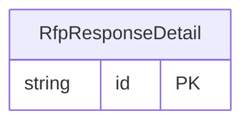

<!-- Code generated by protoc-gen-store. DO NOT EDIT. -->

# `ota/opentravel/hotel/sales/event_report/v1/types/rfp_response_detail/` — Prisma schema

Generated from Protobuf by protoc-gen-store. Source of truth is the `.proto` files — regenerate rather than editing.

| Models | Enums |
| ---: | ---: |
| 1 | 1 |

## Entity relationships

Schema file: [`rfp_response_detail.postgres.prisma`](./rfp_response_detail.postgres.prisma)

### `RfpResponseDetail` → `rfp_response_details`

Provides an area to send comments regarding the response.

| Column | Type | Null |
| --- | --- | --- |
| `id` | `CHAR(26)` | not null |
| `detail_included_indicator` | `BOOLEAN` | nullable |
| `minimum_duration` | `VARCHAR(255)` | nullable |
| `maximum_duration` | `VARCHAR(255)` | nullable |
| `response_method` | `EventreportDistributionType` | nullable |
| `response_time_unit` | `ResponseTimeUnit` | nullable |
| `decline_indicator` | `BOOLEAN` | nullable |
| `decline_reason_code` | `DeclineReason` | nullable |
| `code_detail` | `VARCHAR(255)` | nullable |

### Enums

- `ResponseTimeUnit`: BUSINESS_DAY, ELAPSED_TIME
