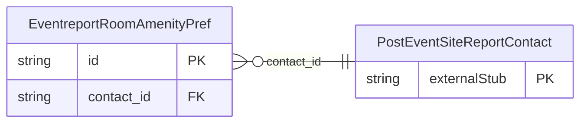

<!-- Code generated by protoc-gen-store. DO NOT EDIT. -->

# `ota/opentravel/hotel/sales/event_report/v1/types/room_amenity_pref/` — Prisma schema

Generated from Protobuf by protoc-gen-store. Source of truth is the `.proto` files — regenerate rather than editing.

| Models | Enums |
| ---: | ---: |
| 1 | 1 |

## Entity relationships

Schema file: [`room_amenity_pref.postgres.prisma`](./room_amenity_pref.postgres.prisma)

### `EventreportRoomAmenityPref` → `room_amenity_prefs`

Indicates preferences for hotel room amenities.

| Column | Type | Null |
| --- | --- | --- |
| `id` | `CHAR(26)` | not null |
| `prefer_level` | `EventreportPreferLevel` | nullable |
| `room_amenity` | `EventreportRoomAmenityType` | nullable |
| `exists_code` | `EventreportOptionTypeCode` | nullable |
| `quantity` | `INTEGER` | nullable |
| `quality_level` | `VARCHAR(255)` | nullable |
| `room_gender` | `EventreportRoomGender` | nullable |
| `shared_room` | `BOOLEAN` | nullable |
| `value` | `VARCHAR(255)` | nullable |
| `contact_id` | `CHAR(26)` | not null |

### Enums

- `EventreportRoomGender`: MALE, FEMALE, MALE_AND_FEMALE, UNKNOWN
