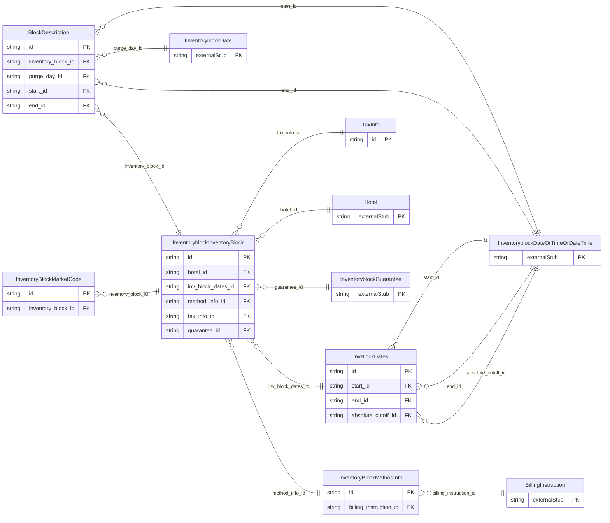

<!-- Code generated by protoc-gen-store. DO NOT EDIT. -->

# `ota/opentravel/hotel/sales/inventory_block/inventory_block/` — Prisma schema

Generated from Protobuf by protoc-gen-store. Source of truth is the `.proto` files — regenerate rather than editing.

| Models | Enums |
| ---: | ---: |
| 6 | 3 |

## Entity relationships

Schema file: [`inventory_block.postgres.prisma`](./inventory_block.postgres.prisma)

### `InventoryblockInventoryBlock` → `resource`

This is for creating a single block at a single hotel. A collection resource, named "hotels/{hotel}/inventoryBlocks/{inventory_block}". OTA: OTA_HotelInvBlockNotifRQ/InvBlocks/InvBlock.

| Column | Type | Null |
| --- | --- | --- |
| `id` | `CHAR(26)` | not null |
| `name` | `VARCHAR(255)` | not null |
| `uid` | `VARCHAR(255)` | nullable |
| `etag` | `VARCHAR(255)` | nullable |
| `delete_time` | `TIMESTAMPTZ` | nullable |
| `expire_time` | `TIMESTAMPTZ` | nullable |
| `create_time` | `TIMESTAMPTZ` | not null |
| `update_time` | `TIMESTAMPTZ` | not null |
| `booking_status` | `BookingAvailability` | nullable |
| `inv_block_type_code` | `InventoryBlockType` | nullable |
| `inv_block_grouping_code` | `VARCHAR(255)` | nullable |
| `inv_block_display_name` | `VARCHAR(255)` | nullable |
| `inv_block_long_display_name` | `VARCHAR(255)` | nullable |
| `inv_block_status_code` | `InventoryBlockStatusCode` | nullable |
| `pms_inv_block_id` | `VARCHAR(255)` | nullable |
| `opportunity_id` | `VARCHAR(255)` | nullable |
| `inv_block_company_id` | `VARCHAR(255)` | nullable |
| `restricted_booking_code_lists` | `` | nullable |
| `restricted_viewing_code_lists` | `` | nullable |
| `transaction_detail` | `VARCHAR(255)` | nullable |
| `quote_id` | `VARCHAR(255)` | nullable |
| `destination_system_codes` | `VARCHAR(255)[]` | nullable |
| `hotel_id` | `CHAR(26)` | not null |
| `inv_block_dates_id` | `CHAR(26)` | nullable |
| `method_info_id` | `CHAR(26)` | nullable |
| `tax_info_id` | `CHAR(26)` | nullable |
| `guarantee_id` | `CHAR(26)` | nullable |

### `InvBlockDates` → `inv_block_dates`

This is used to indicate the date or date range applicable to this inventory block.

| Column | Type | Null |
| --- | --- | --- |
| `id` | `CHAR(26)` | not null |
| `duration` | `VARCHAR(255)` | nullable |
| `end_date_extension_indicator` | `BOOLEAN` | nullable |
| `offset_duration` | `VARCHAR(255)` | nullable |
| `offset_calculation_mode` | `InventoryblockOffsetCalculationMode` | nullable |
| `start_id` | `CHAR(26)` | nullable |
| `end_id` | `CHAR(26)` | nullable |
| `absolute_cutoff_id` | `CHAR(26)` | nullable |

### `InventoryBlockMethodInfo` → `method_infos`

This is used to indicate the reservation and billing methods for a single inventory block.

| Column | Type | Null |
| --- | --- | --- |
| `id` | `CHAR(26)` | not null |
| `billing_type` | `BillingType` | nullable |
| `sign_food_and_bev` | `BOOLEAN` | nullable |
| `reservation_method_code` | `InventoryblockReservationMethodCode` | nullable |
| `billing_instruction_id` | `CHAR(26)` | nullable |

### `BlockDescription` → `block_descriptions`

Used for free form descriptive information about the inventory block.

| Column | Type | Null |
| --- | --- | --- |
| `id` | `CHAR(26)` | not null |
| `name` | `VARCHAR(255)` | nullable |
| `paragraph_number` | `INTEGER` | nullable |
| `create_date_time` | `TIMESTAMPTZ` | nullable |
| `creator_id` | `VARCHAR(255)` | nullable |
| `last_modify_date_time` | `TIMESTAMPTZ` | nullable |
| `last_modifier_id` | `VARCHAR(255)` | nullable |
| `language_code` | `VARCHAR(255)` | nullable |
| `duration` | `VARCHAR(255)` | nullable |
| `images` | `VARCHAR(255)[]` | nullable |
| `uris` | `VARCHAR(255)[]` | nullable |
| `inventory_block_id` | `CHAR(26)` | not null |
| `purge_day_id` | `CHAR(26)` | nullable |
| `start_id` | `CHAR(26)` | nullable |
| `end_id` | `CHAR(26)` | nullable |

### `TaxInfo` → `tax_infos`

Tax information for the entire group.

| Column | Type | Null |
| --- | --- | --- |
| `id` | `CHAR(26)` | not null |
| `tax_type` | `TaxType` | nullable |
| `tax_reason` | `VARCHAR(255)` | nullable |
| `tax_id` | `VARCHAR(255)` | nullable |

### `InventoryBlockMarketCode` → `market_codes`

This is user specific information used for tracking and market segmentation reporting.

| Column | Type | Null |
| --- | --- | --- |
| `id` | `CHAR(26)` | not null |
| `market_code` | `VARCHAR(255)` | nullable |
| `market_code_display_name` | `VARCHAR(255)` | nullable |
| `commissionable_indicator` | `BOOLEAN` | nullable |
| `business_source` | `VARCHAR(255)` | nullable |
| `inventory_block_id` | `CHAR(26)` | not null |

### Enums

- `BookingAvailability`: OPEN, CLOSED
- `InventoryblockOffsetCalculationMode`: BEFORE_BLOCK_START_DATE, AFTER_BLOCK_CREATION
- `TaxType`: TAXABLE, ROOM_EXEMPT, FULL_EXEMPT, EMPTY
