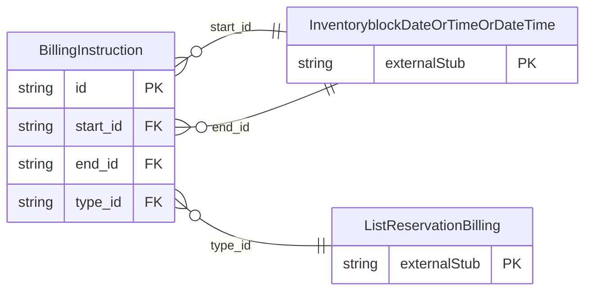

<!-- Code generated by protoc-gen-store. DO NOT EDIT. -->

# `ota/opentravel/hotel/sales/inventory_block/v1/types/billing_instruction/` — Prisma schema

Generated from Protobuf by protoc-gen-store. Source of truth is the `.proto` files — regenerate rather than editing.

| Models | Enums |
| ---: | ---: |
| 1 | 0 |

## Entity relationships

Schema file: [`billing_instruction.postgres.prisma`](./billing_instruction.postgres.prisma)

### `BillingInstruction` → `billing_instructions`

Hotel billing instructions definition.

| Column | Type | Null |
| --- | --- | --- |
| `id` | `CHAR(26)` | not null |
| `code` | `VARCHAR(255)` | not null |
| `authorization_code` | `VARCHAR(255)` | nullable |
| `description` | `VARCHAR(255)` | nullable |
| `duration` | `VARCHAR(255)` | nullable |
| `account_number` | `VARCHAR(255)` | nullable |
| `start_id` | `CHAR(26)` | nullable |
| `end_id` | `CHAR(26)` | nullable |
| `type_id` | `CHAR(26)` | nullable |
