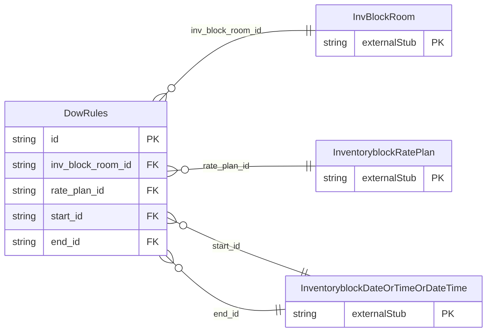

<!-- Code generated by protoc-gen-store. DO NOT EDIT. -->

# `ota/opentravel/hotel/sales/inventory_block/v1/types/dow_rules/` — Prisma schema

Generated from Protobuf by protoc-gen-store. Source of truth is the `.proto` files — regenerate rather than editing.

| Models | Enums |
| ---: | ---: |
| 1 | 1 |

## Entity relationships

Schema file: [`dow_rules.postgres.prisma`](./dow_rules.postgres.prisma)

### `DowRules` → `dow_rules`

Indicates the day of week rules that apply based on the DOW_TypeCode.

| Column | Type | Null |
| --- | --- | --- |
| `id` | `CHAR(26)` | not null |
| `weekdays` | `` | nullable |
| `dow_type_code` | `DowTypeCode` | nullable |
| `duration` | `VARCHAR(255)` | nullable |
| `inv_block_room_id` | `CHAR(26)` | not null |
| `rate_plan_id` | `CHAR(26)` | not null |
| `start_id` | `CHAR(26)` | nullable |
| `end_id` | `CHAR(26)` | nullable |

### Enums

- `DowTypeCode`: ARRIVAL, AVAILABLE, REQUIRED
