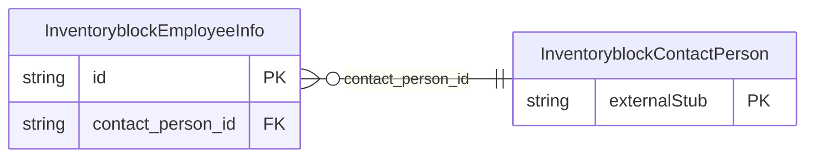

<!-- Code generated by protoc-gen-store. DO NOT EDIT. -->

# `ota/opentravel/hotel/sales/inventory_block/v1/types/employee_info/` — Prisma schema

Generated from Protobuf by protoc-gen-store. Source of truth is the `.proto` files — regenerate rather than editing.

| Models | Enums |
| ---: | ---: |
| 1 | 0 |

## Entity relationships

Schema file: [`employee_info.postgres.prisma`](./employee_info.postgres.prisma)

### `InventoryblockEmployeeInfo` → `employee_infos`

Employment identification; using an employee ID number, title, level within the company, and an indication of their status (e.g., active, retired, on leave, or terminated from employment). Additional information about an employee can be entered into the element, including the name of the employee, if it differs from the person name identified as a customer or contact.

| Column | Type | Null |
| --- | --- | --- |
| `id` | `CHAR(26)` | not null |
| `employee_id` | `VARCHAR(255)` | nullable |
| `employee_level` | `VARCHAR(255)` | nullable |
| `employee_title` | `VARCHAR(255)` | nullable |
| `employee_status` | `InventoryblockEmployeeStatusCode` | nullable |
| `value` | `VARCHAR(255)` | nullable |
| `contact_person_id` | `CHAR(26)` | not null |
