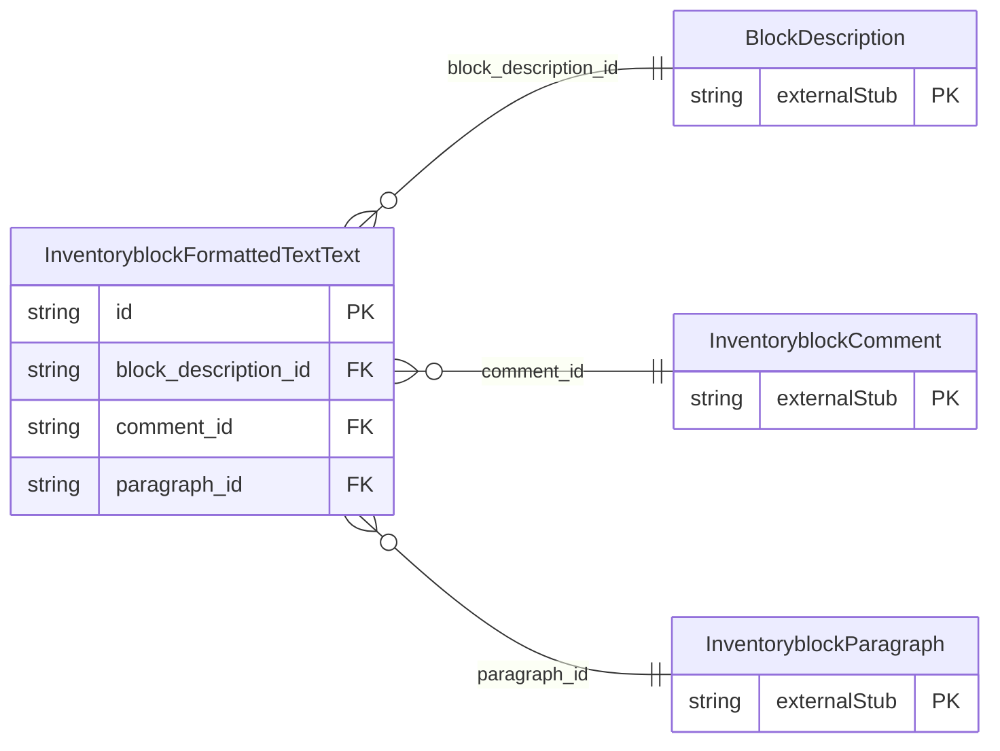

<!-- Code generated by protoc-gen-store. DO NOT EDIT. -->

# `ota/opentravel/hotel/sales/inventory_block/v1/types/formatted_text_text/` — Prisma schema

Generated from Protobuf by protoc-gen-store. Source of truth is the `.proto` files — regenerate rather than editing.

| Models | Enums |
| ---: | ---: |
| 1 | 1 |

## Entity relationships

Schema file: [`formatted_text_text.postgres.prisma`](./formatted_text_text.postgres.prisma)

### `InventoryblockFormattedTextText` → `formatted_text_texts`

Provides text and indicates whether it is formatted or not.

| Column | Type | Null |
| --- | --- | --- |
| `id` | `CHAR(26)` | not null |
| `formatted` | `BOOLEAN` | nullable |
| `language_code` | `VARCHAR(255)` | nullable |
| `text_format` | `InventoryblockFormattedTextTextTextFormat` | nullable |
| `value` | `VARCHAR(255)` | nullable |
| `block_description_id` | `CHAR(26)` | not null |
| `comment_id` | `CHAR(26)` | not null |
| `paragraph_id` | `CHAR(26)` | not null |

### Enums

- `InventoryblockFormattedTextTextTextFormat`: PLAIN_TEXT, HTML
