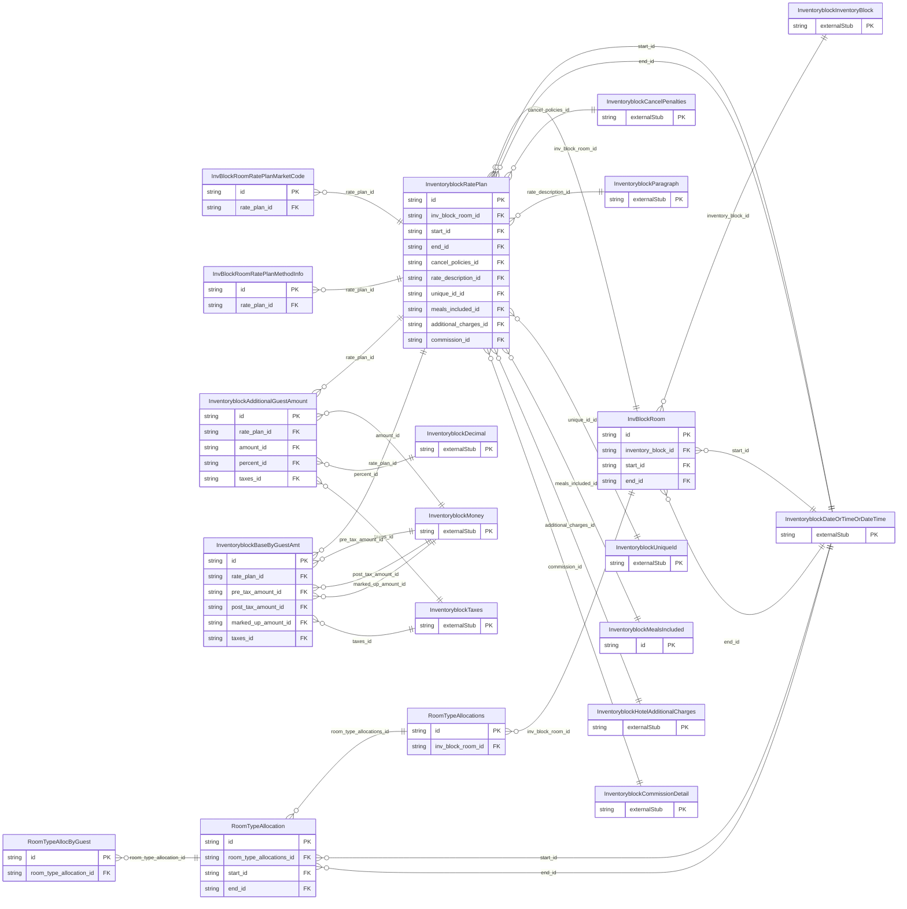

<!-- Code generated by protoc-gen-store. DO NOT EDIT. -->

# `ota/opentravel/hotel/sales/inventory_block/v1/types/inv_block_room/` — Prisma schema

Generated from Protobuf by protoc-gen-store. Source of truth is the `.proto` files — regenerate rather than editing.

| Models | Enums |
| ---: | ---: |
| 10 | 1 |

## Entity relationships

Schema file: [`inv_block_room.postgres.prisma`](./inv_block_room.postgres.prisma)

### `InvBlockRoom` → `inv_block_rooms`

Used to define the room types and all of their supporting data within a room block.

| Column | Type | Null |
| --- | --- | --- |
| `id` | `CHAR(26)` | not null |
| `duration` | `VARCHAR(255)` | nullable |
| `room_type_code` | `VARCHAR(255)` | nullable |
| `inventory_block_id` | `CHAR(26)` | not null |
| `start_id` | `CHAR(26)` | nullable |
| `end_id` | `CHAR(26)` | nullable |

### `RoomTypeAllocations` → `room_type_allocations`

This allows for multiple allocations to be blocked for a specific room type.

| Column | Type | Null |
| --- | --- | --- |
| `id` | `CHAR(26)` | not null |
| `room_type_pick_up_status` | `InventoryblockInventoryCountType` | nullable |
| `inv_block_room_id` | `CHAR(26)` | not null |

### `InventoryblockRatePlan` → `rate_plans`

This is a specific rate plan defined for a specific room type.

| Column | Type | Null |
| --- | --- | --- |
| `id` | `CHAR(26)` | not null |
| `unit_count` | `INTEGER` | nullable |
| `rate_time_unit` | `InventoryblockTimeUnit` | nullable |
| `unit_multiplier` | `INTEGER` | nullable |
| `min_guest_applicable` | `INTEGER` | nullable |
| `max_guest_applicable` | `INTEGER` | nullable |
| `age_qualifying_code` | `InventoryblockAgeQualifyingCode` | nullable |
| `min_age` | `INTEGER` | nullable |
| `max_age` | `INTEGER` | nullable |
| `age_time_unit` | `InventoryblockTimeUnit` | nullable |
| `age_bucket` | `VARCHAR(255)` | nullable |
| `min_los` | `VARCHAR(255)` | nullable |
| `max_los` | `VARCHAR(255)` | nullable |
| `stayover_weekday` | `InventoryblockDayOfWeek` | nullable |
| `duration` | `VARCHAR(255)` | nullable |
| `weekdays` | `` | nullable |
| `currency_code` | `VARCHAR(255)` | nullable |
| `decimal_places` | `INTEGER` | nullable |
| `rate_tier` | `VARCHAR(255)` | nullable |
| `rate_plan_code` | `VARCHAR(255)` | nullable |
| `booking_code` | `VARCHAR(255)` | nullable |
| `promotion_code` | `VARCHAR(255)` | nullable |
| `promotion_vendor_codes` | `VARCHAR(255)[]` | nullable |
| `upgrade_indicator` | `BOOLEAN` | nullable |
| `inv_block_room_id` | `CHAR(26)` | not null |
| `start_id` | `CHAR(26)` | nullable |
| `end_id` | `CHAR(26)` | nullable |
| `cancel_policies_id` | `CHAR(26)` | nullable |
| `rate_description_id` | `CHAR(26)` | nullable |
| `unique_id_id` | `VARCHAR(255)` | nullable |
| `meals_included_id` | `CHAR(26)` | nullable |
| `additional_charges_id` | `CHAR(26)` | nullable |
| `commission_id` | `CHAR(26)` | nullable |

### `RoomTypeAllocation` → `room_type_allocation`

This is the number of rooms blocked for a specific room type for specific dates.

| Column | Type | Null |
| --- | --- | --- |
| `id` | `CHAR(26)` | not null |
| `duration` | `VARCHAR(255)` | nullable |
| `unit_count` | `INTEGER` | nullable |
| `comp_room_quantity` | `INTEGER` | nullable |
| `comp_room_factor` | `INTEGER` | nullable |
| `end_date_indicator` | `BOOLEAN` | nullable |
| `sell_limit` | `INTEGER` | nullable |
| `procure_block_code` | `VARCHAR(255)` | nullable |
| `allocation_id` | `VARCHAR(255)` | nullable |
| `allow_general_inv` | `BOOLEAN` | nullable |
| `room_type_allocations_id` | `CHAR(26)` | not null |
| `start_id` | `CHAR(26)` | nullable |
| `end_id` | `CHAR(26)` | nullable |

### `InventoryblockBaseByGuestAmt` → `base_by_guest_amts`

Base charge for a given number of guests for a given age qualifying code.

| Column | Type | Null |
| --- | --- | --- |
| `id` | `CHAR(26)` | not null |
| `additional_fees_excluded_indicator` | `BOOLEAN` | nullable |
| `type` | `InventoryblockChargeType` | nullable |
| `service_override_indicator` | `BOOLEAN` | nullable |
| `rate_override_indicator` | `BOOLEAN` | nullable |
| `code` | `VARCHAR(255)` | nullable |
| `guest_count` | `INTEGER` | nullable |
| `age_qualifying_code` | `InventoryblockAgeQualifyingCode` | nullable |
| `min_age` | `INTEGER` | nullable |
| `max_age` | `INTEGER` | nullable |
| `age_time_unit` | `InventoryblockTimeUnit` | nullable |
| `age_bucket` | `VARCHAR(255)` | nullable |
| `rate_plan_id` | `CHAR(26)` | not null |
| `pre_tax_amount_id` | `CHAR(26)` | nullable |
| `post_tax_amount_id` | `CHAR(26)` | nullable |
| `marked_up_amount_id` | `CHAR(26)` | nullable |
| `taxes_id` | `CHAR(26)` | nullable |

### `InventoryblockAdditionalGuestAmount` → `additional_guest_amounts`

Collection of incremental charges per age qualifying code for additional guests. Amount charged for additional occupant is with respect to age group of the base guests.

| Column | Type | Null |
| --- | --- | --- |
| `id` | `CHAR(26)` | not null |
| `tax_inclusive` | `BOOLEAN` | nullable |
| `max_additional_guests` | `INTEGER` | nullable |
| `age_qualifying_code` | `InventoryblockAgeQualifyingCode` | nullable |
| `min_age` | `INTEGER` | nullable |
| `max_age` | `INTEGER` | nullable |
| `age_time_unit` | `InventoryblockTimeUnit` | nullable |
| `age_bucket` | `VARCHAR(255)` | nullable |
| `type` | `InventoryblockAmountDetermination` | nullable |
| `code` | `InventoryblockFeeTaxType` | nullable |
| `rate_plan_id` | `CHAR(26)` | not null |
| `amount_id` | `CHAR(26)` | nullable |
| `percent_id` | `CHAR(26)` | nullable |
| `taxes_id` | `CHAR(26)` | nullable |

### `InventoryblockMealsIncluded` → `meals_includeds`

Defines which meals are included with this rate program.

| Column | Type | Null |
| --- | --- | --- |
| `id` | `CHAR(26)` | not null |
| `breakfast` | `BOOLEAN` | nullable |
| `lunch` | `BOOLEAN` | nullable |
| `dinner` | `BOOLEAN` | nullable |
| `meal_plan_indicator` | `BOOLEAN` | nullable |
| `meal_plan_codes` | `` | nullable |

### `InvBlockRoomRatePlanMarketCode` → `inv_block_room_rate_plan_market_codes`

This is user specific information used for tracking and market segmentation reporting.

| Column | Type | Null |
| --- | --- | --- |
| `id` | `CHAR(26)` | not null |
| `market_code` | `VARCHAR(255)` | nullable |
| `market_code_display_name` | `VARCHAR(255)` | nullable |
| `commissionable_indicator` | `BOOLEAN` | nullable |
| `business_source` | `VARCHAR(255)` | nullable |
| `rate_plan_id` | `CHAR(26)` | not null |

### `InvBlockRoomRatePlanMethodInfo` → `inv_block_room_rate_plan_method_infos`

This is used to indicate the reservation and billing methods for the rate plan.

| Column | Type | Null |
| --- | --- | --- |
| `id` | `CHAR(26)` | not null |
| `billing_type` | `BillingType` | nullable |
| `sign_food_and_bev` | `BOOLEAN` | nullable |
| `reservation_method_code` | `InventoryblockReservationMethodCode` | nullable |
| `rate_plan_id` | `CHAR(26)` | not null |

### `RoomTypeAllocByGuest` → `room_type_alloc_by_guests`

This is the number of rooms blocked for a specific room type for specific dates by a given number of guests.

| Column | Type | Null |
| --- | --- | --- |
| `id` | `CHAR(26)` | not null |
| `guest_count` | `INTEGER` | not null |
| `unit_count` | `INTEGER` | not null |
| `room_type_allocation_id` | `CHAR(26)` | not null |

### Enums

- `BillingType`: EACH_PAYS_OWN, SIGN_ROOM_AND_TAX, SIGN_ALL_CHARGES, SIGN_ROOM_ONLY
