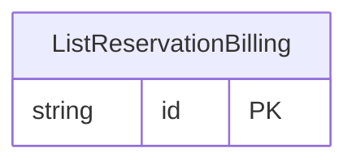

<!-- Code generated by protoc-gen-store. DO NOT EDIT. -->

# `ota/opentravel/hotel/sales/inventory_block/v1/types/list_reservation_billing/` — Prisma schema

Generated from Protobuf by protoc-gen-store. Source of truth is the `.proto` files — regenerate rather than editing.

| Models | Enums |
| ---: | ---: |
| 1 | 0 |

## Entity relationships

Schema file: [`list_reservation_billing.postgres.prisma`](./list_reservation_billing.postgres.prisma)

### `ListReservationBilling` → `list_reservation_billings`

Reservation billing code types. Use: This is a string list of enumerations with an "Other_" literal to support an open enumeration list. Use the "Other_" enumeration in combination with the Code Extension fields to exchange a value that is not in the list and is known to your trading partners.

| Column | Type | Null |
| --- | --- | --- |
| `id` | `CHAR(26)` | not null |
| `removal` | `BOOLEAN` | nullable |
| `code` | `VARCHAR(255)` | nullable |
| `description` | `VARCHAR(255)` | nullable |
| `description_detail` | `VARCHAR(255)` | nullable |
| `source_display_name` | `VARCHAR(255)` | nullable |
| `source_uri` | `VARCHAR(255)` | nullable |
| `resource_display_name` | `VARCHAR(255)` | nullable |
| `resource_uri` | `VARCHAR(255)` | nullable |
| `unique_id` | `VARCHAR(255)` | nullable |
| `value` | `ListReservationBillingTypeBase` | nullable |
