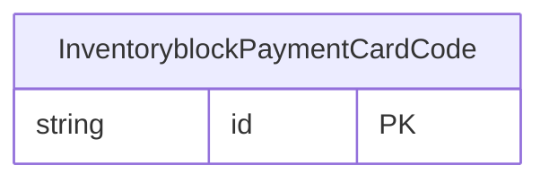

<!-- Code generated by protoc-gen-store. DO NOT EDIT. -->

# `ota/opentravel/hotel/sales/inventory_block/v1/types/payment_card_code/` — Prisma schema

Generated from Protobuf by protoc-gen-store. Source of truth is the `.proto` files — regenerate rather than editing.

| Models | Enums |
| ---: | ---: |
| 1 | 2 |

## Entity relationships

Schema file: [`payment_card_code.postgres.prisma`](./payment_card_code.postgres.prisma)

### `InventoryblockPaymentCardCode` → `payment_card_codes`

The 2 digit code that identifies the credit card.

| Column | Type | Null |
| --- | --- | --- |
| `id` | `CHAR(26)` | not null |
| `card_code` | `InventoryblockCardCode` | nullable |
| `text` | `VARCHAR(255)` | nullable |
| `value_case` | `InventoryblockPaymentCardCodeValueCase` | nullable |

### Enums

- `InventoryblockCardCode`: AX, BC, BL, CB, DN, DS, EC, JC, MA, MC, TP, UP, VI
- `InventoryblockPaymentCardCodeValueCase`: CARD_CODE, TEXT
