<!-- Code generated by protoc-gen-store. DO NOT EDIT. -->

# `ota/opentravel/hotel/sales/meeting_rfp/meeting_rfp/` — Prisma schema

Generated from Protobuf by protoc-gen-store. Source of truth is the `.proto` files — regenerate rather than editing.

| Models | Enums |
| ---: | ---: |
| 37 | 3 |

## Entity relationships

```mermaid
erDiagram
    direction LR
    AudioVisualReq {
        string id PK
        string event_day_function_id FK
        string comments_id FK
    }
    AvailableDateRange {
        string id PK
        string start_id FK
        string end_id FK
        string date_window_range_id FK
        string start_date_window_id FK
        string end_date_window_id FK
    }
    BudgetedRoomRate {
        string id PK
        string room_block_id FK
        string amount_id FK
    }
    Dates {
        string id PK
        string comments_id FK
    }
    DaySummary {
        string id PK
        string history_id FK
        string total_guest_room_amount_id FK
        string total_food_and_bev_amount_id FK
        string total_meeting_room_rental_amount_id FK
        string total_audio_visual_rental_amount_id FK
        string total_misc_amount_id FK
    }
    EventBlock {
        string id PK
        string function_space_req_id FK
        string event_days_id FK
    }
    EventBudget {
        string id PK
        string event_block_id FK
        string amount_id FK
    }
    FunctionSpaceReq {
        string id PK
        string ceiling_height_id FK
    }
    History {
        string id PK
        string meeting_rfp_id FK
        string start_id FK
        string end_id FK
        string total_guest_room_amount_id FK
        string total_food_and_bev_amount_id FK
        string total_meeting_room_rental_amount_id FK
        string total_audio_visual_rental_amount_id FK
        string total_misc_amount_id FK
        string unique_id_id FK
        string comments_id FK
    }
    KeyDecisionFactor {
        string id PK
        string proposal_spec_id FK
    }
    MeetingRfp {
        string id PK
        string proposal_spec_id FK
        string dates_id FK
        string room_block_id FK
        string event_block_id FK
    }
    MeetingRfpAdditionalInfo {
        string id PK
        string meeting_rfp_id FK
    }
    MeetingRfpDatesDate {
        string id PK
        string dates_id FK
        string start_id FK
        string end_id FK
        string date_window_range_id FK
        string start_date_window_id FK
        string end_date_window_id FK
    }
    MeetingRfpSiteAdditionalInfo {
        string id PK
        string site_id FK
    }
    MeetingrfpCategory {
        string id PK
        string location_categories_id FK
    }
    MeetingrfpDateTimeSpan {
        string id PK
        string start_id FK
        string end_id FK
        string date_window_range_id FK
        string start_date_window_id FK
        string end_date_window_id FK
    }
    MeetingrfpEndDateWindow {
        string id PK
        string earliest_id FK
        string latest_id FK
    }
    MeetingrfpEventDay {
        string id PK
        string event_days_id FK
    }
    MeetingrfpEventDayFunction {
        string id PK
        string event_day_id FK
        string start_clock_id FK
        string end_clock_id FK
        string unit_quantity_id FK
        string comments_id FK
    }
    MeetingrfpEventDays {
        string id PK
    }
    MeetingrfpExhibitDetail {
        string id PK
        string exhibition_id FK
    }
    MeetingrfpExhibition {
        string id PK
        string event_block_id FK
        string comments_id FK
    }
    MeetingrfpLocationCategories {
        string id PK
        string preference_id FK
        string location_id FK
    }
    MeetingrfpPromotion {
        string id PK
        string site_id FK
        string advertised_high_amount_id FK
        string advertised_low_amount_id FK
        string available_date_range_id FK
        string offered_date_range_id FK
        string description_id FK
    }
    MeetingrfpRecreation {
        string id PK
        string preference_id FK
    }
    MeetingrfpReservationMethod {
        string id PK
        string room_block_id FK
    }
    MeetingrfpRoomBlock {
        string id PK
        string stay_days_id FK
        string comments_id FK
    }
    MeetingrfpSite {
        string id PK
        string meeting_rfp_id FK
    }
    MeetingrfpStartDateWindow {
        string id PK
        string earliest_id FK
        string latest_id FK
    }
    MeetingrfpStayDay {
        string id PK
        string stay_days_id FK
    }
    MeetingrfpStayDays {
        string id PK
    }
    Preference {
        string id PK
        string meeting_rfp_id FK
        string comments_id FK
    }
    Presentation {
        string id PK
        string start_id FK
        string end_id FK
        string location_id FK
    }
    Property {
        string id PK
        string preference_id FK
    }
    ProposalSpec {
        string id PK
        string response_due_id FK
        string decision_due_id FK
        string preliminary_cut_day_id FK
        string rfp_distribution_day_id FK
        string rfp_published_day_id FK
        string rfp_creation_day_id FK
        string presentation_id FK
    }
    RfpId {
        string id PK
        string meeting_rfp_id FK
        string company_display_name_id FK
    }
    StayDayRoom {
        string id PK
        string stay_day_id FK
        string amount_id FK
        string comment_id FK
    }
    MeetingrfpCompanyName {
        string externalStub PK
    }
    MeetingrfpDate {
        string externalStub PK
    }
    MeetingrfpDateOrDateTime {
        string externalStub PK
    }
    MeetingrfpDateOrTimeOrDateTime {
        string externalStub PK
    }
    MeetingrfpDecimal {
        string externalStub PK
    }
    MeetingrfpLocationGeneral {
        string externalStub PK
    }
    MeetingrfpMoney {
        string externalStub PK
    }
    MeetingrfpParagraph {
        string externalStub PK
    }
    MeetingrfpTimeInstant {
        string externalStub PK
    }
    MeetingrfpTimeOfDay {
        string externalStub PK
    }
    MeetingrfpUniqueId {
        string externalStub PK
    }
    AudioVisualReq }o--|| MeetingrfpEventDayFunction : "event_day_function_id"
    AudioVisualReq }o--|| MeetingrfpParagraph : "comments_id"
    AvailableDateRange }o--|| MeetingrfpDateOrTimeOrDateTime : "start_id"
    AvailableDateRange }o--|| MeetingrfpDateOrTimeOrDateTime : "end_id"
    AvailableDateRange }o--|| MeetingrfpTimeInstant : "date_window_range_id"
    AvailableDateRange }o--|| MeetingrfpStartDateWindow : "start_date_window_id"
    AvailableDateRange }o--|| MeetingrfpEndDateWindow : "end_date_window_id"
    BudgetedRoomRate }o--|| MeetingrfpRoomBlock : "room_block_id"
    BudgetedRoomRate }o--|| MeetingrfpMoney : "amount_id"
    Dates }o--|| MeetingrfpParagraph : "comments_id"
    DaySummary }o--|| History : "history_id"
    DaySummary }o--|| MeetingrfpMoney : "total_guest_room_amount_id"
    DaySummary }o--|| MeetingrfpMoney : "total_food_and_bev_amount_id"
    DaySummary }o--|| MeetingrfpMoney : "total_meeting_room_rental_amount_id"
    DaySummary }o--|| MeetingrfpMoney : "total_audio_visual_rental_amount_id"
    DaySummary }o--|| MeetingrfpMoney : "total_misc_amount_id"
    EventBlock }o--|| FunctionSpaceReq : "function_space_req_id"
    EventBlock }o--|| MeetingrfpEventDays : "event_days_id"
    EventBudget }o--|| EventBlock : "event_block_id"
    EventBudget }o--|| MeetingrfpMoney : "amount_id"
    FunctionSpaceReq }o--|| MeetingrfpDecimal : "ceiling_height_id"
    History }o--|| MeetingRfp : "meeting_rfp_id"
    History }o--|| MeetingrfpDateOrTimeOrDateTime : "start_id"
    History }o--|| MeetingrfpDateOrTimeOrDateTime : "end_id"
    History }o--|| MeetingrfpMoney : "total_guest_room_amount_id"
    History }o--|| MeetingrfpMoney : "total_food_and_bev_amount_id"
    History }o--|| MeetingrfpMoney : "total_meeting_room_rental_amount_id"
    History }o--|| MeetingrfpMoney : "total_audio_visual_rental_amount_id"
    History }o--|| MeetingrfpMoney : "total_misc_amount_id"
    History }o--|| MeetingrfpUniqueId : "unique_id_id"
    History }o--|| MeetingrfpParagraph : "comments_id"
    KeyDecisionFactor }o--|| ProposalSpec : "proposal_spec_id"
    MeetingRfp }o--|| ProposalSpec : "proposal_spec_id"
    MeetingRfp }o--|| Dates : "dates_id"
    MeetingRfp }o--|| MeetingrfpRoomBlock : "room_block_id"
    MeetingRfp }o--|| EventBlock : "event_block_id"
    MeetingRfpAdditionalInfo }o--|| MeetingRfp : "meeting_rfp_id"
    MeetingRfpDatesDate }o--|| Dates : "dates_id"
    MeetingRfpDatesDate }o--|| MeetingrfpDateOrTimeOrDateTime : "start_id"
    MeetingRfpDatesDate }o--|| MeetingrfpDateOrTimeOrDateTime : "end_id"
    MeetingRfpDatesDate }o--|| MeetingrfpTimeInstant : "date_window_range_id"
    MeetingRfpDatesDate }o--|| MeetingrfpStartDateWindow : "start_date_window_id"
    MeetingRfpDatesDate }o--|| MeetingrfpEndDateWindow : "end_date_window_id"
    MeetingRfpSiteAdditionalInfo }o--|| MeetingrfpSite : "site_id"
    MeetingrfpCategory }o--|| MeetingrfpLocationCategories : "location_categories_id"
    MeetingrfpDateTimeSpan }o--|| MeetingrfpDateOrTimeOrDateTime : "start_id"
    MeetingrfpDateTimeSpan }o--|| MeetingrfpDateOrTimeOrDateTime : "end_id"
    MeetingrfpDateTimeSpan }o--|| MeetingrfpTimeInstant : "date_window_range_id"
    MeetingrfpDateTimeSpan }o--|| MeetingrfpStartDateWindow : "start_date_window_id"
    MeetingrfpDateTimeSpan }o--|| MeetingrfpEndDateWindow : "end_date_window_id"
    MeetingrfpEndDateWindow }o--|| MeetingrfpDateOrDateTime : "earliest_id"
    MeetingrfpEndDateWindow }o--|| MeetingrfpDateOrDateTime : "latest_id"
    MeetingrfpEventDay }o--|| MeetingrfpEventDays : "event_days_id"
    MeetingrfpEventDayFunction }o--|| MeetingrfpEventDay : "event_day_id"
    MeetingrfpEventDayFunction }o--|| MeetingrfpTimeOfDay : "start_clock_id"
    MeetingrfpEventDayFunction }o--|| MeetingrfpTimeOfDay : "end_clock_id"
    MeetingrfpEventDayFunction }o--|| MeetingrfpDecimal : "unit_quantity_id"
    MeetingrfpEventDayFunction }o--|| MeetingrfpParagraph : "comments_id"
    MeetingrfpExhibitDetail }o--|| MeetingrfpExhibition : "exhibition_id"
    MeetingrfpExhibition }o--|| EventBlock : "event_block_id"
    MeetingrfpExhibition }o--|| MeetingrfpParagraph : "comments_id"
    MeetingrfpLocationCategories }o--|| Preference : "preference_id"
    MeetingrfpLocationCategories }o--|| MeetingrfpLocationGeneral : "location_id"
    MeetingrfpPromotion }o--|| MeetingrfpSite : "site_id"
    MeetingrfpPromotion }o--|| MeetingrfpMoney : "advertised_high_amount_id"
    MeetingrfpPromotion }o--|| MeetingrfpMoney : "advertised_low_amount_id"
    MeetingrfpPromotion }o--|| AvailableDateRange : "available_date_range_id"
    MeetingrfpPromotion }o--|| MeetingrfpDateTimeSpan : "offered_date_range_id"
    MeetingrfpPromotion }o--|| MeetingrfpParagraph : "description_id"
    MeetingrfpRecreation }o--|| Preference : "preference_id"
    MeetingrfpReservationMethod }o--|| MeetingrfpRoomBlock : "room_block_id"
    MeetingrfpRoomBlock }o--|| MeetingrfpStayDays : "stay_days_id"
    MeetingrfpRoomBlock }o--|| MeetingrfpParagraph : "comments_id"
    MeetingrfpSite }o--|| MeetingRfp : "meeting_rfp_id"
    MeetingrfpStartDateWindow }o--|| MeetingrfpDateOrDateTime : "earliest_id"
    MeetingrfpStartDateWindow }o--|| MeetingrfpDateOrDateTime : "latest_id"
    MeetingrfpStayDay }o--|| MeetingrfpStayDays : "stay_days_id"
    Preference }o--|| MeetingRfp : "meeting_rfp_id"
    Preference }o--|| MeetingrfpParagraph : "comments_id"
    Presentation }o--|| MeetingrfpDateOrTimeOrDateTime : "start_id"
    Presentation }o--|| MeetingrfpDateOrTimeOrDateTime : "end_id"
    Presentation }o--|| MeetingrfpLocationGeneral : "location_id"
    Property }o--|| Preference : "preference_id"
    ProposalSpec }o--|| MeetingrfpDateOrDateTime : "response_due_id"
    ProposalSpec }o--|| MeetingrfpDateOrDateTime : "decision_due_id"
    ProposalSpec }o--|| MeetingrfpDate : "preliminary_cut_day_id"
    ProposalSpec }o--|| MeetingrfpDate : "rfp_distribution_day_id"
    ProposalSpec }o--|| MeetingrfpDate : "rfp_published_day_id"
    ProposalSpec }o--|| MeetingrfpDate : "rfp_creation_day_id"
    ProposalSpec }o--|| Presentation : "presentation_id"
    RfpId }o--|| MeetingRfp : "meeting_rfp_id"
    RfpId }o--|| MeetingrfpCompanyName : "company_display_name_id"
    StayDayRoom }o--|| MeetingrfpStayDay : "stay_day_id"
    StayDayRoom }o--|| MeetingrfpMoney : "amount_id"
    StayDayRoom }o--|| MeetingrfpParagraph : "comment_id"
```

Schema file: [`meeting_rfp.postgres.prisma`](./meeting_rfp.postgres.prisma)

### `MeetingRfp` → `resource`

This is the request data for an event, whether it be a block of rooms and/or meeting space. A collection resource, named "meetingRfps/{meeting_rfp}". OTA: OTA_HotelRFP_MeetingRQ/RFP_RequestSegments/RFP_RequestSegment.

| Column | Type | Null |
| --- | --- | --- |
| `id` | `CHAR(26)` | not null |
| `name` | `VARCHAR(255)` | not null |
| `uid` | `VARCHAR(255)` | nullable |
| `etag` | `VARCHAR(255)` | nullable |
| `delete_time` | `TIMESTAMPTZ` | nullable |
| `expire_time` | `TIMESTAMPTZ` | nullable |
| `create_time` | `TIMESTAMPTZ` | not null |
| `update_time` | `TIMESTAMPTZ` | not null |
| `room_block_indicator` | `BOOLEAN` | nullable |
| `event_block_indicator` | `BOOLEAN` | nullable |
| `proposal_spec_id` | `CHAR(26)` | nullable |
| `dates_id` | `CHAR(26)` | not null |
| `room_block_id` | `CHAR(26)` | nullable |
| `event_block_id` | `CHAR(26)` | nullable |

### `ProposalSpec` → `proposal_specs`

Used to provide details on the proposal such as the key factors that will play a role in the proposal evaluation.

| Column | Type | Null |
| --- | --- | --- |
| `id` | `CHAR(26)` | not null |
| `response_format` | `MeetingrfpDistributionType` | nullable |
| `response_language` | `VARCHAR(255)` | nullable |
| `preliminary_cut_indicator` | `BOOLEAN` | nullable |
| `response_due_id` | `CHAR(26)` | nullable |
| `decision_due_id` | `CHAR(26)` | nullable |
| `preliminary_cut_day_id` | `CHAR(26)` | nullable |
| `rfp_distribution_day_id` | `CHAR(26)` | nullable |
| `rfp_published_day_id` | `CHAR(26)` | nullable |
| `rfp_creation_day_id` | `CHAR(26)` | nullable |
| `presentation_id` | `CHAR(26)` | nullable |

### `Dates` → `dates`

A collection of dates which allows you to request preferred and/or alternate dates.

| Column | Type | Null |
| --- | --- | --- |
| `id` | `CHAR(26)` | not null |
| `comments_id` | `CHAR(26)` | nullable |

### `MeetingrfpSite` → `sites`

Specifies an individual destination of the request.

| Column | Type | Null |
| --- | --- | --- |
| `id` | `CHAR(26)` | not null |
| `chain_code` | `VARCHAR(255)` | nullable |
| `brand_code` | `VARCHAR(255)` | nullable |
| `hotel_code` | `VARCHAR(255)` | nullable |
| `hotel_city_code` | `VARCHAR(255)` | nullable |
| `hotel_display_name` | `VARCHAR(255)` | nullable |
| `hotel_code_context` | `VARCHAR(255)` | nullable |
| `chain_display_name` | `VARCHAR(255)` | nullable |
| `brand_display_name` | `VARCHAR(255)` | nullable |
| `area_id` | `VARCHAR(255)` | nullable |
| `tt_icode` | `INTEGER` | nullable |
| `approx_site_inspection` | `VARCHAR(255)` | nullable |
| `site_inspection_attendee_quantity` | `INTEGER` | nullable |
| `meeting_rfp_id` | `CHAR(26)` | not null |

### `MeetingrfpRoomBlock` → `room_blocks`

This is information pertaining to room requirements for this request.

| Column | Type | Null |
| --- | --- | --- |
| `id` | `CHAR(26)` | not null |
| `total_room_night_quantity` | `INTEGER` | nullable |
| `peak_room_night_quantity` | `INTEGER` | nullable |
| `concessions_indicator` | `BOOLEAN` | nullable |
| `stay_days_id` | `CHAR(26)` | nullable |
| `comments_id` | `CHAR(26)` | nullable |

### `EventBlock` → `event_blocks`

This is information pertaining to the event requirements for this request.

| Column | Type | Null |
| --- | --- | --- |
| `id` | `CHAR(26)` | not null |
| `type` | `VARCHAR(255)` | nullable |
| `market_segment_code` | `VARCHAR(255)` | nullable |
| `definite_indicator` | `BOOLEAN` | nullable |
| `frequency` | `MeetingrfpFrequency` | nullable |
| `expected_total_attendance_quantity` | `INTEGER` | nullable |
| `first_time_indicator` | `BOOLEAN` | nullable |
| `future_open_dates_indicator` | `BOOLEAN` | nullable |
| `exhibition_included_indicator` | `BOOLEAN` | nullable |
| `event_display_name` | `VARCHAR(255)` | nullable |
| `function_space_req_id` | `CHAR(26)` | nullable |
| `event_days_id` | `CHAR(26)` | nullable |

### `Preference` → `preferences`

Describes various preferences or requirements for the RFP.

| Column | Type | Null |
| --- | --- | --- |
| `id` | `CHAR(26)` | not null |
| `meeting_rfp_id` | `CHAR(26)` | not null |
| `comments_id` | `CHAR(26)` | nullable |

### `History` → `histories`

Data pertaining to previous instances of the same or similar event in the past.

| Column | Type | Null |
| --- | --- | --- |
| `id` | `CHAR(26)` | not null |
| `duration` | `VARCHAR(255)` | nullable |
| `meeting_display_name` | `VARCHAR(255)` | nullable |
| `site_display_name` | `VARCHAR(255)` | nullable |
| `attendee_quantity` | `INTEGER` | nullable |
| `room_block_quantity` | `INTEGER` | nullable |
| `room_pickup_quantity` | `INTEGER` | nullable |
| `post_event_report_exists` | `BOOLEAN` | nullable |
| `meeting_rfp_id` | `CHAR(26)` | not null |
| `start_id` | `CHAR(26)` | nullable |
| `end_id` | `CHAR(26)` | nullable |
| `total_guest_room_amount_id` | `CHAR(26)` | nullable |
| `total_food_and_bev_amount_id` | `CHAR(26)` | nullable |
| `total_meeting_room_rental_amount_id` | `CHAR(26)` | nullable |
| `total_audio_visual_rental_amount_id` | `CHAR(26)` | nullable |
| `total_misc_amount_id` | `CHAR(26)` | nullable |
| `unique_id_id` | `VARCHAR(255)` | nullable |
| `comments_id` | `CHAR(26)` | nullable |

### `RfpId` → `rfp_ids`

This is a UniqueID that is associated with an individual RFP. This element repeats to accommodate the IDs of multiple systems.

| Column | Type | Null |
| --- | --- | --- |
| `uri` | `VARCHAR(255)` | nullable |
| `type` | `MeetingrfpUniqueIdType` | not null |
| `instance` | `VARCHAR(255)` | nullable |
| `id` | `VARCHAR(255)` | not null |
| `id_context` | `VARCHAR(255)` | nullable |
| `meeting_display_name` | `VARCHAR(255)` | nullable |
| `meeting_rfp_id` | `CHAR(26)` | not null |
| `company_display_name_id` | `CHAR(26)` | nullable |

### `MeetingRfpAdditionalInfo` → `additional_infos`

A request for additional information and the required delivery method.

| Column | Type | Null |
| --- | --- | --- |
| `id` | `CHAR(26)` | not null |
| `addtional_info_code` | `AdditionalInfoCode` | nullable |
| `delivery_method_code` | `MeetingrfpDistributionType` | nullable |
| `meeting_rfp_id` | `CHAR(26)` | not null |

### `KeyDecisionFactor` → `key_decision_factors`

Defines what each key decision factor is and how important it is in the proposal evaluation.

| Column | Type | Null |
| --- | --- | --- |
| `id` | `CHAR(26)` | not null |
| `code` | `VARCHAR(255)` | nullable |
| `ranking` | `INTEGER` | nullable |
| `proposal_spec_id` | `CHAR(26)` | not null |

### `Presentation` → `presentations`

Used to provide information on where and when the sites should present their proposals to the meeting planners.

| Column | Type | Null |
| --- | --- | --- |
| `id` | `CHAR(26)` | not null |
| `duration` | `VARCHAR(255)` | nullable |
| `start_id` | `CHAR(26)` | nullable |
| `end_id` | `CHAR(26)` | nullable |
| `location_id` | `CHAR(26)` | nullable |

### `MeetingRfpDatesDate` → `dates_dates`

Specifies a specific date or date range.

| Column | Type | Null |
| --- | --- | --- |
| `id` | `CHAR(26)` | not null |
| `duration` | `VARCHAR(255)` | nullable |
| `date_type` | `DateType` | nullable |
| `promotion_rph` | `VARCHAR(255)` | nullable |
| `dates_id` | `CHAR(26)` | not null |
| `start_id` | `CHAR(26)` | nullable |
| `end_id` | `CHAR(26)` | nullable |
| `date_window_range_id` | `CHAR(26)` | nullable |
| `start_date_window_id` | `CHAR(26)` | nullable |
| `end_date_window_id` | `CHAR(26)` | nullable |

### `MeetingrfpPromotion` → `promotions`

A promotion that has similar date criteria as the meeting dates.

| Column | Type | Null |
| --- | --- | --- |
| `id` | `CHAR(26)` | not null |
| `user_acknowledgement_indicator` | `BOOLEAN` | nullable |
| `promotion_code` | `VARCHAR(255)` | nullable |
| `advertised_room_quantity` | `INTEGER` | nullable |
| `site_id` | `CHAR(26)` | not null |
| `advertised_high_amount_id` | `CHAR(26)` | nullable |
| `advertised_low_amount_id` | `CHAR(26)` | nullable |
| `available_date_range_id` | `CHAR(26)` | not null |
| `offered_date_range_id` | `CHAR(26)` | not null |
| `description_id` | `CHAR(26)` | not null |

### `MeetingRfpSiteAdditionalInfo` → `site_additional_infos`

A request for additional information and the required delivery method.

| Column | Type | Null |
| --- | --- | --- |
| `id` | `CHAR(26)` | not null |
| `addtional_info_code` | `AdditionalInfoCode` | nullable |
| `delivery_method_code` | `MeetingrfpDistributionType` | nullable |
| `site_id` | `CHAR(26)` | not null |

### `BudgetedRoomRate` → `budgeted_room_rates`

A general indication of the planner's budget for individual room nights and/or delegate rates.

| Column | Type | Null |
| --- | --- | --- |
| `id` | `CHAR(26)` | not null |
| `total_room_night_quantity` | `INTEGER` | nullable |
| `requested_rate_type` | `MeetingrfpRatePlanType` | nullable |
| `includes_tax` | `BOOLEAN` | nullable |
| `includes_service_fees` | `BOOLEAN` | nullable |
| `includes_gratuity` | `BOOLEAN` | nullable |
| `room_block_id` | `CHAR(26)` | not null |
| `amount_id` | `CHAR(26)` | nullable |

### `MeetingrfpReservationMethod` → `reservation_methods`

Contains information regarding the reservation method.

| Column | Type | Null |
| --- | --- | --- |
| `id` | `CHAR(26)` | not null |
| `code` | `MeetingrfpReservationMethodCode` | nullable |
| `room_block_id` | `CHAR(26)` | not null |

### `MeetingrfpStayDays` → `stay_days`

A collection of multiple StayDays.

| Column | Type | Null |
| --- | --- | --- |
| `id` | `CHAR(26)` | not null |
| `first_stay_weekday` | `MeetingrfpDayOfWeek` | nullable |

### `FunctionSpaceReq` → `function_space_reqs`

Used to define requirements for function space for the event.

| Column | Type | Null |
| --- | --- | --- |
| `id` | `CHAR(26)` | not null |
| `largest_room_space` | `INTEGER` | nullable |
| `meeting_room_format_code` | `MeetingrfpMeetingRoomFormatCode` | nullable |
| `min_occupancy` | `INTEGER` | nullable |
| `unit` | `VARCHAR(255)` | nullable |
| `min_breakout_room_quantity` | `INTEGER` | nullable |
| `ceiling_height_id` | `CHAR(26)` | nullable |

### `EventBudget` → `event_budgets`

A general indication of the planner's budget for the event.

| Column | Type | Null |
| --- | --- | --- |
| `id` | `CHAR(26)` | not null |
| `budget_type` | `BudgetType` | nullable |
| `includes_tax` | `BOOLEAN` | nullable |
| `includes_service_fees` | `BOOLEAN` | nullable |
| `includes_gratuity` | `BOOLEAN` | nullable |
| `event_block_id` | `CHAR(26)` | not null |
| `amount_id` | `CHAR(26)` | nullable |

### `MeetingrfpEventDays` → `event_days`

A collection of multiple EventDays.

| Column | Type | Null |
| --- | --- | --- |
| `id` | `CHAR(26)` | not null |
| `first_event_weekday` | `MeetingrfpDayOfWeek` | nullable |

### `MeetingrfpExhibition` → `exhibitions`

Describes an event at which products and services are displayed, typically the primary activity of attendees is visiting exhibits on the show floor.

| Column | Type | Null |
| --- | --- | --- |
| `id` | `CHAR(26)` | not null |
| `type` | `MeetingrfpType` | nullable |
| `kit_distribution_code` | `VARCHAR(255)` | nullable |
| `kit_format_code` | `VARCHAR(255)` | nullable |
| `general_service_contractor` | `BOOLEAN` | nullable |
| `gross_exhibition_space` | `INTEGER` | nullable |
| `net_exhibition_space` | `INTEGER` | nullable |
| `gross_unit` | `VARCHAR(255)` | nullable |
| `net_unit` | `VARCHAR(255)` | nullable |
| `exhibit_quantity` | `INTEGER` | nullable |
| `company_quantity` | `INTEGER` | nullable |
| `secured_area_indicator` | `BOOLEAN` | nullable |
| `event_block_id` | `CHAR(26)` | not null |
| `comments_id` | `CHAR(26)` | nullable |

### `MeetingrfpLocationCategories` → `location_categories`

Used to define requirements or preferences in location for the event,

| Column | Type | Null |
| --- | --- | --- |
| `id` | `CHAR(26)` | not null |
| `preference_id` | `CHAR(26)` | not null |
| `location_id` | `CHAR(26)` | nullable |

### `MeetingrfpRecreation` → `recreations`

Used to define recreation preferences for the event site.

| Column | Type | Null |
| --- | --- | --- |
| `id` | `CHAR(26)` | not null |
| `code` | `MeetingrfpRecreationSrvcType` | nullable |
| `prefer_level` | `MeetingrfpPreferLevel` | nullable |
| `preference_id` | `CHAR(26)` | not null |

### `Property` → `properties`

Used to define the preferred type of property for the event.

| Column | Type | Null |
| --- | --- | --- |
| `id` | `CHAR(26)` | not null |
| `property_type_code` | `MeetingrfpPropertyClassType` | nullable |
| `prefer_level` | `MeetingrfpPreferLevel` | nullable |
| `preference_id` | `CHAR(26)` | not null |

### `DaySummary` → `day_summaries`

A container for the previous event detail data.

| Column | Type | Null |
| --- | --- | --- |
| `id` | `CHAR(26)` | not null |
| `day_number` | `INTEGER` | nullable |
| `attendee_quantity` | `INTEGER` | nullable |
| `room_block_quantity` | `INTEGER` | nullable |
| `room_pickup_quantity` | `INTEGER` | nullable |
| `history_id` | `CHAR(26)` | not null |
| `total_guest_room_amount_id` | `CHAR(26)` | nullable |
| `total_food_and_bev_amount_id` | `CHAR(26)` | nullable |
| `total_meeting_room_rental_amount_id` | `CHAR(26)` | nullable |
| `total_audio_visual_rental_amount_id` | `CHAR(26)` | nullable |
| `total_misc_amount_id` | `CHAR(26)` | nullable |

### `MeetingrfpStartDateWindow` → `start_date_windows`

The earliest and latest dates acceptable for the start date.

| Column | Type | Null |
| --- | --- | --- |
| `id` | `CHAR(26)` | not null |
| `dow` | `MeetingrfpDayOfWeek` | nullable |
| `earliest_id` | `CHAR(26)` | nullable |
| `latest_id` | `CHAR(26)` | nullable |

### `MeetingrfpEndDateWindow` → `end_date_windows`

The earliest and latest dates acceptable for the end date.

| Column | Type | Null |
| --- | --- | --- |
| `id` | `CHAR(26)` | not null |
| `dow` | `MeetingrfpDayOfWeek` | nullable |
| `earliest_id` | `CHAR(26)` | nullable |
| `latest_id` | `CHAR(26)` | nullable |

### `AvailableDateRange` → `available_date_ranges`

This is the date range the rooms are available at the hotel.

| Column | Type | Null |
| --- | --- | --- |
| `id` | `CHAR(26)` | not null |
| `duration` | `VARCHAR(255)` | nullable |
| `date_rph` | `VARCHAR(255)` | nullable |
| `start_id` | `CHAR(26)` | nullable |
| `end_id` | `CHAR(26)` | nullable |
| `date_window_range_id` | `CHAR(26)` | nullable |
| `start_date_window_id` | `CHAR(26)` | nullable |
| `end_date_window_id` | `CHAR(26)` | nullable |

### `MeetingrfpDateTimeSpan` → `date_time_spans`

Used to specify a time window range by either specifying an earliest and latest date for the start date and end date or by giving a date with a time period that can be applied before and/or after the start date.

| Column | Type | Null |
| --- | --- | --- |
| `id` | `CHAR(26)` | not null |
| `duration` | `VARCHAR(255)` | nullable |
| `start_id` | `CHAR(26)` | nullable |
| `end_id` | `CHAR(26)` | nullable |
| `date_window_range_id` | `CHAR(26)` | nullable |
| `start_date_window_id` | `CHAR(26)` | nullable |
| `end_date_window_id` | `CHAR(26)` | nullable |

### `MeetingrfpStayDay` → `stay_day`

A container for the DayNumber.

| Column | Type | Null |
| --- | --- | --- |
| `id` | `CHAR(26)` | not null |
| `day_number` | `INTEGER` | not null |
| `guest_quantity` | `INTEGER` | nullable |
| `total_unit_count` | `INTEGER` | nullable |
| `stay_days_id` | `CHAR(26)` | not null |

### `MeetingrfpEventDay` → `event_day`

Event day.

| Column | Type | Null |
| --- | --- | --- |
| `id` | `CHAR(26)` | not null |
| `day_number` | `INTEGER` | not null |
| `event_days_id` | `CHAR(26)` | not null |

### `MeetingrfpExhibitDetail` → `exhibit_details`

Describes display areas constructed to showcase products, services or to convey a message.

| Column | Type | Null |
| --- | --- | --- |
| `id` | `CHAR(26)` | not null |
| `exhibit_type_code` | `VARCHAR(255)` | nullable |
| `exhibition_id` | `CHAR(26)` | not null |

### `MeetingrfpCategory` → `categories`

Used to define the preferences or requirements regarding an event location.

| Column | Type | Null |
| --- | --- | --- |
| `id` | `CHAR(26)` | not null |
| `formatted` | `BOOLEAN` | nullable |
| `language_code` | `VARCHAR(255)` | nullable |
| `text_format` | `MeetingrfpFormattedTextTextTextFormat` | nullable |
| `location_category_code` | `VARCHAR(255)` | nullable |
| `prefer_level` | `MeetingrfpPreferLevel` | nullable |
| `value` | `VARCHAR(255)` | nullable |
| `location_categories_id` | `CHAR(26)` | not null |

### `StayDayRoom` → `stay_day_rooms`

A container for the room requirements data.

| Column | Type | Null |
| --- | --- | --- |
| `id` | `CHAR(26)` | not null |
| `room_type_requirement` | `VARCHAR(255)` | nullable |
| `unit_count` | `INTEGER` | nullable |
| `stay_day_id` | `CHAR(26)` | not null |
| `amount_id` | `CHAR(26)` | nullable |
| `comment_id` | `CHAR(26)` | nullable |

### `MeetingrfpEventDayFunction` → `event_day_functions`

A container for the events requirements data.

| Column | Type | Null |
| --- | --- | --- |
| `id` | `CHAR(26)` | not null |
| `event_display_name` | `VARCHAR(255)` | not null |
| `event_type` | `VARCHAR(255)` | nullable |
| `unit` | `VARCHAR(255)` | nullable |
| `unit_code` | `MeetingrfpUnitOfMeasureCode` | nullable |
| `attendee_quantity` | `INTEGER` | nullable |
| `room_setup` | `MeetingrfpMeetingRoomFormatCode` | nullable |
| `twenty_four_hour_hold` | `BOOLEAN` | nullable |
| `event_day_id` | `CHAR(26)` | not null |
| `start_clock_id` | `CHAR(26)` | not null |
| `end_clock_id` | `CHAR(26)` | not null |
| `unit_quantity_id` | `CHAR(26)` | nullable |
| `comments_id` | `CHAR(26)` | nullable |

### `AudioVisualReq` → `audio_visual_reqs`

Defines a specific audio visual need for the event.

| Column | Type | Null |
| --- | --- | --- |
| `id` | `CHAR(26)` | not null |
| `code` | `VARCHAR(255)` | nullable |
| `audio_visual_pref` | `MeetingrfpPreferLevel` | nullable |
| `quantity` | `INTEGER` | nullable |
| `event_day_function_id` | `CHAR(26)` | not null |
| `comments_id` | `CHAR(26)` | not null |

### Enums

- `DateType`: PRIMARY, ALTERNATE, PUBLISHED, SET_UP, BREAKDOWN
- `BudgetType`: TOTAL, FOOD_AND_BEVERAGE, AUDIO_VISUAL
- `MeetingrfpType`: PUBLIC, PRIVATE, PUBLIC_PRIVATE
