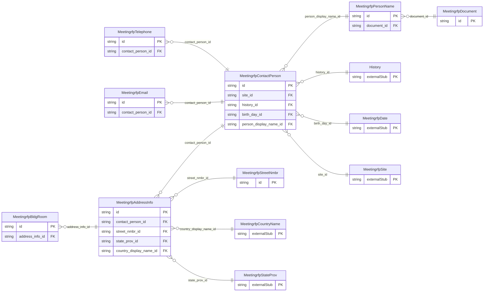

<!-- Code generated by protoc-gen-store. DO NOT EDIT. -->

# `ota/opentravel/hotel/sales/meeting_rfp/v1/types/contact_person/` — Prisma schema

Generated from Protobuf by protoc-gen-store. Source of truth is the `.proto` files — regenerate rather than editing.

| Models | Enums |
| ---: | ---: |
| 8 | 5 |

## Entity relationships

Schema file: [`contact_person.postgres.prisma`](./contact_person.postgres.prisma)

### `MeetingrfpContactPerson` → `contact_persons`

Name of an individual and appropriate contact information. May be contact information for the customer or someone affiliated with the customer.

| Column | Type | Null |
| --- | --- | --- |
| `id` | `CHAR(26)` | not null |
| `share_synch_ind` | `ContactPersonShareSynchInd` | nullable |
| `share_market_ind` | `ContactPersonShareMarketInd` | nullable |
| `default_value` | `BOOLEAN` | nullable |
| `contact_type` | `VARCHAR(255)` | nullable |
| `relation` | `VARCHAR(255)` | nullable |
| `emergency_flag` | `BOOLEAN` | nullable |
| `rph` | `VARCHAR(255)` | nullable |
| `communication_method_code` | `MeetingrfpDistributionType` | nullable |
| `document_distrib_method_code` | `MeetingrfpDistributionType` | nullable |
| `site_id` | `CHAR(26)` | not null |
| `history_id` | `CHAR(26)` | not null |
| `birth_day_id` | `CHAR(26)` | nullable |
| `person_display_name_id` | `CHAR(26)` | nullable |

### `MeetingrfpPersonName` → `person_names`

This provides name information for a person.

| Column | Type | Null |
| --- | --- | --- |
| `id` | `CHAR(26)` | not null |
| `share_synch_ind` | `ContactPersonShareSynchInd` | nullable |
| `share_market_ind` | `ContactPersonShareMarketInd` | nullable |
| `name_type` | `MeetingrfpNameType` | nullable |
| `language_code` | `VARCHAR(255)` | nullable |
| `default_value` | `BOOLEAN` | nullable |
| `name_prefixes` | `VARCHAR(255)[]` | nullable |
| `given_names` | `VARCHAR(255)[]` | nullable |
| `middle_names` | `VARCHAR(255)[]` | nullable |
| `surname_prefix` | `VARCHAR(255)` | nullable |
| `surname` | `VARCHAR(255)` | not null |
| `name_suffixes` | `VARCHAR(255)[]` | nullable |
| `name_titles` | `VARCHAR(255)[]` | nullable |
| `document_id` | `CHAR(26)` | nullable |

### `MeetingrfpTelephone` → `telephones`

Information about a telephone number, including the actual number and its usage.

| Column | Type | Null |
| --- | --- | --- |
| `id` | `CHAR(26)` | not null |
| `rph` | `VARCHAR(255)` | nullable |
| `share_synch_ind` | `ContactPersonTelephoneShareSynchInd` | nullable |
| `share_market_ind` | `ContactPersonTelephoneShareMarketInd` | nullable |
| `phone_location_type` | `MeetingrfpPhoneLocationType` | nullable |
| `phone_tech_type` | `MeetingrfpPhoneTechnologyType` | nullable |
| `phone_use_type` | `MeetingrfpPhoneUseType` | nullable |
| `country_access_code` | `VARCHAR(255)` | nullable |
| `area_city_code` | `VARCHAR(255)` | nullable |
| `phone_number` | `VARCHAR(255)` | not null |
| `extension` | `VARCHAR(255)` | nullable |
| `pin` | `VARCHAR(255)` | nullable |
| `remark` | `VARCHAR(255)` | nullable |
| `formatted` | `BOOLEAN` | nullable |
| `default_value` | `BOOLEAN` | nullable |
| `contact_person_id` | `CHAR(26)` | not null |

### `MeetingrfpAddressInfo` → `address_infos`

Information about an address that identifies a location for a specific purposes.

| Column | Type | Null |
| --- | --- | --- |
| `id` | `CHAR(26)` | not null |
| `formatted` | `BOOLEAN` | nullable |
| `share_synch_ind` | `ContactPersonShareSynchInd` | nullable |
| `share_market_ind` | `ContactPersonShareMarketInd` | nullable |
| `type` | `MeetingrfpCommunicationLocationType` | nullable |
| `remark` | `VARCHAR(255)` | nullable |
| `language_code` | `VARCHAR(255)` | nullable |
| `valid` | `BOOLEAN` | nullable |
| `default_value` | `BOOLEAN` | nullable |
| `use_type` | `MeetingrfpAddressUseType` | nullable |
| `rph` | `VARCHAR(255)` | nullable |
| `address_lines` | `VARCHAR(255)[]` | nullable |
| `city_display_name` | `VARCHAR(255)` | nullable |
| `postal_code` | `VARCHAR(255)` | nullable |
| `county` | `VARCHAR(255)` | nullable |
| `contact_person_id` | `CHAR(26)` | not null |
| `street_nmbr_id` | `CHAR(26)` | nullable |
| `state_prov_id` | `CHAR(26)` | nullable |
| `country_display_name_id` | `CHAR(26)` | nullable |

### `MeetingrfpEmail` → `emails`

Electronic email addresses, in IETF specified format.

| Column | Type | Null |
| --- | --- | --- |
| `id` | `CHAR(26)` | not null |
| `share_synch_ind` | `ContactPersonShareSynchInd` | nullable |
| `share_market_ind` | `ContactPersonShareMarketInd` | nullable |
| `default_value` | `BOOLEAN` | nullable |
| `email_type` | `MeetingrfpEmailAddressType` | nullable |
| `rph` | `VARCHAR(255)` | nullable |
| `remark` | `VARCHAR(255)` | nullable |
| `valid` | `BOOLEAN` | nullable |
| `text_format` | `MeetingrfpEmailTextFormat` | nullable |
| `value` | `VARCHAR(255)` | nullable |
| `contact_person_id` | `CHAR(26)` | not null |

### `MeetingrfpDocument` → `documents`

Document information for verification purposes and also used for additional filtering for common names.

| Column | Type | Null |
| --- | --- | --- |
| `id` | `CHAR(26)` | not null |
| `doc_id` | `VARCHAR(255)` | nullable |
| `doc_type` | `MeetingrfpDocumentType` | nullable |

### `MeetingrfpStreetNmbr` → `street_nmbrs`

May contain the street number and optionally the street name.

| Column | Type | Null |
| --- | --- | --- |
| `id` | `CHAR(26)` | not null |
| `po_box` | `VARCHAR(255)` | nullable |
| `street_nmbr_suffix` | `VARCHAR(255)` | nullable |
| `street_direction` | `VARCHAR(255)` | nullable |
| `rural_route_nmbr` | `VARCHAR(255)` | nullable |
| `value` | `VARCHAR(255)` | nullable |

### `MeetingrfpBldgRoom` → `bldg_rooms`

Building name, room, apartment, or suite number.

| Column | Type | Null |
| --- | --- | --- |
| `id` | `CHAR(26)` | not null |
| `bldg_name_indicator` | `BOOLEAN` | nullable |
| `value` | `VARCHAR(255)` | nullable |
| `address_info_id` | `CHAR(26)` | not null |

### Enums

- `ContactPersonShareSynchInd`: YES, NO, INHERIT
- `ContactPersonShareMarketInd`: YES, NO, INHERIT
- `ContactPersonTelephoneShareSynchInd`: YES, NO, INHERIT
- `ContactPersonTelephoneShareMarketInd`: YES, NO, INHERIT
- `MeetingrfpEmailTextFormat`: TEXT_HTML, TEXT_PLAIN
