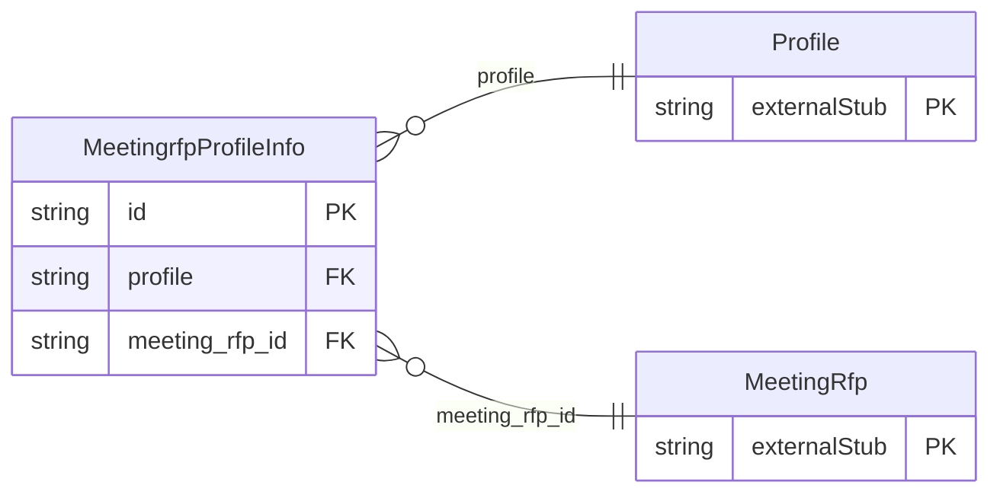

<!-- Code generated by protoc-gen-store. DO NOT EDIT. -->

# `ota/opentravel/hotel/sales/meeting_rfp/v1/types/profile_info/` — Prisma schema

Generated from Protobuf by protoc-gen-store. Source of truth is the `.proto` files — regenerate rather than editing.

| Models | Enums |
| ---: | ---: |
| 1 | 0 |

## Entity relationships

Schema file: [`profile_info.postgres.prisma`](./profile_info.postgres.prisma)

### `MeetingrfpProfileInfo` → `profile_infos`

A collection of Profiles or Unique IDs of Profiles.

| Column | Type | Null |
| --- | --- | --- |
| `id` | `CHAR(26)` | not null |
| `profile` | `CHAR(26)` | not null |
| `meeting_rfp_id` | `CHAR(26)` | not null |
