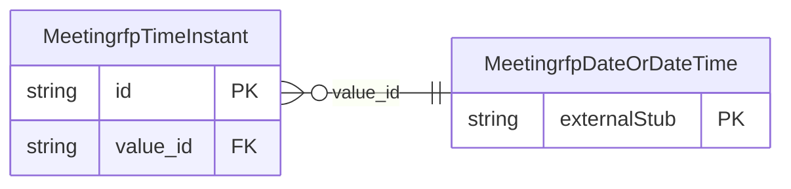

<!-- Code generated by protoc-gen-store. DO NOT EDIT. -->

# `ota/opentravel/hotel/sales/meeting_rfp/v1/types/time_instant/` — Prisma schema

Generated from Protobuf by protoc-gen-store. Source of truth is the `.proto` files — regenerate rather than editing.

| Models | Enums |
| ---: | ---: |
| 1 | 0 |

## Entity relationships

Schema file: [`time_instant.postgres.prisma`](./time_instant.postgres.prisma)

### `MeetingrfpTimeInstant` → `time_instants`

Specifies a time window.

| Column | Type | Null |
| --- | --- | --- |
| `id` | `CHAR(26)` | not null |
| `early_window` | `VARCHAR(255)` | nullable |
| `late_window` | `VARCHAR(255)` | nullable |
| `cross_date_allowed_indicator` | `BOOLEAN` | nullable |
| `value_id` | `CHAR(26)` | nullable |
