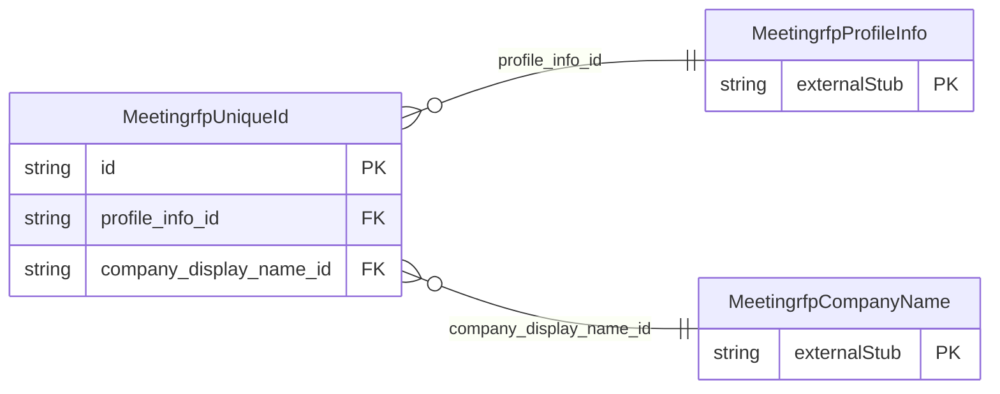

<!-- Code generated by protoc-gen-store. DO NOT EDIT. -->

# `ota/opentravel/hotel/sales/meeting_rfp/v1/types/unique_id/` — Prisma schema

Generated from Protobuf by protoc-gen-store. Source of truth is the `.proto` files — regenerate rather than editing.

| Models | Enums |
| ---: | ---: |
| 1 | 0 |

## Entity relationships

Schema file: [`unique_id.postgres.prisma`](./unique_id.postgres.prisma)

### `MeetingrfpUniqueId` → `unique_ids`

An identifier used to uniquely reference an object in a system (e.g. an airline reservation reference, customer profile reference, booking confirmation number, or a reference to a previous availability quote).

| Column | Type | Null |
| --- | --- | --- |
| `uri` | `VARCHAR(255)` | nullable |
| `type` | `MeetingrfpUniqueIdType` | not null |
| `instance` | `VARCHAR(255)` | nullable |
| `id` | `VARCHAR(255)` | not null |
| `id_context` | `VARCHAR(255)` | nullable |
| `profile_info_id` | `CHAR(26)` | not null |
| `company_display_name_id` | `CHAR(26)` | nullable |
