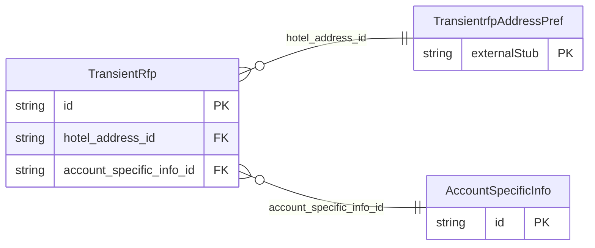

<!-- Code generated by protoc-gen-store. DO NOT EDIT. -->

# `ota/opentravel/hotel/sales/transient_rfp/transient_rfp/` — Prisma schema

Generated from Protobuf by protoc-gen-store. Source of truth is the `.proto` files — regenerate rather than editing.

| Models | Enums |
| ---: | ---: |
| 2 | 0 |

## Entity relationships

Schema file: [`transient_rfp.postgres.prisma`](./transient_rfp.postgres.prisma)

### `TransientRfp` → `resource`

Provides the details of the data being requested. A collection resource, named "transientRfps/{transient_rfp}". OTA: OTA_HotelRFP_TransientRQ/TransientRFP_RequestSegments/TransientRFP_RequestSegment.

| Column | Type | Null |
| --- | --- | --- |
| `id` | `CHAR(26)` | not null |
| `name` | `VARCHAR(255)` | not null |
| `uid` | `VARCHAR(255)` | nullable |
| `etag` | `VARCHAR(255)` | nullable |
| `delete_time` | `TIMESTAMPTZ` | nullable |
| `expire_time` | `TIMESTAMPTZ` | nullable |
| `create_time` | `TIMESTAMPTZ` | not null |
| `update_time` | `TIMESTAMPTZ` | not null |
| `chain_code` | `VARCHAR(255)` | nullable |
| `brand_code` | `VARCHAR(255)` | nullable |
| `hotel_code` | `VARCHAR(255)` | nullable |
| `hotel_city_code` | `VARCHAR(255)` | nullable |
| `hotel_display_name` | `VARCHAR(255)` | nullable |
| `hotel_code_context` | `VARCHAR(255)` | nullable |
| `chain_display_name` | `VARCHAR(255)` | nullable |
| `brand_display_name` | `VARCHAR(255)` | nullable |
| `area_id` | `VARCHAR(255)` | nullable |
| `tt_icode` | `INTEGER` | nullable |
| `intermediary_property_code` | `VARCHAR(255)` | nullable |
| `hotel_address_id` | `CHAR(26)` | nullable |
| `account_specific_info_id` | `CHAR(26)` | nullable |

### `AccountSpecificInfo` → `account_specific_infos`

Used to specify information that is specific to the requesting account.

| Column | Type | Null |
| --- | --- | --- |
| `id` | `CHAR(26)` | not null |
| `hotel_potential_room_quantity` | `INTEGER` | nullable |
| `city_potential_room_quantity` | `INTEGER` | nullable |
| `additional_hotel_indicator` | `BOOLEAN` | nullable |
