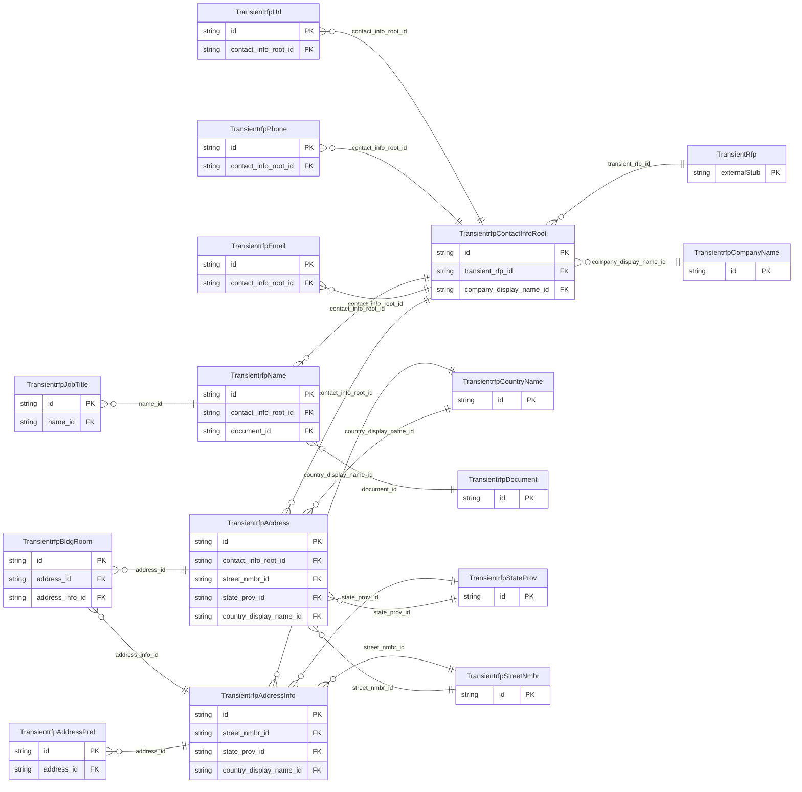

<!-- Code generated by protoc-gen-store. DO NOT EDIT. -->

# `ota/opentravel/hotel/sales/transient_rfp/v1/types/` — Prisma schema

Generated from Protobuf by protoc-gen-store. Source of truth is the `.proto` files — regenerate rather than editing.

| Models | Enums |
| ---: | ---: |
| 15 | 6 |

## Entity relationships

## Subfolders

- [`address/`](./address/README.md)
- [`address_info/`](./address_info/README.md)
- [`address_pref/`](./address_pref/README.md)
- [`contact_info_root/`](./contact_info_root/README.md)
- [`country_name/`](./country_name/README.md)
- [`email/`](./email/README.md)
- [`name/`](./name/README.md)
- [`phone/`](./phone/README.md)
- [`state_prov/`](./state_prov/README.md)
- [`url/`](./url/README.md)
