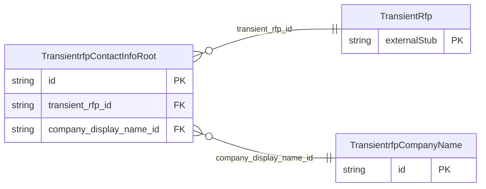

<!-- Code generated by protoc-gen-store. DO NOT EDIT. -->

# `ota/opentravel/hotel/sales/transient_rfp/v1/types/contact_info_root/` — Prisma schema

Generated from Protobuf by protoc-gen-store. Source of truth is the `.proto` files — regenerate rather than editing.

| Models | Enums |
| ---: | ---: |
| 2 | 0 |

## Entity relationships

Schema file: [`contact_info_root.postgres.prisma`](./contact_info_root.postgres.prisma)

### `TransientrfpContactInfoRoot` → `contact_info_roots`

The ContactInfo class is used to define the contacts for consumers and technical people at the hotel facility, including various telephone numbers and e-mail addresses, or any respective attribute or affiliation for the hotel.

| Column | Type | Null |
| --- | --- | --- |
| `id` | `CHAR(26)` | not null |
| `location` | `TransientrfpContactLocation` | nullable |
| `contact_profile_id` | `VARCHAR(255)` | nullable |
| `contact_profile_type` | `VARCHAR(255)` | nullable |
| `last_update_time` | `TIMESTAMPTZ` | nullable |
| `transient_rfp_id` | `CHAR(26)` | not null |
| `company_display_name_id` | `VARCHAR(255)` | nullable |

### `TransientrfpCompanyName` → `company_names`

The name of the company with which this contact is associated.

| Column | Type | Null |
| --- | --- | --- |
| `company_short_display_name` | `VARCHAR(255)` | nullable |
| `travel_sector` | `TransientrfpTravelSector` | nullable |
| `code` | `VARCHAR(255)` | nullable |
| `code_context` | `VARCHAR(255)` | nullable |
| `region_code` | `VARCHAR(255)` | nullable |
| `division` | `VARCHAR(255)` | nullable |
| `department` | `VARCHAR(255)` | nullable |
| `id` | `VARCHAR(255)` | not null |
| `value` | `VARCHAR(255)` | nullable |
